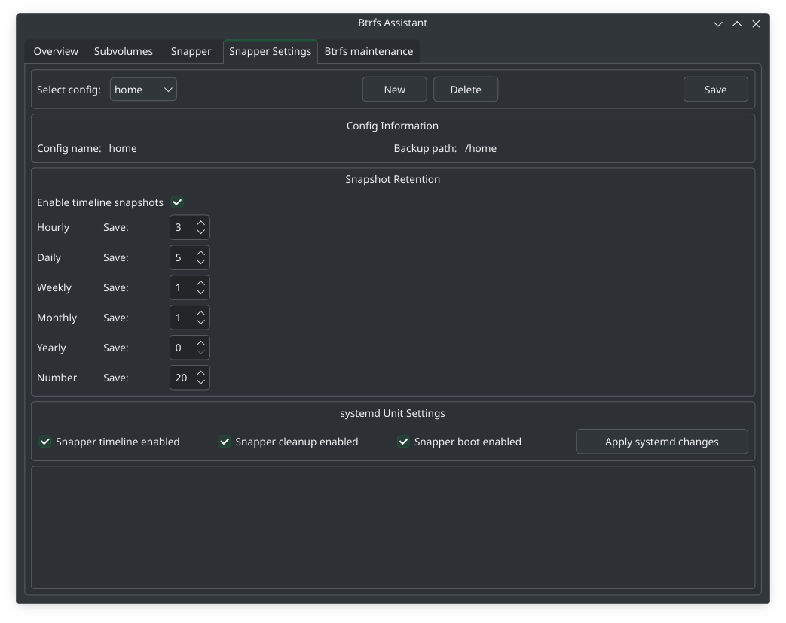
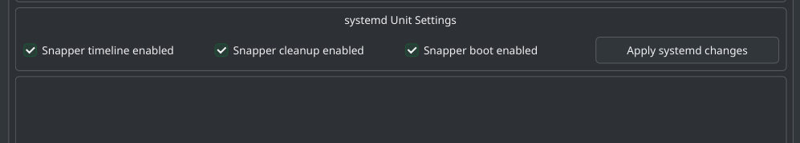

# Btrfs Assistant + Snapper Setup Guide

## Overview

This guide sets up Parrot OS with:
- Snapper for automatic snapshots (boot + apt pre/post)
- Btrfs Assistant GUI for easy snapshot management and rollback

> The Parrot installer handles partitioning and btrfs subvolume layout (`@` and `@home`) automatically. No manual partitioning or fstab editing is required.

---

## Part 1 — Install Packages

```bash
sudo apt install snapper btrfs-assistant
```

---

## Part 2 — Create Snapper Configs

Snapper will automatically create the `.snapshots` subvolume nested inside `@` when the root config is created.

```bash
# Config for root — also creates the .snapshots subvolume
sudo snapper -c root create-config /

# Config for home
sudo snapper -c home create-config /home
```

Verify configs:

```bash
sudo snapper list-configs
```

You should see:

```
Config | Subvolume
-------+----------
root   | /
home   | /home
```

> **Note:** Do not manually create `.snapshots` or add it to fstab — snapper manages it as a nested subvolume inside `@`.

---

## Part 3 — Rebuild GRUB Config

After snapper creates the new subvolumes, rebuild the GRUB config:

```bash
sudo grub-mkconfig -o /boot/grub/grub.cfg
```

> Only `grub-mkconfig` is needed here — not `grub-install`. The bootloader itself has not changed.

> **Note:** `grub-btrfs` is not required. It displays snapshots in the GRUB boot menu but cannot boot into them without additional initramfs configuration. Rollback is handled through Btrfs Assistant and `snapper rollback` instead, which don't require it.

---

## Part 4 — Configure Snapper via Btrfs Assistant

Open **Btrfs Assistant** from the application menu and go to the **Snapper Settings** tab.

### Configure root config

1. Select **root** from the **Select config** dropdown
2. Under **Snapshot Retention**, set the following values:


3. Click **Save**

### Configure home config

1. Select **home** from the **Select config** dropdown
2. Under **Snapshot Retention**, set the following values:



3. Click **Save**

### Enable systemd services

At the bottom of the **Snapper Settings** tab under **systemd Unit Settings**:



This enables automatic timeline snapshots, automatic cleanup of old snapshots, and a snapshot on every boot.

---

## Part 5 — Apt Snapshots

Snapper automatically creates pre/post snapshots around apt operations via its built-in apt hook. No additional packages are needed.

Verify the hook is in place:

```bash
ls /etc/apt/apt.conf.d/ | grep snapper
```

You should see `80snapper` — this triggers snapper before and after every `apt install`, `apt upgrade`, and `apt remove` automatically.

---

## Part 6 — Btrfs Assistant Overview

| Tab | Purpose |
|---|---|
| Overview | Disk usage and btrfs filesystem info |
| Subvolumes | View and manage all subvolumes |
| Snapper | View, create, and restore snapshots |
| Snapper Settings | Configure snapshot retention and systemd services |
| Btrfs maintenance | Run scrub, balance, and other maintenance tasks |

---

## Part 7 — Rolling Back

### Using Btrfs Assistant (recommended)

1. Open **Btrfs Assistant** from the application menu
2. Go to the **Snapper** tab
3. Find the snapshot you want to restore
4. Click **Restore**
5. Reboot

> **Note:** The first reboot after a restore may drop to a TTY login prompt — this is normal. Log in, then reboot once more and KDE will start correctly.

### From the command line

```bash
# List snapshots to find the number you want
sudo snapper -c root list

# Roll back to snapshot N
sudo snapper rollback N

# Reboot into the restored snapshot
sudo reboot
```

After reboot, verify everything works, then **reboot once more** to set it as the permanent default.

### From a live USB (system won't boot)

Boot a Parrot/Debian live USB, then:

```bash
# Mount the btrfs partition
sudo mount /dev/sdX2 /mnt

# Check available snapshots
sudo ls /mnt/@.snapshots/

# Mount the snapshot you want as root
sudo mount -o subvol=@.snapshots/N/snapshot /dev/sdX2 /mnt/snap

# Chroot into it
sudo mount --bind /dev /mnt/snap/dev
sudo mount --bind /proc /mnt/snap/proc
sudo mount --bind /sys /mnt/snap/sys
sudo chroot /mnt/snap

# Run rollback from inside chroot
snapper rollback N
exit

# Reboot
sudo reboot
```

---

## Part 8 — Cleaning Up After a Restore

When Btrfs Assistant restores a snapshot it creates a backup subvolume of your previous root, named something like:

```
@_backup_2026-04-15T10:22:26.644Z_test
```

Once you have confirmed the restore worked correctly, delete it:

```bash
sudo btrfs subvolume delete "/run/BtrfsAssistant/YOUR-UUID/@_backup_YYYY-MM-DDTHH:MM:SS.MMMZ_test"
```

> **Note:** Always use quotes around the subvolume name — the colons in the timestamp will cause errors without them.

Verify it is gone:

```bash
sudo btrfs subvolume list /
```

---

## Summary

| Component | Purpose |
|---|---|
| Btrfs `@` | Root filesystem (created by installer) |
| Btrfs `@home` | Home directory, protected from root rollbacks (created by installer) |
| Btrfs `.snapshots` | Stores all snapper snapshots (created by snapper) |
| Snapper | Automatic snapshot creation and cleanup |
| Btrfs Assistant | GUI for browsing, configuring and restoring snapshots |
| `snapper rollback N` | Command line rollback |

### What to skip

- **grub-btrfs** — not reliable on Debian/Parrot without custom initramfs work
- **`apt-btrfs-snapshot`** — redundant, snapper already handles apt snapshots via its built-in hook
- Extra subvolumes (`@srv`, `@tmp`, `@usr@local`, `@var@log`) — unnecessary on desktop
