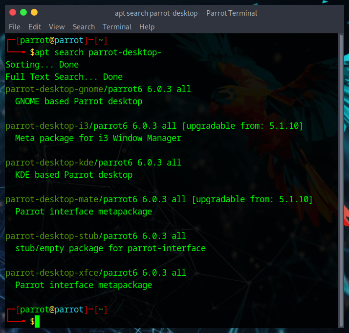
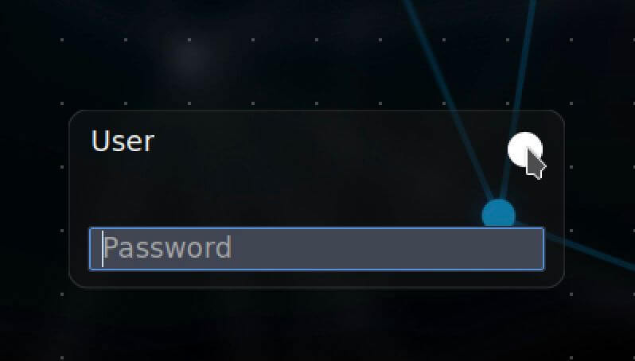
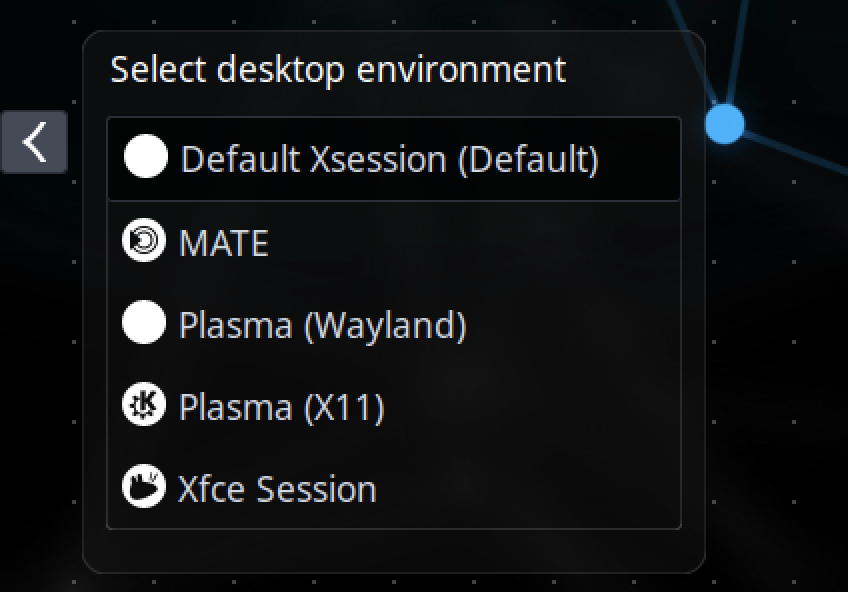

# Desktop Enviroments #

From version 5.0 LTS, ParrotOS is available with the **default MATE Desktop Environment (DE)** for all editions (Home, Security and HTB Edition). However, additional desktop environments can be installed on one OS. Each DE has its  peculiarity, but we recommend trying them out before deciding what to install.


Being a graphical interface through which the user can interact with the operating system, the possibilities to modify the various components of the DE are many.  
Each of the following DE (all of them available on our repository) gives the possibility to be customized according to one's tastes:

* **MATE** (default ParrotOS DE)
* **XFCE**
* **GNOME**
* **KDE**
* **i3** (this is not a full DE, it's a [WindowManager](https://en.wikipedia.org/wiki/Window_manager))



The differences between all DEs mainly concern the graphical interface, any software is equally available through the Parrot repositories regardless of the DE used.

[Feel free to download(https://parrotsec.org/download/) the edition that is useful to you!]: #

[hide this sentence because it's not related to the desktop environments, since we actually don't have any different DE edition than MATE]: #

:::tip Install a Desktop Enviroment

  It may be useful to know that the user can install more DE on their Parrot, just type in a terminal:
        
  ```
  sudo apt update && sudo apt install parrot-desktop-<desktop environment>
  ```

  then restart your computer. 
  In the login session you can change DE by clicking on the white dot ⚪️ (it's the "default session") and change DE. You can now use the newly installed DE with all the tools and configurations already present previously.
  
   

:::
