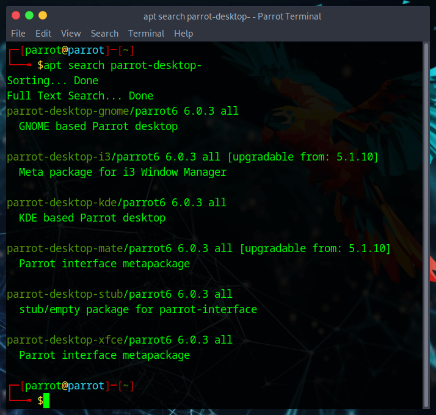
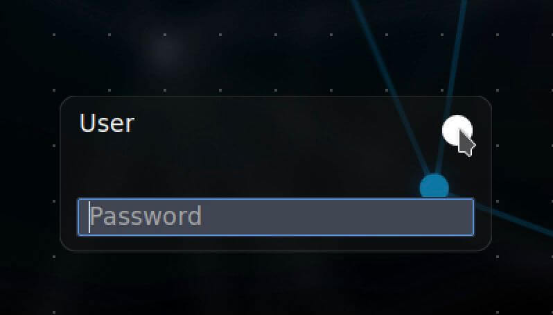
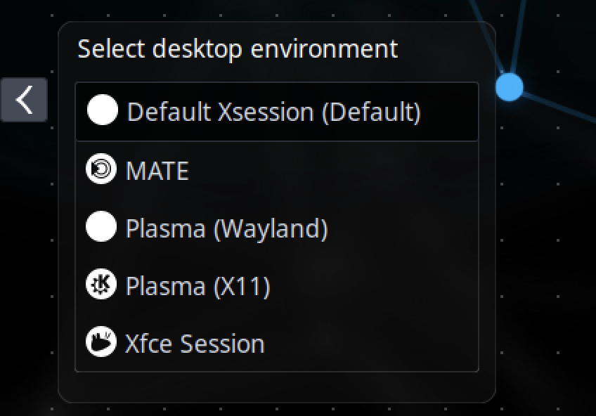

# Desktop Enviroments

ParrotOS ships with **KDE Plasma** as the default Desktop Environment (DE) for all editions (Home, Security, and HTB). Additional desktop environments can be installed alongside it — each has its own look and workflow, so it's worth trying a few before settling on one.

Since the DE is the graphical layer through which you interact with the operating system, there are many ways to customise its components. The following DEs are all available in the Parrot repositories:

- **KDE Plasma** *(default)*
- **MATE**
- **XFCE**
- **GNOME**

:::info
If you prefer a window manager over a full DE, a metapackage for [**i3**](https://i3wm.org/) is available in the Parrot repositories.
:::

Differences between DEs are primarily visual and workflow-related — all software remains accessible from the Parrot repositories regardless of which DE you use.



## Install a Desktop Environment

To install a DE, run the following in your terminal:

```bash
sudo apt update && sudo apt install parrot-desktop-<desktop-environment>
```

Then restart your computer. At the login screen, click the session selector next to your username to switch to the newly installed DE. All your tools and existing configuration will carry over.



:::note
You can install more than one DE, but given the number of packages involved, it is recommended to keep one or at most two installed to avoid potential conflicts.
:::


