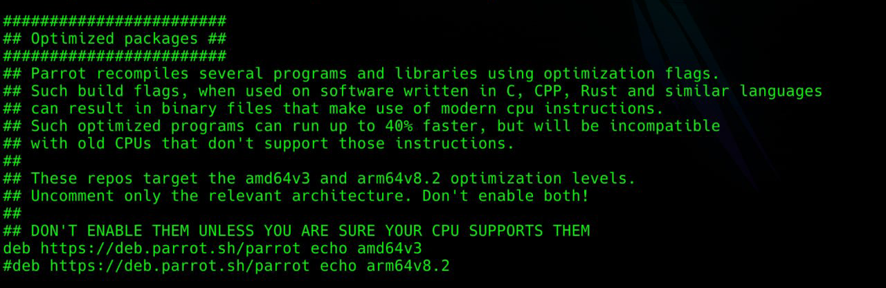

# Optimized Package Builds

Parrot Security provides **optimized package builds** that target modern CPU instruction sets for improved performance on recent hardware. This page explains what they are, which packages are currently covered, how to confirm your CPU is compatible, how to enable them, and the technical details behind the feature.

## 1. What are optimized builds?

Every standard `amd64` package in Parrot Security (and in Debian, on which Parrot is based) is compiled to run on the original 64-bit x86 instruction set defined in 2003. This guarantees that a package runs on any 64-bit machine, regardless of age. The same principle applies to the standard `arm64` packages, which target the original ARMv8.0 baseline.

The trade-off is that these packages cannot use any of the CPU features introduced after that baseline — features that modern processors have offered for years.

**Optimized builds** are recompiled versions of selected packages that target a newer instruction-set baseline:

| Component   | Architecture | Target                   | Key features enabled                     |
|-------------|--------------|--------------------------|------------------------------------------|
| `amd64v3`   | x86-64       | `x86-64-v3`              | AVX, AVX2, FMA, BMI1, BMI2, MOVBE, F16C  |
| `arm64v8.2` | AArch64      | `armv8.2-a` + extensions | LSE atomics, DOTPROD, FP16, cryptography |

These instructions accelerate common operations such as compression, encryption, hashing, media processing, and numerical computation. Depending on the workload, the speedup ranges from negligible (for I/O-bound tasks) to substantial (for compute-bound tasks such as cryptography, compression, and media encoding).

The optimized packages are published in **dedicated, opt-in repository components**. They coexist with the standard archive and do not replace or conflict with your existing system. When enabled, your package manager automatically prefers the optimized version of any package that has one; all other packages remain unchanged.



## 2. Which packages are currently optimized?

Only a curated subset of the archive is optimized. Priority is given first to **shared libraries** that many other programs depend on (compression, cryptography, numerical, and parsing libraries), then to **compute-heavy utilities** (such as ffmpeg), and finally to other packages that benefit measurably. Packages that are I/O-bound or syscall-bound — network daemons, shells, and similar infrastructure — are intentionally left at the baseline because recompiling them yields no measurable benefit.

:::info
 **This list changes over time.** Packages are added as coverage expands, and individual packages may temporarily leave the optimized set (see [Section 8](#8-why-an-optimized-package-may-revert-to-the-standard-version)). Treat the lists below as a snapshot, not a fixed guarantee.
:::

### A note on source vs binary package names

The lists below give **source package names**. A single source package frequently produces several binary packages whose names differ slightly from the source name. For example, a source package `abc` might produce binaries such as `abc`, `abc1`, `libabc1`, `abc-dev`, and `abc-doc`. When a source package is optimized, **all of the binary packages it produces are optimized**. So if you are looking for a specific binary package, check which source package builds it (for example with `apt-cache showsrc <binary-package>` or `dpkg-query -W -f='${source:Package}\n' <binary-package>`).

### Currently optimized (source packages)

```
aom              armnn            arpack           blender
box2d            btrfs-progs      bullet           bzip2
cairo            cairosvg         capnproto        ccache
ceres-solver     clamav           containerd       darktable
dav1d            eagerpy          eigen3           expat

fdk-aac          ffmpeg           fftw             fftw3
flac             flatbuffers      flint            frugally-deep
gcc-14           ghostscript      gimp             gmp
gnupg2           golang-github-containers-buildah  gsl
handbrake        hdf5             icu              imagemagick

inkscape         jpeg-xl          jq               keras-applications
keras-preprocessing  krb5         lame             lapack
libgcrypt20      libheif          libjpeg-turbo    libraw
libsodium        libtheora        libvorbis        libvpx
libxml2          libxslt          libyaml          libzstd

llvm-toolchain-19  lmdb           lz4              maxima
maxima-sage      memcached        mold             mpfr4
mupdf            netcdf           netcdf-cxx       netcdf-fortran
netcdf-parallel  nettle           ninja-build      nlopt
nss              numpy            obs-studio       octave

openblas         opencv           openjdk-17       opus
pari             pcre2            pcre3            php8.4
pixman           plocate          poppler          protobuf
protobuf-c       python3.13       python-autoray   python-einops
pytorch          qemu             rawtherapee      r-base

rclone           rsync            ruby3.3          runc
rust-b3sum       rustc            ruy              scikit-learn
silversearcher-ag  simdjson       singular         snappy
soundtouch       sqlite3          suitesparse      superlu
tesseract        tiff             vips             vorbis-tools

wine             x265             xapian-core      xgboost
xnnpack          xxhash           xz-utils         yaml-cpp
argon2           brotli           freetype         gnutls28
gzip             libpng1.6        libwebp          lzma
mesa             mpc              nodejs           ntl

openssl          openjdk-21       openjdk-25       perl
pigz             recoll           redis            rust-brotli
rust-ripgrep     scilab           scipy            x264
zlib
```

## 3. CPU compatibility requirement

> **Important:** Optimized builds require a CPU that supports the corresponding instruction set. Installing them on incompatible hardware will result in programs that crash with an *illegal instruction* error. The packages are designed to refuse installation on unsupported hardware, but you should verify compatibility before enabling the feature.

### amd64v3 hardware requirements

Your CPU must support the `x86-64-v3` instruction set. This is satisfied by:

- **Intel:** Haswell (4th-generation Core, 2013) or newer
- **AMD:** Excavator (2015) or Zen / Ryzen (2017) or newer

The following are **not** compatible: Intel Sandy Bridge and Ivy Bridge (2011–2012), 1st/2nd/3rd-generation Core, and pre-2013 Atom processors.

### arm64v8.2 hardware requirements

Your CPU must support the ARMv8.2-A instruction set with the dot-product, FP16, and cryptography extensions. This is satisfied by:

- Apple **M1** or newer (including all Apple Silicon Macs)
- **Raspberry Pi 5** (Cortex-A76)
- AWS **Graviton 2** or newer
- Qualcomm **Snapdragon 845** or newer
- Most ARM server and laptop CPUs released from 2018 onward

The following are **not** compatible: Cortex-A72-class hardware (Raspberry Pi 3 and 4, AWS Graviton 1) and earlier ARMv8.0 cores.

## 4. Verifying your CPU is compatible

Before enabling the feature, confirm your processor supports the required instruction set.

### Method A — the dynamic loader (recommended, amd64)

On a 64-bit Intel/AMD system, run:

```bash
/lib64/ld-linux-x86-64.so.2 --help | grep -A4 Subdirectories
```

If your CPU supports the v3 baseline, the output includes a line similar to:

```
  x86-64-v3 (supported, searched)
```

If `x86-64-v3` is listed as supported, your machine is compatible with `amd64v3`.

:::info
    This method requires glibc 2.33 or newer. Parrot Security and current Debian releases meet this requirement.
:::

### Method B — inspecting CPU flags (works everywhere)

This method works regardless of glibc version and on both architectures.

**For amd64v3**, check that all of the following flags are present:

```bash
grep -m1 ^flags /proc/cpuinfo | grep -ow -e avx2 -e fma -e bmi1 -e bmi2 -e movbe -e f16c
```

If all six terms (`avx2`, `fma`, `bmi1`, `bmi2`, `movbe`, `f16c`) are printed, your CPU is compatible.

**For arm64v8.2**, check the ARM feature flags:

```bash
grep -m1 ^Features /proc/cpuinfo | grep -ow -e atomics -e asimddp -e fphp -e asimdhp -e aes -e sha2
```

The terms correspond to LSE (`atomics`), dot-product (`asimddp`), FP16 (`fphp`, `asimdhp`), and cryptography (`aes`, `sha2`). If they are present, your CPU is compatible with `arm64v8.2`.

### One-line compatibility check (amd64v3)

```bash
grep -m1 ^flags /proc/cpuinfo | grep -qE 'avx2.*bmi2|bmi2.*avx2' && echo "compatible" || echo "not compatible"
```

## 5. Enabling the optimized repository

After confirming compatibility, add the repository component for your architecture.

### On a 64-bit Intel or AMD machine (amd64v3)

Create the file `/etc/apt/sources.list.d/parrot-optimized.list` containing:

```
deb https://deb.parrot.sh/parrot echo amd64v3
```

### On a 64-bit ARM machine (arm64v8.2)

Create the file `/etc/apt/sources.list.d/parrot-optimized.list` containing:

```
deb https://deb.parrot.sh/parrot echo arm64v8.2
```

You can create the file in one step. For amd64v3:

```bash
echo 'deb https://deb.parrot.sh/parrot echo amd64v3' | sudo tee /etc/apt/sources.list.d/parrot-optimized.list
```

For arm64v8.2:

```bash
echo 'deb https://deb.parrot.sh/parrot echo arm64v8.2' | sudo tee /etc/apt/sources.list.d/parrot-optimized.list
```

## 6. Installing the optimized packages

Once the repository is enabled, upgrade your system. The package manager will automatically replace any package that has an optimized variant available.

Using standard APT tooling:

```bash
sudo apt update && sudo apt full-upgrade
```

Or using the dedicated Parrot helper:

```bash
sudo parrot-upgrade
```

`full-upgrade` (rather than a plain `upgrade`) is recommended so that APT is permitted to resolve the package transitions cleanly.

## 7. Recognizing optimized packages

Optimized packages are easy to identify by their version suffix:

- amd64v3 packages carry **`+amd64v3optimized1`** appended to their version string.
- arm64v8.2 packages carry **`+armv82optimized1`** appended to their version string.

During an upgrade, these suffixes appear in the list of packages being installed, so you can confirm at a glance that the optimized variants are being applied. To list the optimized packages currently installed:

```bash
dpkg -l | grep -E 'optimized1'
```

To inspect a specific package's installed version:

```bash
apt-cache policy <package-name>
```

The optimized version will be listed with a higher priority than the standard version, which is why APT prefers it.

## 8. Why an optimized package may revert to the standard version

It is normal and expected for an individual package to occasionally appear **without** its optimized suffix, even while the optimized repository is enabled. This is not a malfunction. There are three reasons it can happen, and in every case the system automatically returns to the optimized version once it becomes available again.

### Reason 1 — A newer standard version is published

The optimized component selects packages purely by version number. An optimized package such as `1.2.3-1+amd64v3optimized1` outranks the standard `1.2.3-1`, so it is preferred. However, when a newer standard release `1.2.3-2` is published, that version outranks the older optimized one, so APT installs the standard `1.2.3-2` until the optimized rebuild of that same version is published. During this gap you safely run the standard package.

### Reason 2 — Security updates

Security fixes are published to the standard archive first, as quickly as possible. Because a security update raises the package version, it temporarily takes priority over the previously optimized package — exactly as in Reason 1. **You always receive the security fix immediately**, on the standard (unoptimized) package; the optimized rebuild of the patched version follows afterward. Security is never delayed for the sake of optimization.

### Reason 3 — The optimized build failed and needs manual intervention

The optimized packages are produced by automated build workers. When a new version of a package is released, the workers attempt to rebuild it with the optimization flags. Occasionally a package fails to build under the optimized configuration — for example because of a new compiler-flag incompatibility, an architecture-specific assumption in the new code, or a test that does not pass in the optimized build environment. When this happens, **no optimized variant is published for that version**, and the system uses the standard package until a maintainer resolves the build manually and republishes the optimized version.

In all three cases, the practical effect is the same: the package temporarily loses its `+amd64v3optimized1` / `+armv82optimized1` suffix and runs as the standard build. No action is required from you; the optimized version returns automatically once it is rebuilt.

## 9. Verifying an installed binary is optimized

To confirm that an installed library actually contains the optimized instructions, you can inspect it with `objdump`. For example, to check a shared object on amd64v3:

```bash
objdump -d /usr/lib/x86_64-linux-gnu/libzstd.so.1 | grep -m5 -E '(vfmadd|vpbroadcast|pdep|pext|sarx)'
```

If the command returns matches, the binary contains AVX2/FMA/BMI2 instructions and is correctly optimized. On arm64v8.2, check for the corresponding instructions:

```bash
objdump -d /usr/lib/aarch64-linux-gnu/libzstd.so.1 | grep -m5 -E '(ldaddal|udot|sdot|fmla v)'
```

Here `ldaddal` indicates LSE atomics and `udot`/`sdot` indicate the dot-product instructions.

## 10. Disabling optimized builds

To revert to standard packages, remove the repository file and reinstall the affected packages from the standard archive.

```bash
sudo rm /etc/apt/sources.list.d/parrot-optimized.list
sudo apt update
sudo apt full-upgrade
```

Because the standard archive always contains the baseline version of every package, APT will transition the optimized packages back to their standard counterparts on the next upgrade. If you want to force an immediate downgrade of a specific package, reinstall it explicitly:

```bash
sudo apt install --reinstall <package-name>
```

## 11. Technical implementation details

This section describes how the feature is implemented for users who want to understand the underlying mechanism. It is not required reading for normal use.

### Repository components, not architectures

The most important design decision is that optimized builds are delivered as **repository components** (in the same sense as `main`, `contrib`, and `non-free`), not as separate Debian architectures. The optimized packages retain the `amd64` or `arm64` architecture in their package metadata.

This matters because Debian architectures are effectively distinct ABIs, and the optimized instruction-set levels are *not* a new ABI — a `v3` binary uses the same calling conventions, type sizes, and library layout as a baseline binary. Modeling the optimized builds as a separate architecture would have introduced multiarch path collisions (two packages competing to install the same files in the same library directory) and would have required patching the package manager. Delivering them as components avoids all of this.

### Version-based selection

Each optimized package is built with a version string that appends a suffix to the standard version — `+amd64v3optimized1` or `+armv82optimized1`. Under Debian's version-comparison rules, a version such as `1.2.3-1+amd64v3optimized1` sorts *higher* than the standard `1.2.3-1`, but *lower* than the next standard release `1.2.3-2`.

This produces exactly the behaviour we want:

- When the optimized component is enabled, APT sees both the standard and optimized versions of a package and selects the optimized one because its version is higher.
- When a newer standard release appears upstream — including a **security update** — before the optimized rebuild has caught up, APT temporarily selects the standard version (because `1.2.3-2` outranks `1.2.3-1+amd64v3optimized1`). The user silently and safely falls back to the baseline package until the optimized rebuild is published. This is correct and intentional, and is what guarantees that security fixes are never delayed by the optimization process. (See [Section 8](#8-why-an-optimized-package-may-revert-to-the-standard-version).)

Because selection is driven entirely by standard version comparison, the feature requires no modifications to APT or dpkg.

### Build infrastructure

The optimized packages are produced by automated build environments configured to inject the appropriate compiler flags into every package build. The mechanism uses Debian's standard build-flags system (`dpkg-buildflags`), so the flags are picked up automatically by any package using the standard `debhelper` build process — no per-package modification is required for the large majority of packages.

For the `amd64v3` component, builds inject:

```
-march=x86-64-v3 -mtune=generic
```

For the `arm64v8.2` component, builds inject:

```
-march=armv8.2-a+dotprod+fp16+crypto -mtune=neoverse-n1
```

The `-mtune` value selects instruction-scheduling heuristics. For arm64 the generic-yet-modern `neoverse-n1` profile is used because it matches the wide out-of-order pipeline design shared by the Apple, Qualcomm, and Neoverse cores that the component targets; it does not restrict which CPUs can run the binaries (that is governed solely by `-march`).

Languages with their own toolchains are handled separately: Go builds set `GOAMD64=v3` (or the ARM equivalent) and Rust builds set the corresponding `target-cpu` / `target-feature` options, because these toolchains do not read the C/C++ build-flags system.

Because the rebuilds are automated, a new upstream version is recompiled with the optimization flags as soon as it is published. If that automated rebuild fails — due to a build-flag incompatibility, an architecture-specific issue in the new code, or a failing test in the optimized environment — no optimized variant is produced for that version, and the package falls back to the standard build until a maintainer intervenes. (See [Section 8](#8-why-an-optimized-package-may-revert-to-the-standard-version).)

### Hardware-compatibility guard

To prevent the optimized packages from being installed on hardware that cannot execute them, the component employs a guard mechanism: a small support package performs a CPU feature check at installation time, and optimized packages declare a dependency on it. If the check fails on incompatible hardware, the installation aborts cleanly before any unusable binary is unpacked.

## 12. Caveats and known limitations

- **The feature is experimental.** Package coverage is being expanded over time, and you may encounter packages that are not yet optimized. The lists in [Section 2](#2-which-packages-are-currently-optimized) are a snapshot and will change.

- **Not every package is optimized.** We deliberately limit the optimized component to packages where the performance benefit is measurable — shared libraries, compute-heavy utilities, language runtimes, and databases. Network daemons, shells, and I/O-bound infrastructure are intentionally left at the baseline because recompiling them yields no measurable benefit.

- **Optimized packages may temporarily revert to the standard build.** As described in [Section 8](#8-why-an-optimized-package-may-revert-to-the-standard-version), this happens when a newer standard version is published, when a security update is released, or when an automated optimized rebuild fails and needs manual intervention. In every case the optimized version returns automatically once available, and no user action is required.

- **Security updates always take precedence.** Security fixes are published to the standard archive immediately and are installed straight away, even if that means temporarily running the unoptimized build of a package. The optimized rebuild of the patched version follows afterward.

- **Packages with built-in runtime CPU dispatch see smaller gains.** Some packages (notably glibc, OpenSSL, and parts of ffmpeg) already select optimized code paths at runtime based on the detected CPU. For these, the optimized rebuild improves only the surrounding code, so the gain is modest.

- **Third-party repositories are unaffected.** The optimized component only affects packages published in it. Packages from other repositories continue to install their standard versions.

## 13. Frequently Asked Questions

**Do I need to reinstall Parrot?**
No. The feature is enabled by adding a repository and upgrading. No reinstallation is required.

**Why did one of my packages lose its optimized suffix after an update?**
This is expected. It happens when a newer standard version (including a security update) is published before the optimized rebuild catches up, or when the automated optimized rebuild of a new version fails and needs manual intervention. The optimized version returns automatically once it is rebuilt. See [Section 8](#8-why-an-optimized-package-may-revert-to-the-standard-version).

**Does this delay security updates?**
No. Security updates are delivered immediately on the standard package. If a package is temporarily unoptimized because of a security update, you still received the fix on time; the optimized rebuild simply follows afterward.

**My package isn't in the optimized list. Will it be added?**
Possibly. Coverage is expanding over time, prioritizing widely-shared libraries and compute-heavy software. The pipeline list in [Section 2](#2-which-packages-are-currently-optimized) shows what is currently being prepared.

**I found a binary package name that isn't in the list, but a related one is.**
The lists use source package names. One source package produces several binary packages (for example `libabc1`, `abc-dev`, `abc-doc`). If the source package is optimized, all of its binaries are. Use `apt-cache showsrc <binary-package>` to find the source package a binary comes from.

**Can I use this on plain Debian?**
Yes. The components are self-contained and do not depend on Parrot-specific packages. They have been tested on stock Debian servers, particularly for compression and cryptographic workloads.

**How much faster will my system be?**
It depends entirely on the workload. Compute-bound tasks (compression, encryption, hashing, media encoding, numerical computation) can see significant improvements from 20% up to 40% or 50% faster.. General desktop use and I/O-bound tasks see little to no difference, between 0% and 3%.

**What happens if my CPU is not compatible?**
Programs built with unsupported instructions will terminate with an *illegal instruction* error. The system may crash, become unusable or refuse to boot, this is why you have to make sure that your cpu is supported before installing optimized packages.

A system held in a broke state can be recovered by booting it on another computer with a modern CPU that supports such new instructions.
