# Printers installation

Printers can be installed on ParrotOS, this is possible thanks to [**CUPS**](https://openprinting.github.io/cups/doc/overview.html).

:::info Note
  These instructions are valid for every printer, in this guide an HP printer has been used as example.
  For this reason, it may be necessary to install [HPLIP](https://developers.hp.com/hp-linux-imaging-and-printing/tech_docs/overview) (which provides also the necessary drivers for the printer) with this command 
  ```
  sudo apt install hplip -y
  ```
:::

## Install CUPS

It should be already installed on ParrotOS but, if not, open a terminal window and launch

```
sudo apt update && sudo apt install cups
```

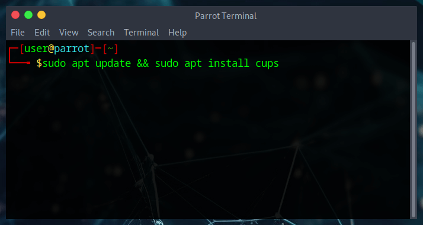

After the installation, it may be necessary to add your user to ***lpadmin*** group, in order to perform administrative tasks via the web interface. For this reason, it's necessary to authenticate in the lpadmin group. Otherwise, CUPS won’t authenticate a passwordless user.

To do so, launch

```
sudo adduser user lpadmin
```

:::info Note
  Change the username *user* in the command accordingly to your system's username.
:::

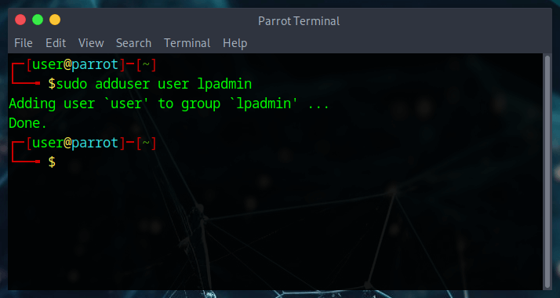

More info about what is lpadmin [here](https://www.cups.org/doc/admin.html)


Now, start CUPS service with

```
sudo service cups start
```

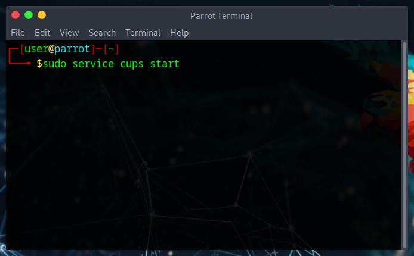

## Printer setup

### Open CUPS Web Interface

After booting CUPS services, now it's time to access its interface. 

CUPS is reachable from your favorite browser at ***http://localhost:631/admin***

This is what will appear:

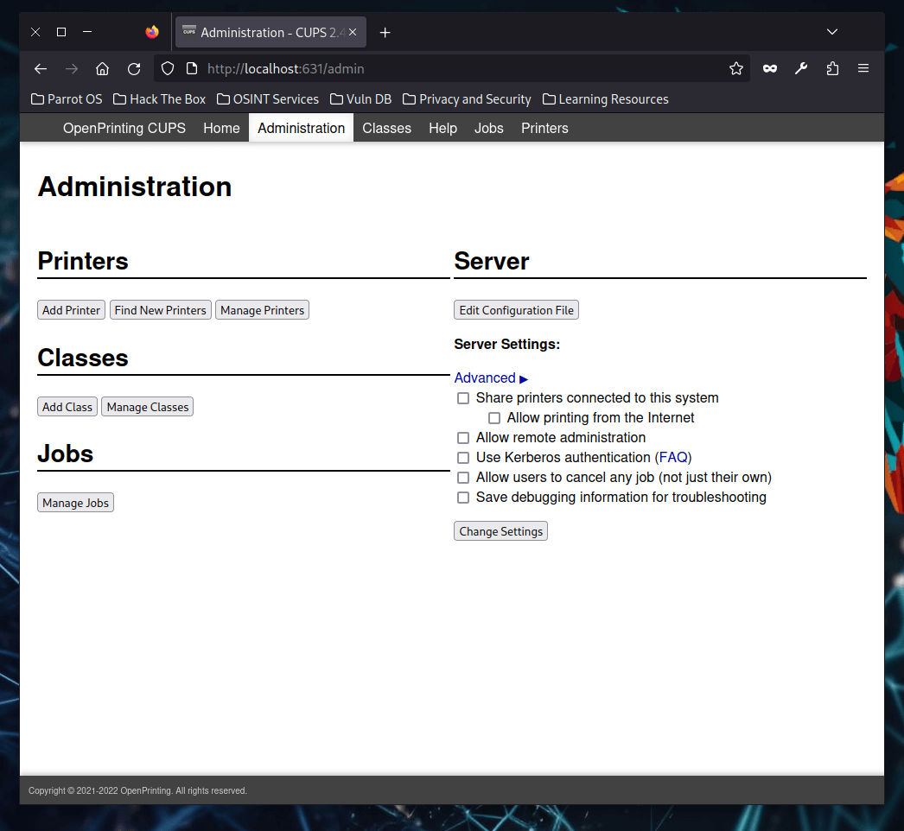

### Adding new printer

From the CUPS web interface, click on ***Add Printer***. It'll ask for your username and password. 

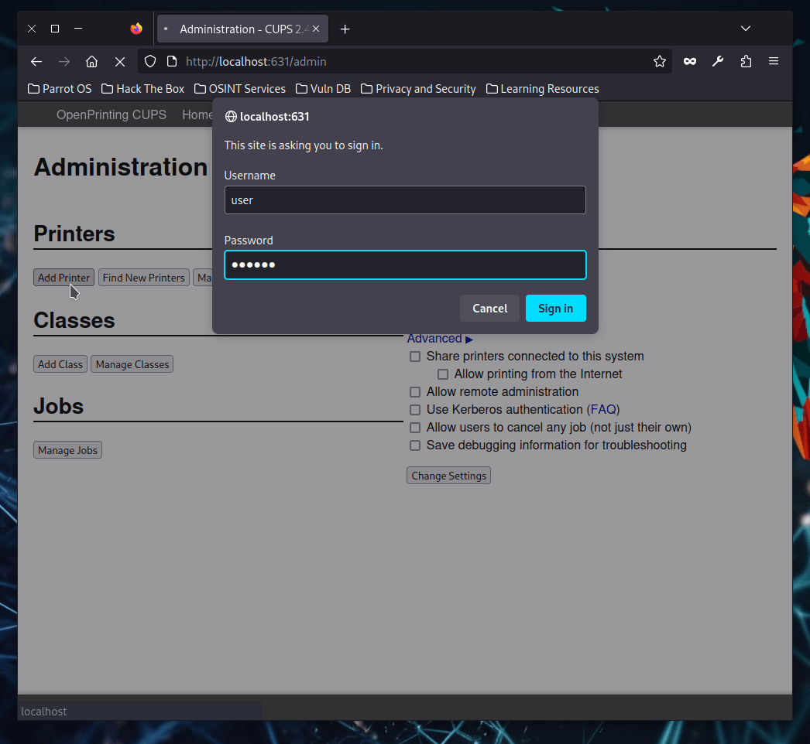

The service will search for any network and local printer. 

Under ***Discovered Network Printers*** the new printer should appear. 
Select it and click on ***Continue***.

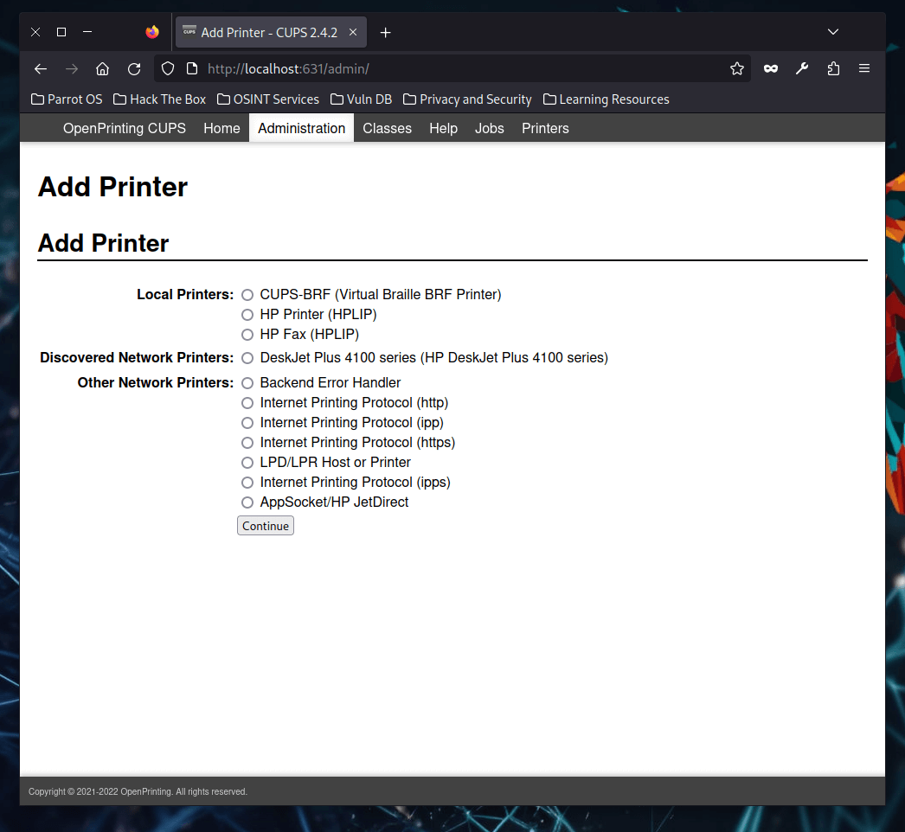

Next page will allow to customize printer's details such as Name and Description. 

Tick the *Share this printer* checkbox to make other clients able to use the printer, then click on ***Continue***.

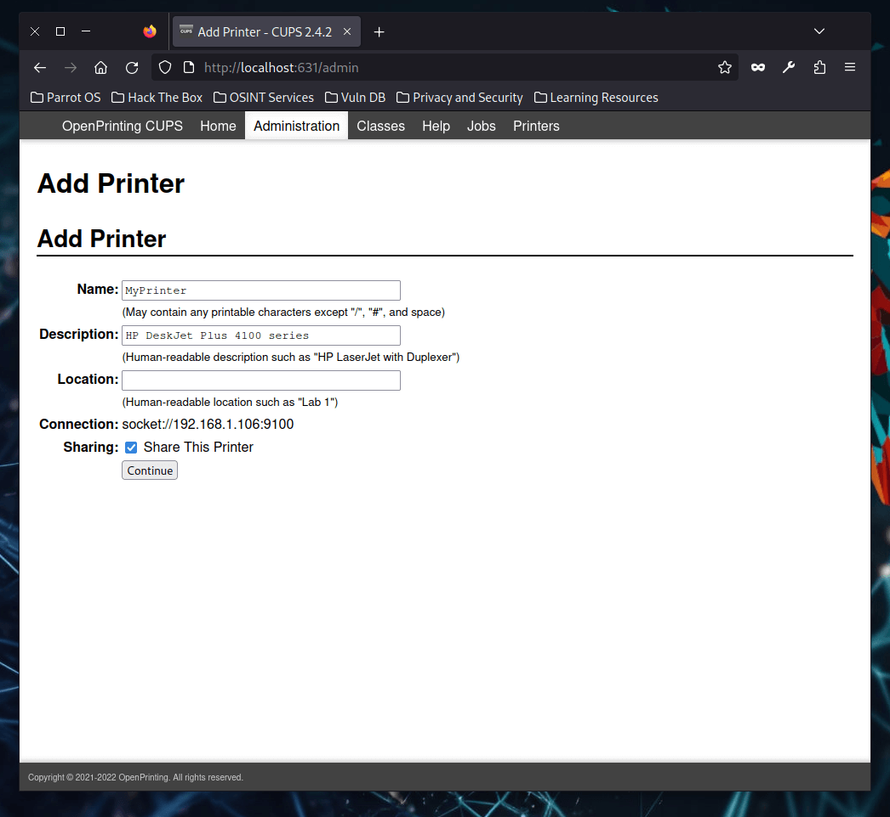

Next page will allow to setup the last settings for the printer.

Select printer's Manufacturer and Model from the ***Make*** and ***Model*** sections or, if necessary, it's possible to provide printer drivers from PPD file. 

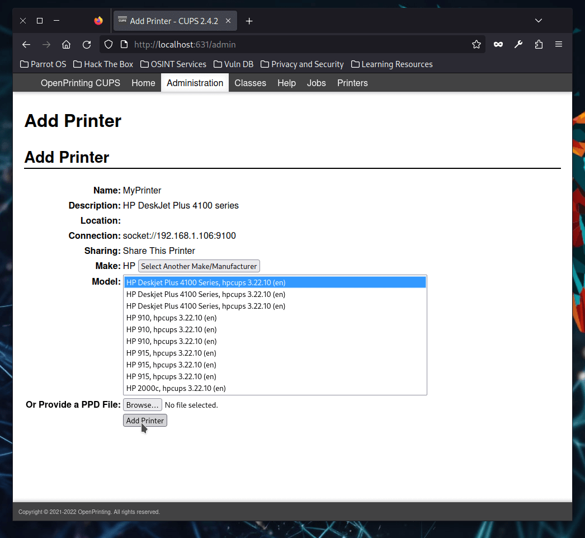

After that, click on ***Add Printer***.

If everything went correctly, this page will appear. 

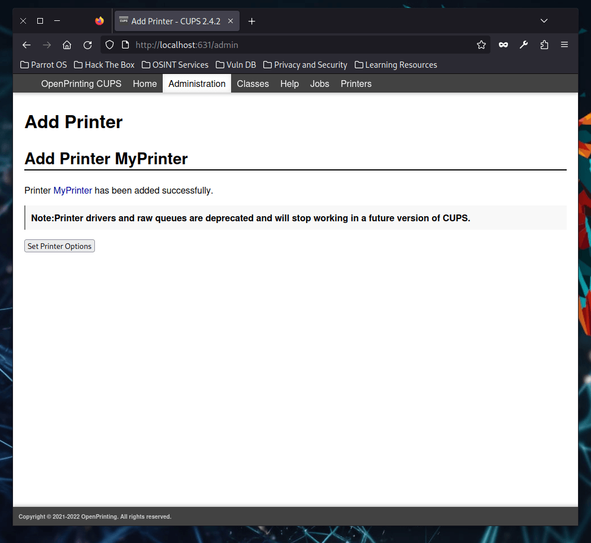

### Verify printer installation

Let's check if the printer has been set up correctly.

From CUPS web interface, click on ***Printers*** tab on the upper right side of the page.

The printer should appear.

Click on the chosen name.

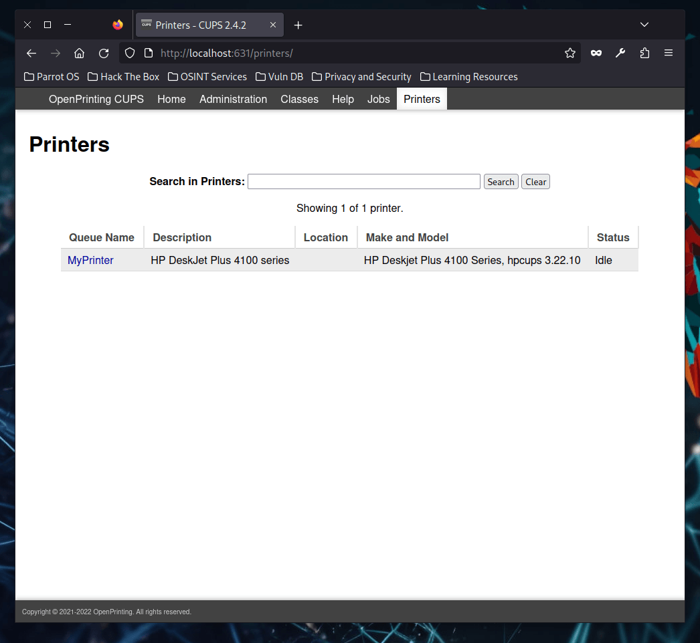

From this page, it's possible to perform many operations (such as print a test page) and handle the printing queue.

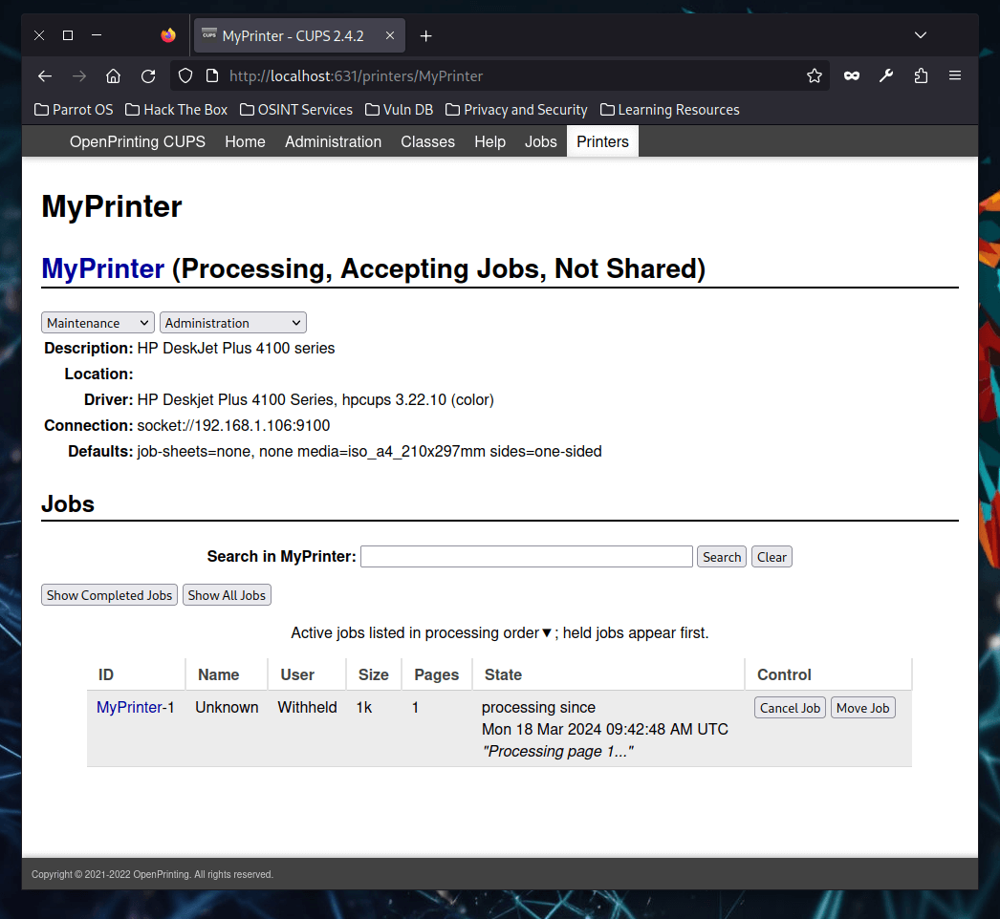

That's all for setting up a printer on ParrotOS. 

