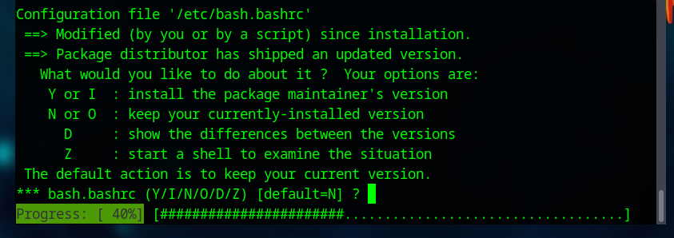

# Upgrade to Parrot 7 "Echo" from Parrot 6 "Lorykeet"

Parrot 7 introduced a number of major changes to the system, [as you can read in the following link](https://parrotsec.org/blog/2025-12-24-parrot-7.0-release-notes). 
All these improvements make it significantly different from the previous Parrot release. 
And since these are substantial changes, it may be necessary to follow this guide. 

The Parrot team recommends performing a fresh installation to ensure all configurations are clean and installed in their most up‑to‑date form.

## Main changes

For those who already have Parrot installed on their computer, the main changes can be summarized in two parts:

- The upgrade to the Echo branch based on Debian 13.
- The upgrade or migration to KDE 6 Plasma.

### Debian 13

In general, using `parrot-upgrade` or `parrot-updater` should allow you to perform a clean migration.

It is **strongly** recommended that you back up your files and configurations (whether they are `.bashrc`, `.zshrc`,
configurations of other WMs such as i3, etc...) as they may be overwritten:



When **apt** asks to update your configurations by replacing the repositories from `lory` to `echo`, if you confirm the choice,
the upgrade will proceed automatically.

If the user decides to install the new repositories later, this is still possible. 
Besides, there are cases in which a manual intervention may be required to add the new links.

The process is simple, as you only need to open `/etc/apt/sources.list.d/parrot.list` and edit or replace the repositories
that contain the name `lory` with `echo`, so that they look like this:

```
deb https://deb.parrot.sh/parrot echo main contrib non-free non-free-firmware
```

Once this is done, it is recommended to run `apt update` to refresh the local package database, and then run `parrot-upgrade`, 
which will proceed with installing the new version packages.

For those who prefer not to look for the specific line to edit, here is the complete file that you can recreate or copy and paste:

```
## This file provides the default APT repositories for Parrot Security
## These repositories are used to fetch new software and system updates

###############################
## Default Parrot Repository ##
###############################
## The 'echo' repository provides all the Parrot software considered
## stable and tested.
##
## the main suite provides the base system plus all the software released
## under a free and open source license compatible with the Debian guidelines.
##
## the contrib suite provides additional free software that depends on third
## party software not provided by the main suite. it usually means that such
## packages depend on non-free software.
##
## the non-free suite provides additional packages that don't comply with
## the Debian Free Software Guidelines. They are mostly proprietary software.
deb https://deb.parrot.sh/parrot echo main contrib non-free non-free-firmware

######################
## Security Updates ##
######################
## The 'echo-security' repository provides time sensitive security updates
## that have to be delivered to end users as fast as possible
##
## this repo should always be enabled in your system
##
## we strongly recommend to NOT use mirrors for this repo, but only
## access security updates from our official domains or CDNs.
##
## a mirror server could take too much time to fetch an important update,
## leaving you without security updates for a timespan outside of our control
deb https://deb.parrot.sh/direct/parrot echo-security main contrib non-free non-free-firmware

###############
## Backports ##
###############
## The stable repository contains software that is considered stable the day of
## the release. such packages receive only security and stability updates that
## don't introduce new features and don't drop old ones.
##
## the 'backports' repository provides feature updates to many packages, and
## even external software that was originally excluded from the stable release.
##
## disable it if you prefer stability and reliability over bleeding edge features
deb https://deb.parrot.sh/parrot echo-backports main contrib non-free non-free-firmware

#######################
## Updates / Testing ##
#######################
## The 'echo-updates' repository provides updates before they are made available
## to 'parrot'. this repo is mostly meant to be used by developers and beta testers 
## to extensively test updates before they are migrated to the main repository
##
## we suggest not to enable it, as it may introduce untested bugs and make the
## system unstable. updates are delivered as fast as possible (within a week)
## so you are not missing anything important with this disabled (unless you are a dev)
#deb https://deb.parrot.sh/parrot echo-updates main contrib non-free non-free-firmware


##############################
## Source Code Repositories ##
##############################
## These repositories provide the debian source artifacts of the packages
## in the corresponding repos in the form of dsc files and the corresponding
## tarballs
##
## you only need these repositories if you intend to download the source code
## of a package and re-compile it yourself with debian-compliant build tools
#deb-src https://deb.parrot.sh/parrot echo main contrib non-free non-free-firmware
#deb-src https://deb.parrot.sh/parrot echo-security main contrib non-free non-free-firmware
#deb-src https://deb.parrot.sh/parrot echo-backports main contrib non-free non-free-firmware
#deb-src https://deb.parrot.sh/parrot echo-updates main contrib non-free non-free-firmware


##########################################################
## How to configure mirror servers for faster downloads ##
##########################################################
## The Parrot system is configured by default to use the central
## parrot archive directors. The Parrot directors are special servers that
## collect all the requests of the users and redirect them to the nearest
## download server available for the user who made the request.
##
## The Parrot Mirror Network is secured by centralized digital signatures
## and the mirrors can't inject fake updates. If an evil mirror tries to inject
## a fake package, Parrot OS will automatically refuse to download and install it.
##
## To configure a mirror, you have to replace the original URL with the URL
## Provided by the mirror
##
## Example:
## If you live in Italy and you want to take advantage of the GARR mirror,
## Replace
##  deb https://deb.parrot.sh/parrot parrot main contrib non-free non-free-firmware
## With
##  deb https://parrot.mirror.garr.it/mirrors/parrot echo main contrib non-free non-free-firmware
##
## IMPORTANT NOTES:
## do NOT use mirrors for the parrot-security repository. use them
## exclusively for 'echo', 'echo-backports' and 'echo-updates'
##
## LIST:
## A full and updated list of official mirrors is available here:
##      https://www.parrotsec.org/docs/mirrors/mirrors-list/
##
##

##########################
## Some popular mirrors ##
##########################
## This is a non-comprehensive, and not-updated list of mirrors
## that we leave here as a quick reference. some of them are
## worldwide, meaning that they have several nodes around the world
## and the fastest one is picked automatically (CDN).
## others are bound to a specific region of the world.


## Worldwide - Parrot - nearest parrot server with no redirection
#deb https://deb.parrot.sh/direct/parrot/ echo main contrib non-free non-free-firmware

## Wordlwide - Bunny - Uses the Bunny CDN platform
#deb https://bunny.deb.parrot.sh/parrot/ echo main contrib non-free non-free-firmware

## Wordlwide - GCore - Uses the G-Core CDN platform
#deb https://gcore.deb.parrot.sh/parrot/ echo main contrib non-free non-free-firmware

## Wordlwide - Azure - Uses the Microsoft Azure CDN platform
#deb https://azure.deb.parrot.sh/parrot/ echo main contrib non-free non-free-firmware

## Wordlwide - Aliyun - Uses the AlibabaCloud mirrors behind their worldwide CDN
#deb deb https://mirrors.aliyun.com/parrot echo main contrib non-free non-free-firmware

## US Massachussetts - SIPB MIT University
#deb http://mirrors.mit.edu/parrot/ echo main contrib non-free non-free-firmware

## US California - OCF Berkekey University
#deb https://mirrors.ocf.berkeley.edu/parrot/ echo main contrib non-free non-free-firmware

## US Virginia - Leaseweb
#deb https://mirror.wdc1.us.leaseweb.net/parrot echo main contrib non-free non-free-firmware

## Germany - Leaseweb
#deb https://mirror.fra10.de.leaseweb.net/parrot echo main contrib non-free non-free-firmware

## Germany - Halifax RWTH-Aachen University
#deb https://ftp.halifax.rwth-aachen.de/parrotsec/ echo main contrib non-free non-free-firmware

## Italy - GARR Consortium
#deb https://parrot.mirror.garr.it/mirrors/parrot/ echo main contrib non-free non-free-firmware

## Netherlands - Nluug
#deb https://ftp.nluug.nl/os/Linux/distr/parrot/ echo main contrib non-free non-free-firmware

## Russia - Yandex
#deb https://mirror.yandex.ru/mirrors/parrot/ echo main contrib non-free non-free-firmware

## Brazil - Sao Paulo University
#deb http://sft.if.usp.br/parrot/ echo main contrib non-free non-free-firmware

## Taiwan - NCHC
#deb https://free.nchc.org.tw/parrot/ echo main contrib non-free non-free-firmware

## Singapore - 0x
#deb https://mirror.0x.sg/parrot/ echo main contrib non-free non-free-firmware

## China - USTC University
#deb https://mirrors.ustc.edu.cn/parrot/ echo main contrib non-free non-free-firmware

## India - NxtGen 
#deb https://mirrors.nxtgen.com/parrot-mirror echo main contrib non-free non-free-firmware


## We strongly invite you to visit https://www.parrotsec.org/docs/mirrors/mirrors-list/
## to find the mirror that better fits your needs
```

### KDE

Until Parrot 6.4, the Desktop Environment used was MATE, which was included in every edition and version of the system. 
Starting from Parrot 7, KDE is the official and primary DE, and it will continue to be used throughout the entire Echo branch.

Switching to the new DE brings many changes, and it can be installed by running `sudo apt install parrot-desktop-kde`. 
From there, the process will continue on its own automatically. 

However, after the installation, MATE will still be present, so at that point you can either keep both DEs or remove MATE. 
If KDE is not installed, we will continue to provide the MATE metapackage, so it is still possible to use Parrot 7 while keeping MATE as the default.