# Dualboot with Windows

It is possible to install ParrotOS alongside Windows, thanks to GRUB and correct partitioning. 

:::info Note
  Disable Secure Boot and CSM in your machine's UEFI settings.
:::

After following the steps in the [Parrot Installation](./) guide up to the partitioning section, the situation will look similar to this:

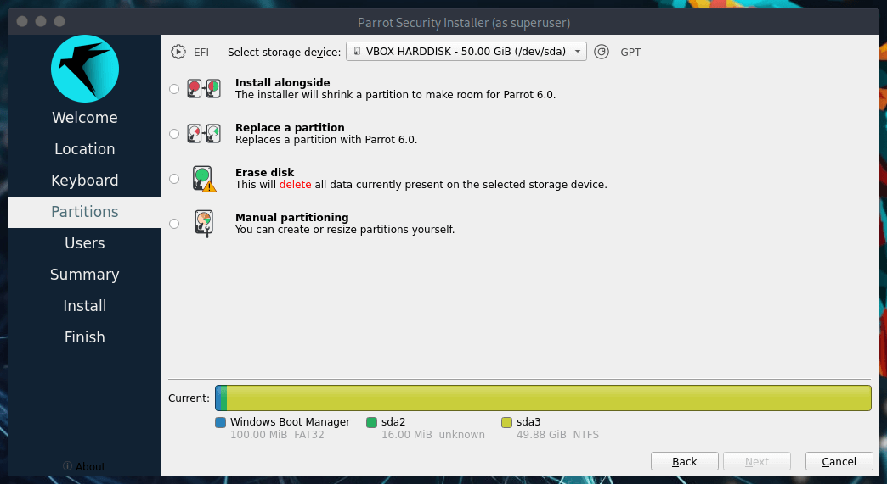

There are two ways to proceed: 

 - [Method 1: Automated Partitioning](<./dualboot-with-windows.html#method-1-automated-partitioning>)
 - [Method 2: Manual Partitioning](<./dualboot-with-windows.html#method-2-manual-partitioning>)

## Method 1: Automated Partitioning

This is the easiest method. You simply verify that **Install alongside** is selected, choose the correct drive (e.g., **/dev/sda3**) from the dropdown menu, and drag the bottom slider to assign the desired amount of space for ParrotOS. Then click on *Next* to proceed.

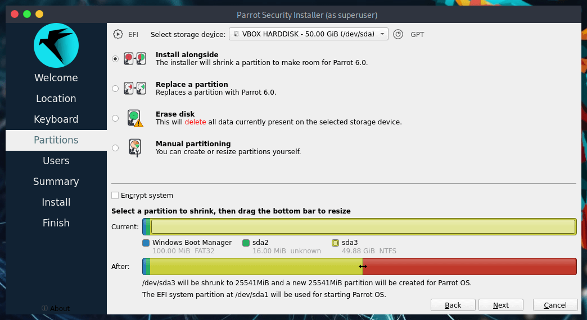

## Method 2: Manual Partitioning

This method gives you the freedom to choose the exact amount of space and the number of partitions for ParrotOS.

**NOTE:** The **Security** edition needs *at least* 40GB of space, while the **Home** edition needs *at least* 20GB. In this guide, we are not creating a Swap partition as it is optional on modern systems with SSDs.

Select **Manual Partitioning** and click on *Next*.

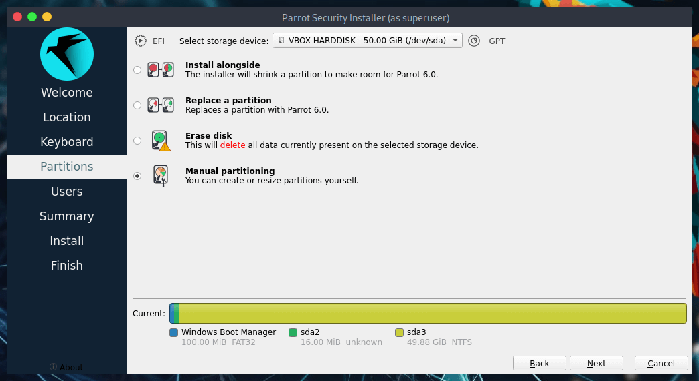

You will see something similar to this:

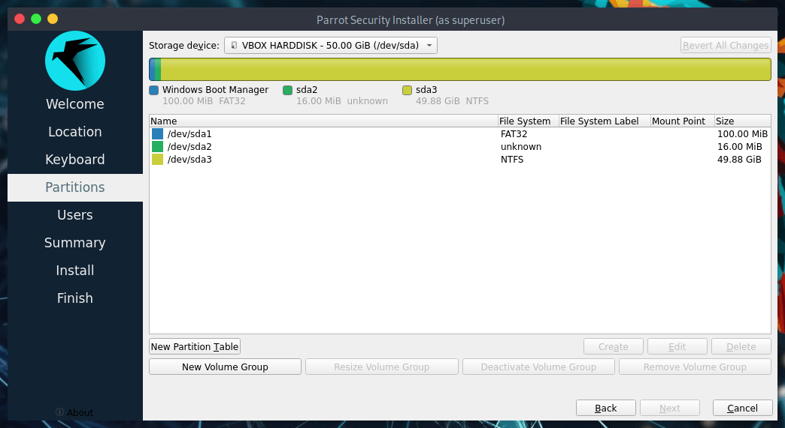

In detail:

* **/dev/sda1** is the boot partition (EFI).
* **/dev/sda2** is the MSR (Microsoft Reserved partition).
* **/dev/sda3** is where Windows is installed.
* **/dev/sda4** is a recovery partition.

This is a standard Windows partition layout.
Select the main Windows partition (e.g., **/dev/sda3**) and click on *Edit*.

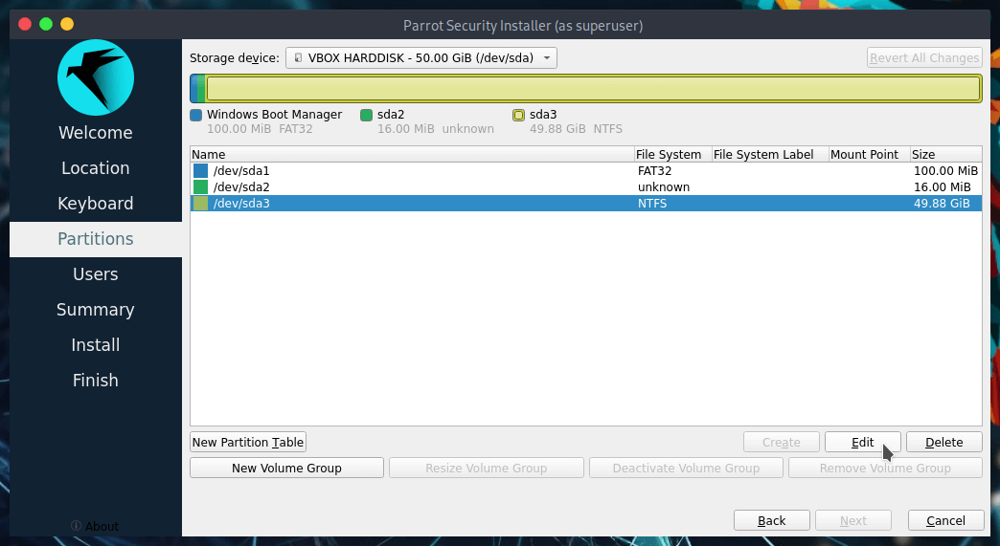

This window will open:

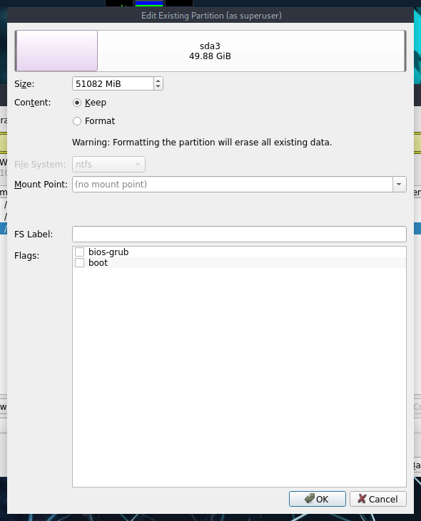

Here you can shrink/resize partitions (by dragging the bar or entering the size in MiB), and set flags and mount points.

Drag the bar or set the value to free up the desired space (in this example, we resized Windows to 40GB, leaving 20GB of unallocated space for ParrotOS), then click on *OK*.

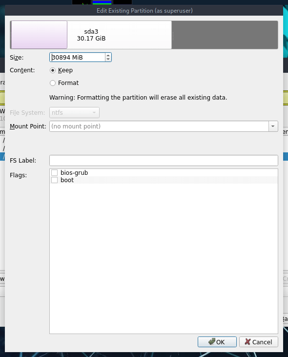

Now you will see the updated layout. Select the new **Unallocated** space and click on *Create*:

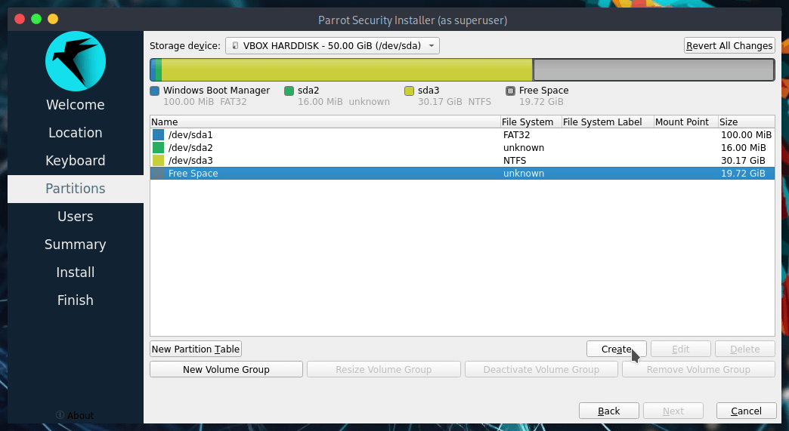

Configure the new partition settings. Choose your file system (ParrotOS defaults to BTRFS) and set the mount point to / (**root**). Then click on *OK*:

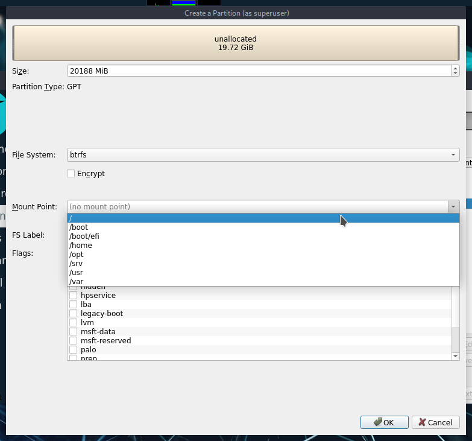

Finally, set up the boot partition.

Select the EFI partition (e.g., **/dev/sda1**) and click on *Edit*:

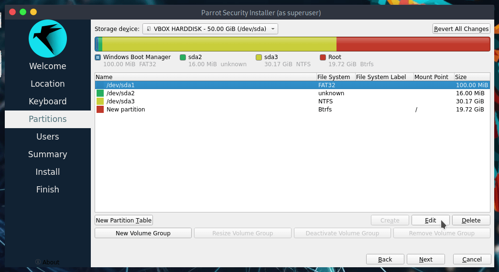

Set the mount point to **/boot/efi** (do not format this partition!) and click on *OK*:

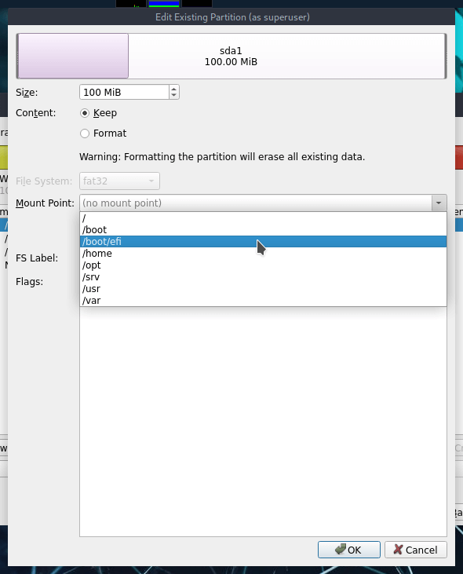

This is the final layout. Proceed with the installation by clicking on *Next*:

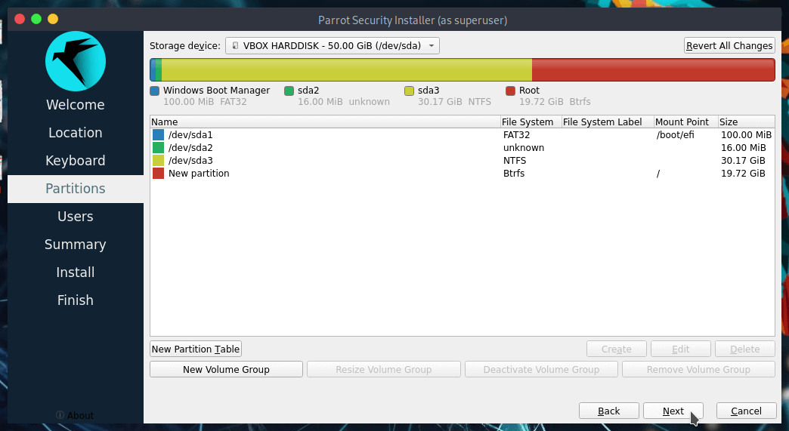