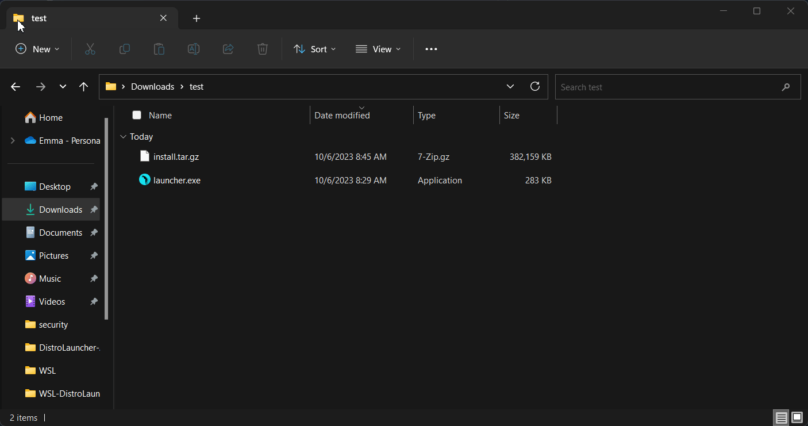

# Install ParrotOS with WSL

Installing ParrotOS on Windows-Subsystem-Linux(henceforth WSL)


### Note about Virtualized Machines
This is not indended, or supported to be ran within a Virtualized Windows Machine.

Any bugs or issues resulting from this are most likely not going to be fixed.

TL;DR, Virtualized Windows Machine - You're on your own.

## Installing WSL

If you already have WSL installed on your machine, you can skip this section.

Open up a Powershell as administrator(Right click -> Run As Administrator), and type `wsl --install`, if you see help text, that means you have WSL already installed, otherwise wait for the install to finish.


## Running Parrot WSL

### Manual Install
Download the .zip containing the needed files from [https://www.parrotsec.org/download/](https://www.parrotsec.org/download/), and extract it to a folder.

Double click launcher.exe and the installation window will pop up.

First, enter `y` or `n` to choose to install all the security tools,, or just the base image(this can be done later).
Next, enter your username & password for your user account.



Your WSL "Hard Drive" will be created as a .vdhx in the folder you create the launcher from.

All updates can be performed via a standard apt upgrade/update. However if you wish to rerun the installer, you must run `wsl --unregister ParrotOS`, and rerun launcher.exe

Congrats, you now have a working WSL instance!


### Windows Store
Coming soon....


## Known Issues

Packages requiring SystemD(i.e. Powershell Empire) are not working on default installs.

This can be fixed however, by editing /etc/wsl.conf and adding
```yaml
[boot]
systemd=true
```

And restarting your wsl instance.

## Unknown Issues
Please open an issue in [The WSL Gitlab Project](https://gitlab.com/parrotsec/project/wsl) for any bugs you encounter.
