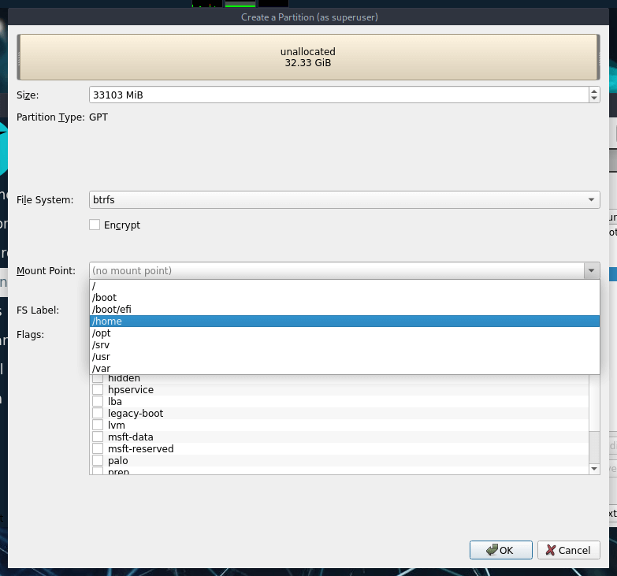
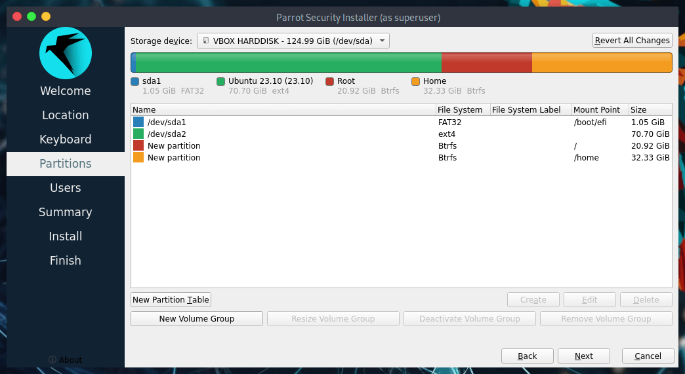
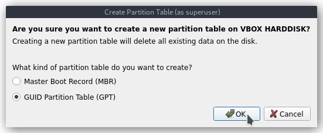
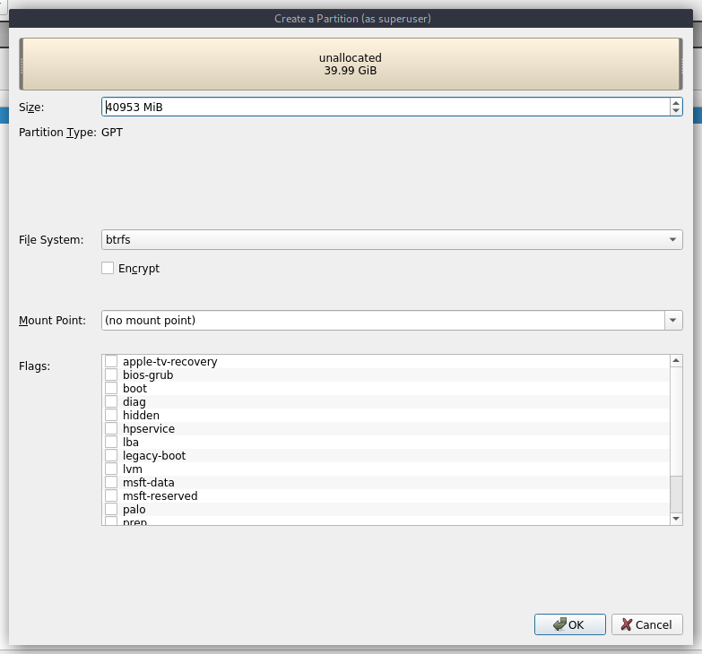
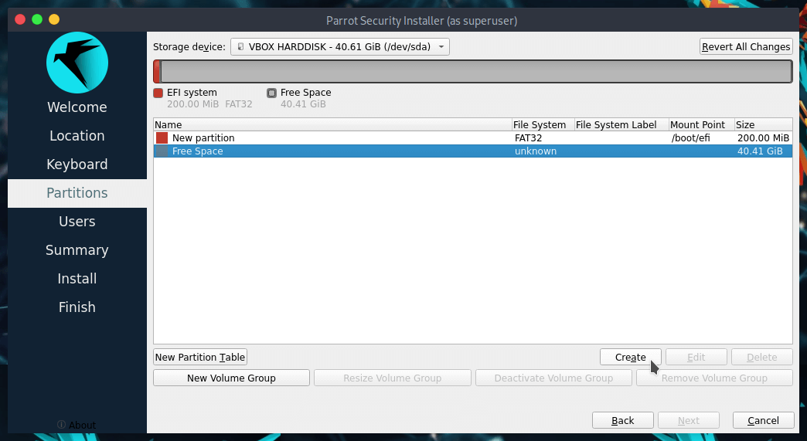
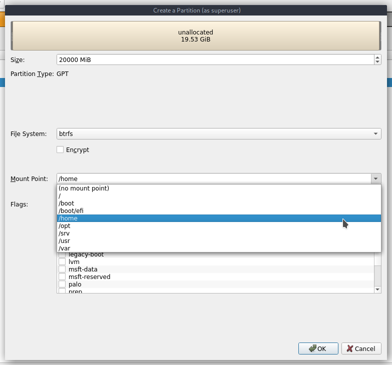
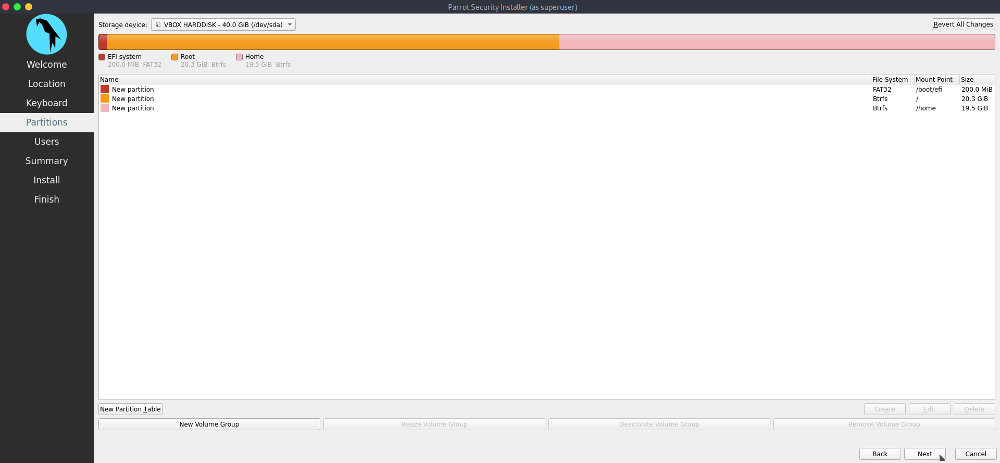

# Install ParrotOS with Manual Partitioning

Now let's focus on the Manual partitioning of ParrotOS using Calamares installer, which may be necessary for various purposes and needs.

Like the [Dualboot with Windows](https://parrotsec.org/docs/installation/dualboot-with-windows), this method allows you to assign the desired size of the partitions and determine how many of them to create or edit.

Let's see two use cases:  

* [Partitioning a disk with existing partitions ](#case-1-partitioning-a-disk-with-existing-partitions)
* [Partitioning an empty disk](#case-2-partitioning-an-empty-disk
)

## Case 1: Partitioning a disk with existing partitions

After following the steps for setting the [Parrot Installation](./) before partitioning, select **Manual Partitioning** then click on Next.

You'll see something similar to this:

The partitions in detail:

* `/dev/sda1` is the partition which contains EFI boot files.
* `/dev/sda2` is the partition containing the existing OS.

To make ParrotOS work in a UEFI computer, at least three working partitions are needed: 
* `/boot/EFI` - _the folder containing the efi firware necessary to boot the system._
* `/` - _the folder containing the entire system_
* `/home`- _the User data folder_

:::info Note
  Disable Secure Boot and CSM from UEFI settings in your machine before doing any of the above descripted operations.
:::

In a standard BIOS partition, at least two working partitions are needed: 
* `/`
* `/home`

Now, let's change the mount point for the necessary partitions.
First, select **/dev/sda1** and click on Edit

This window will appear, here is possible to shrink/resize partitions (by dragging the bar or inserting the size in MiB), set flags and mount point.

Set up the partition as you can see below, then click on Ok.

Now select **/dev/sda2** and click on Edit.

Drag the bar or set the value for getting the desired partition size (in this case the total amount of the partition size is about 124GB, and we dedicated about 70GB to Windows, and thereby the remaining 50GB have been assigned to ParrotOS.) then click on OK.

:::info Note
  Parrot Home needs at least 20GB of space, while Parrot Security needs at least 40GB of space. Home Edition will be installed in this guide.
:::

Now select the *Free Space* and click on Create.

Now let's create the **/ - root partition**, set it up as it appears below then click on Ok:

Now, the last partition, **/home**. Select the remaining Free Space then click on Create:

Set up the partition as it appears below then click on Ok:

Now all the partition are properly configured, proceed with the installation by clicking on next.

After this, proceed with the final steps of the installation by clicking on *Next* .

## Case 2: Partitioning an empty disk

After following the steps for setting the [Parrot Installation](./) before partitioning, select **Manual Partitioning** then click on Next.

Since the hard drive is empty, the space will appear unallocated. Let's create a new partition table by clicking on *New Partition Table*

A dialogue window will appear asking the desired partition table type, keep the default value (GPT) and click *Ok*

Select the **Free Space** and click on *Create*

From here, it's possible to create and edit partitions. Let's create the first one, `/boot/EFI` - _the folder containing the efi firware necessary to boot the system._ by following three simple steps:

* Click on the Mount Point drop-down list, and set it on `/boot/EFI`
* Click on File System drop-down list, set it on `fat32`
* On the Size text field, write `200MiB`, then click on *OK*

At this stage, the partition table will result like this:

Now select again the **Free Space** and click on *Create*, let's create * `/` - _the folder containing the entire system_

From the partition setup window, set the partition *Size* to 20753MiB, the *File System* to btrfs and the *Mount Point* to `/`, then click on *Ok*

:::info Note
  Parrot Home needs at least 20GB of space, while Parrot Security needs at least 40GB of space. Home Edition will be installed in this guide.
:::

Now, the partition table looks almost complete:

Finally, let's create `/home`- _the User data folder_ with the remaining **Free Space**. Select it and click on *Create*

As the setup window appears, setup **File System** as `Btrfs` and **Mount Point** as `/home`. When finished, click on *Ok*

Now the partitioning is completed, proceed with the installation by clicking on *Next*.

