### Install ParrotOS with Manual Partitioning

Now let's focus on the Manual partitioning of ParrotOS using Calamares installer, which may be necessary for various purposes and needs.

Like the [Dualboot with Windows](https://parrotsec.org/docs/installation/dualboot-with-windows), this method allows you to assign the desired size of the partitions and determine how many of them to create or edit.

Let's see two use cases:  

* [Partitioning a disk with existing partitions ](#case-1-partitioning-a-disk-with-existing-partitions)
* [Partitioning an empty disk](#case-2:-partitioning-an-empty-disk
)

## Case 1: Partitioning a disk with existing partitions

After following the steps for setting the [Parrot Installation](./) before partitioning, select **Manual Partitioning** then click on Next.

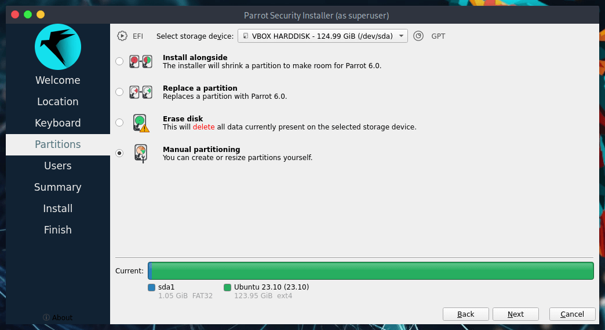

You'll see something similar to this:

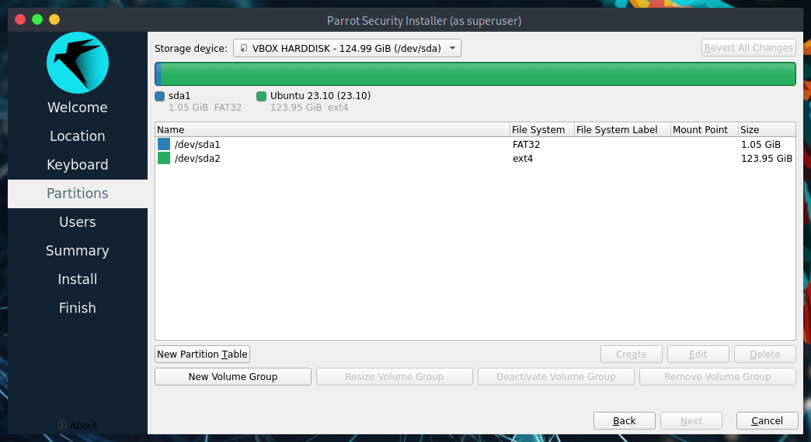

The partitions in detail:

* /dev/sda1 is a hidden partition which contains Windows Files for Recovery.
* /dev/sda2 is the boot partition.
* /dev/sda3 is MSR (Microsoft Reserved partition).
* /dev/sda4 is where preinstalled OS exists (Windows 10 for this use case).

To make ParrotOS work in a UEFI computer, at least three working partitions are needed: 
* `/boot/EFI` - _the folder containing the efi firware necessary to boot the system._
* `/` - _the folder containing the entire system_
* `/home`- _the User data folder_

:::info Note
  Disable Secure Boot and CSM from UEFI settings in your machine before doing any of the above descripted operations.
:::

In a standard BIOS partition, at least two working partitions are needed: 
* `/`
* `/home`

**/dev/sda1** and **/dev/sda3** are useless for ParrotOS, so let's delete them.

Select **/dev/sda1** then click on *Delete*

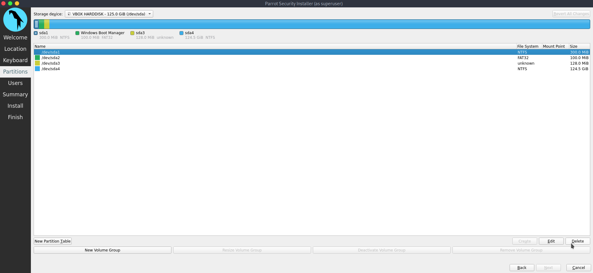

Repeat the operation for **/dev/sda3**. The configuration at this stage will be like this:

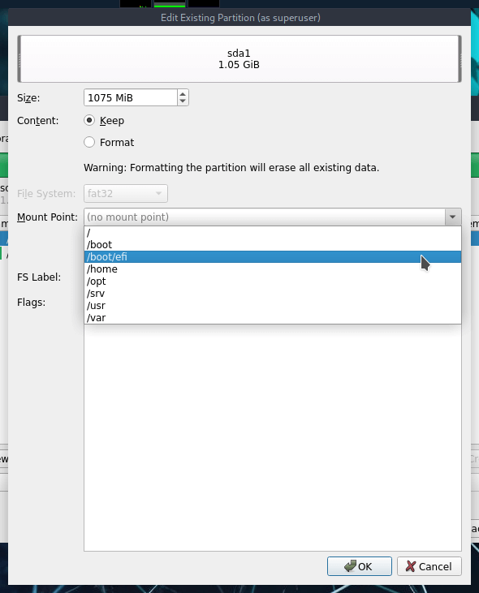

You may need to move **/dev/sda2** to the first section of the disk, so click on *Edit* and this window will appear:

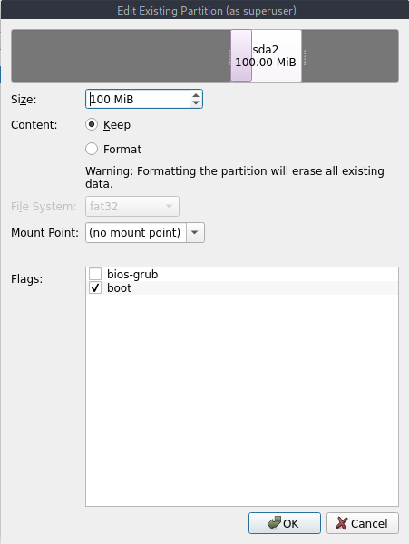

Hold and drag left the partition, then click on *Ok*

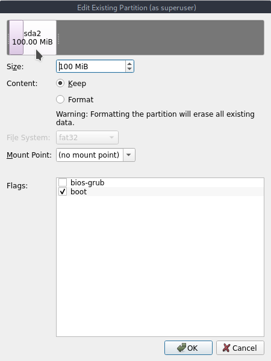

The configuration at this stage will be like this:

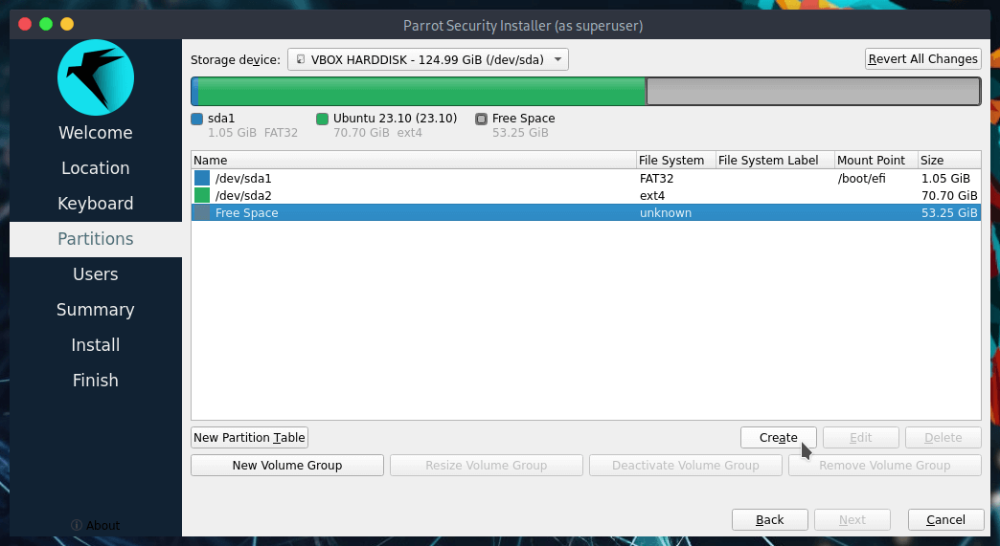

Now, let's change the mount point for the necessary partitions.

Select **/dev/sda2** then click on Edit.

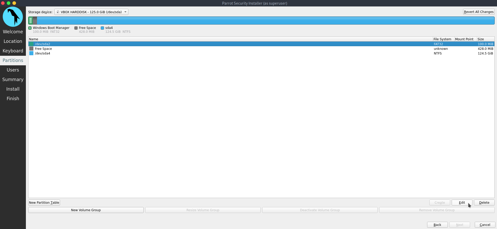

This window will open up:

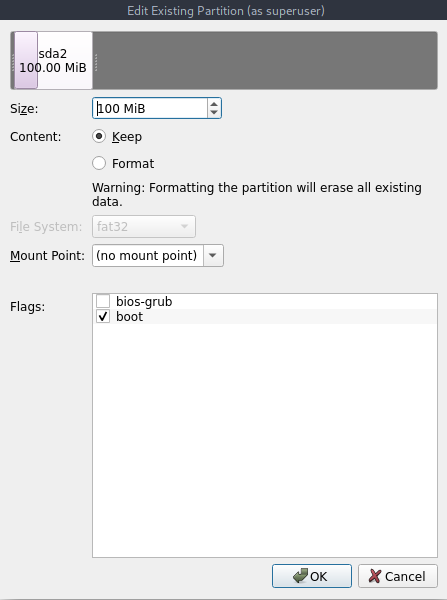

Here is possible to shrink/resize partitions (by dragging the bar or inserting the size in MiB), set flags and mount point.

Click on the Mount Point drop-down list, and set it on `/boot/EFI`, then click on *OK*

Select **/dev/sda4** then click on Edit.

As mentioned before, at least three working partitions are needed for ParrotOS.

The first partition going to be created will be `/home` - _the User data folder_

:::info Note
  Parrot Home needs at least 20GB of space, while Parrot Security needs at least 40GB of space. Home Edition will be installed in this guide.
:::

Shrink the partition by dragging right the slider, unless you'll have 20gb of unallocated space, then set the mount point to `/home`, set the content to *Format*, then click on *Ok*

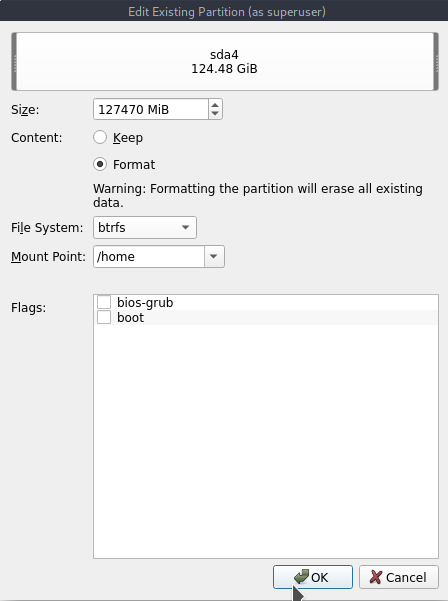

Now the updated situation will be this:

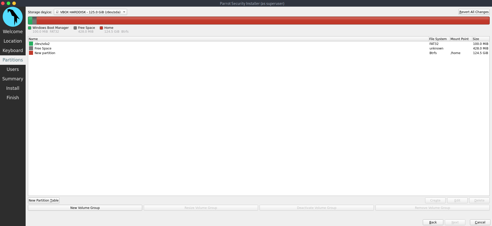

Select the *Free Space* and click on *Create* to setup `/` - _the folder containing the entire system_ :

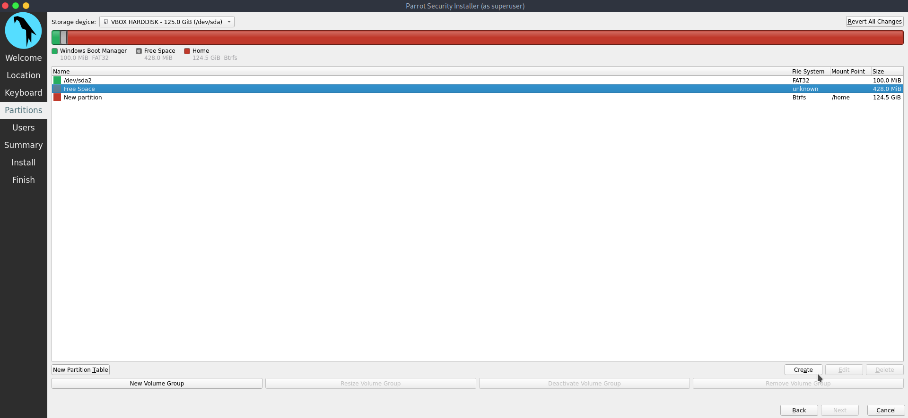

This window will appear:

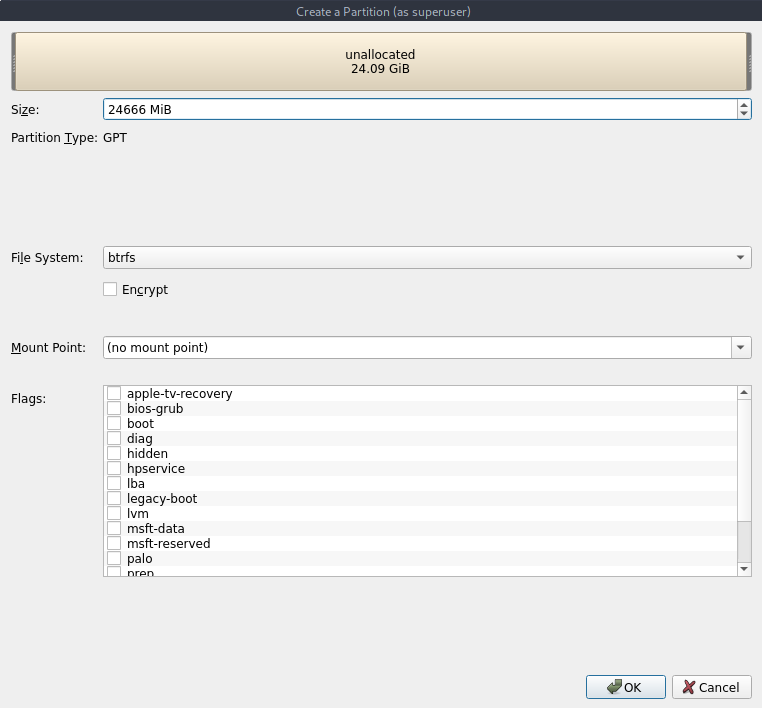

Click on the Mount Point drop-down list, set the file system you want (ParrotOS uses BTRFS by default), set the mount point in `/ (root)`, then click on *OK*

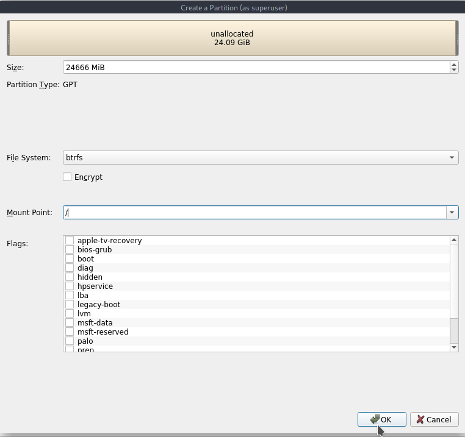

After this, proceed with the final steps of the installation by clicking on *Next* .

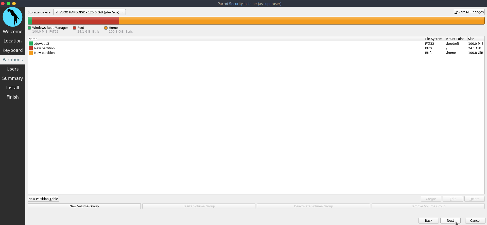

## Case 2: Partitioning an empty disk

After following the steps for setting the [Parrot Installation](./) before partitioning, select **Manual Partitioning** then click on Next.

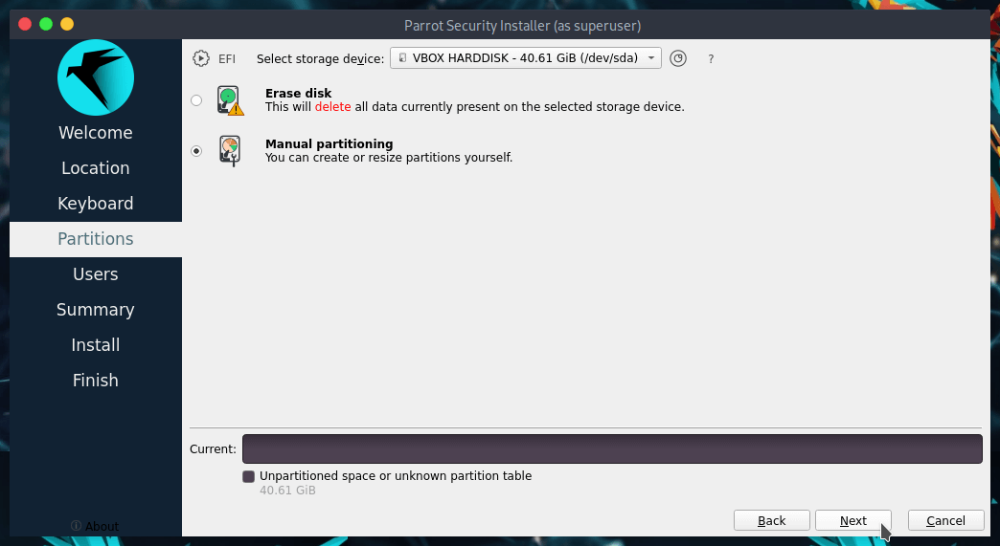

Since the hard drive is empty, the space will appear unallocated. Let's create a new partition table by clicking on *New Partition Table*

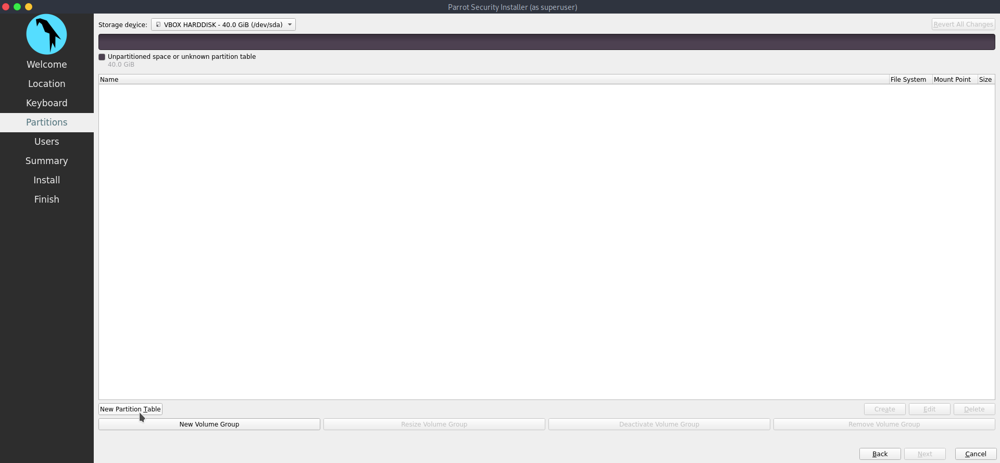

A dialogue window will appear asking the desired partition table type, keep the default value (GPT) and click *Ok*

Select the **Free Space** and click on *Create*

From here, it's possible to create and edit partitions. Let's create the first one, `/boot/EFI` - _the folder containing the efi firware necessary to boot the system._ by following three simple steps:

* Click on the Mount Point drop-down list, and set it on `/boot/EFI`
* Click on File System drop-down list, set it on `fat32`
* On the Size text field, write `200MiB`, then click on *OK*

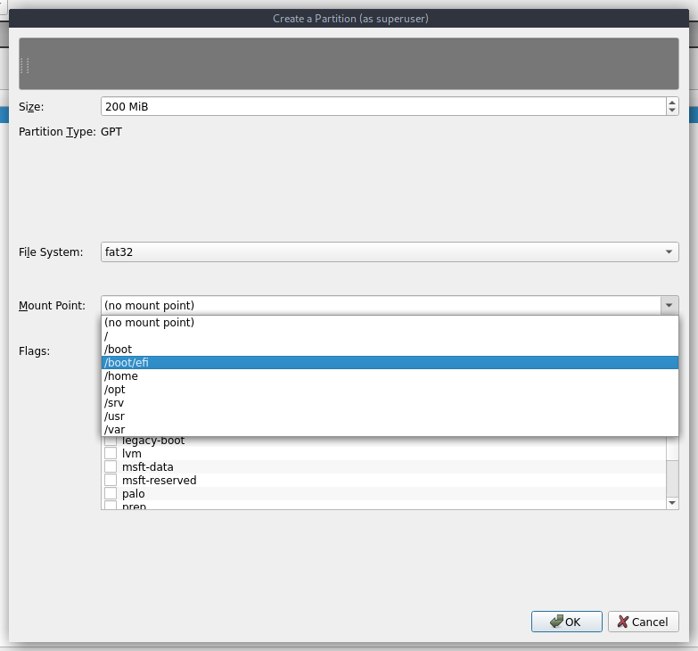

At this stage, the partition table will result like this:

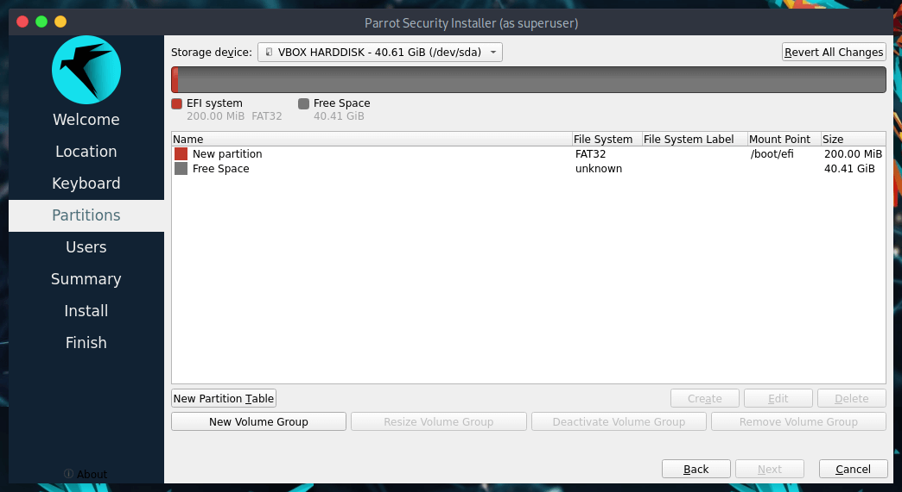

Now select again the **Free Space** and click on *Create*, let's create * `/` - _the folder containing the entire system_

From the partition setup window, set the partition *Size* to 20753MiB, the *File System* to btrfs and the *Mount Point* to `/`, then click on *Ok*

:::info Note
  Parrot Home needs at least 20GB of space, while Parrot Security needs at least 40GB of space. Home Edition will be installed in this guide.
:::

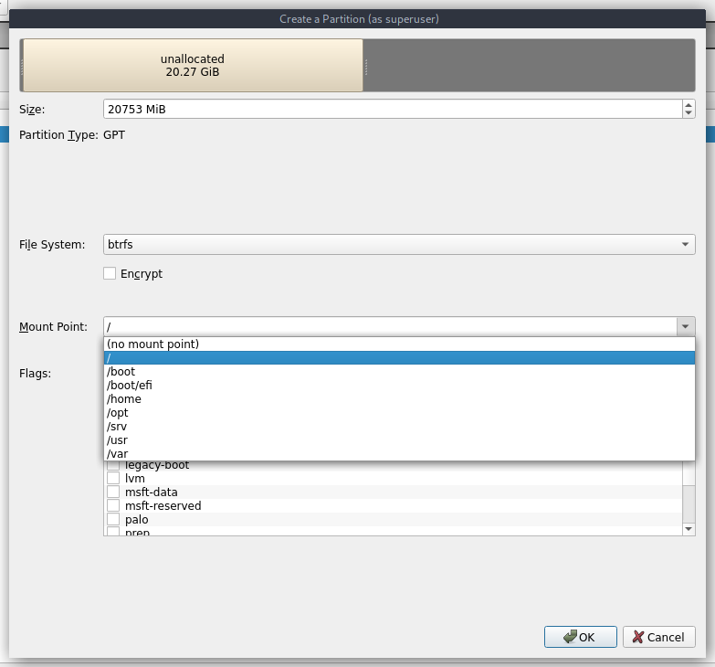

Now, the partition table looks almost complete:

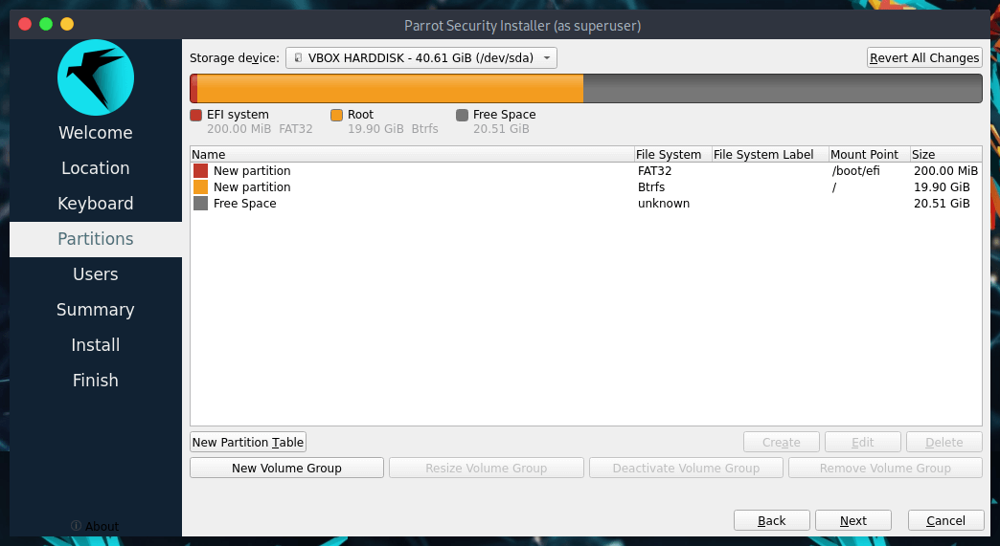

Finally, let's create `/home`- _the User data folder_ with the remaining **Free Space**. Select it and click on *Create*

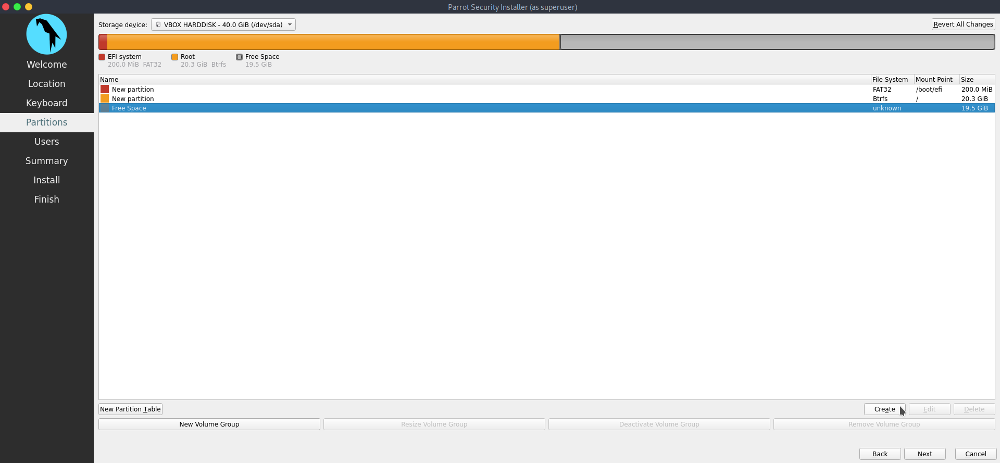

As the setup window appears, setup **File System** as `Btrfs` and **Mount Point** as `/home`. When finished, click on *Ok*

Now the partitioning is completed, proceed with the installation by clicking on *Next*.

