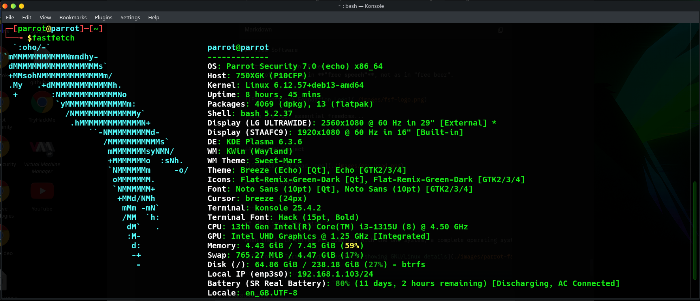

# What is GNU/Linux?

GNU/Linux is an operating system built over the years thanks to the contributions of many developers around the world. Below is a description of its core concepts and history.

## Free Software

"Free software" is software that respects the freedom of users and their community. Broadly speaking, it means that users have the freedom to run, copy, distribute, study, modify, and improve the software.

In other words, "free software" is a question of **liberty**, not price.

:::tip Free as in "Freedom"
To understand the concept, think of "free" as in **"free speech"**, not as in "free beer". 

In English, we sometimes use the term **"Libre Software"** (borrowed from Spanish/French) to clarify that we are referring to freedom, not cost.
:::

There are four essential freedoms that define "Free Software":

* **Freedom 0:** The freedom to run the program as desired, for any purpose.
* **Freedom 1:** The freedom to study how the program works, and change it to do what you want. Access to the source code is a necessary condition for this.
* **Freedom 2:** The freedom to redistribute copies so you can help your neighbor.
* **Freedom 3:** The freedom to distribute copies of your modified versions to others. By doing this, you can give the whole community a chance to benefit from your changes. Access to the source code is a necessary condition for this.

A program is "Free Software" if it grants users all of these freedoms appropriately. Otherwise, it is arguably non-free (Proprietary Software).

:::info Summary
* **Free Software** does not necessarily mean it is free of charge, although in many cases it is.
* It guarantees the freedom to **run**, **modify**, **study**, and **redistribute** the software.
:::

For more information, visit the [Free Software Definition](https://www.gnu.org/philosophy/free-sw.en.html).

---

## The GNU Project

Let's go back to the 1970s. Richard Stallman was working at MIT (Massachusetts Institute of Technology). At that time, sharing code was common; programmers were free to cooperate. However, in the 1980s, software began to be distributed as proprietary products, prohibiting cooperation between users.

Facing this shift, Richard Stallman decided to launch the **GNU Project** in 1983. In 1985, the **Free Software Foundation (FSF)** was founded to raise funds and support the development of GNU.

### The Concept
The GNU operating system is a complete, Unix-compatible free software system.
* **Name:** GNU stands for "GNU's Not Unix". It is a recursive acronym.
* **Pronunciation:** In English, it is pronounced as one syllable with a hard G ("g-noo").
* **Goal:** The name was chosen because it was a real word and fun to say. The design was Unix-compatible because Unix was already proven and portable, making it easy for users to switch.

By the early 1990s, the GNU Project had completed most components: compilers, editors, shells, and libraries. However, it was missing one critical piece: the **Kernel**.

**References:**
* [The GNU Manifesto](https://www.gnu.org/gnu/manifesto.html)
* [The Free Software Song](https://www.gnu.org/music/free-software-song.en.html)

---

## The Linux Project

In 1991, a Finnish computer science student named **Linus Torvalds** wanted to create an operating system similar to Minix but capable of running on his new computer with an 80386 processor.

Using the **GNU C Compiler**, Linus developed the first version of a Kernel. On August 25, 1991, he announced this project on Usenet (`comp.os.minix`). The project quickly gained traction, and many developers joined to contribute code.

### Licensing and Naming
* Linus initially released the software under his own license but switched to the **GNU GPL** in 1992.
* The name "Linux" was not his first choice; he originally wanted to call it "Freax". However, Ari Lemmke, an administrator at the Helsinki University of Technology FTP server, named the folder "Linux" without consulting him. Linus eventually accepted it.

---

## GNU/Linux: The Union

While the Linux kernel was being developed, the FSF (GNU) was working on their own kernel, called **Hurd**. However, Hurd's development was slower than anticipated.

This created a perfect match:
1.  **GNU** had the tools and the user-space software but lacked a working Kernel.
2.  **Linux** was a working Kernel but lacked the surrounding system tools.

When the Linux kernel was combined with the GNU system, a complete operating system was born. Therefore, the technically correct name for the system is **GNU/Linux**. The kernel (Linux) handles the hardware resources, while the GNU tools allow the user to interact with the computer.

:::note Why GNU/Linux?
As seen in the screenshot above, modern distributions like Parrot represent this union perfectly:
* **OS:** Parrot Security (The distribution)
* **Kernel:** Linux (The hardware driver)
* **Shell/Tools:** Bash, Zsh, GNU Utils (The userland tools)

Nowadays, when people say "Linux", they are often referring to this **GNU/Linux** combination.
:::

[Read more about the relationship between Linux and GNU](https://www.gnu.org/gnu/linux-and-gnu.en.html).