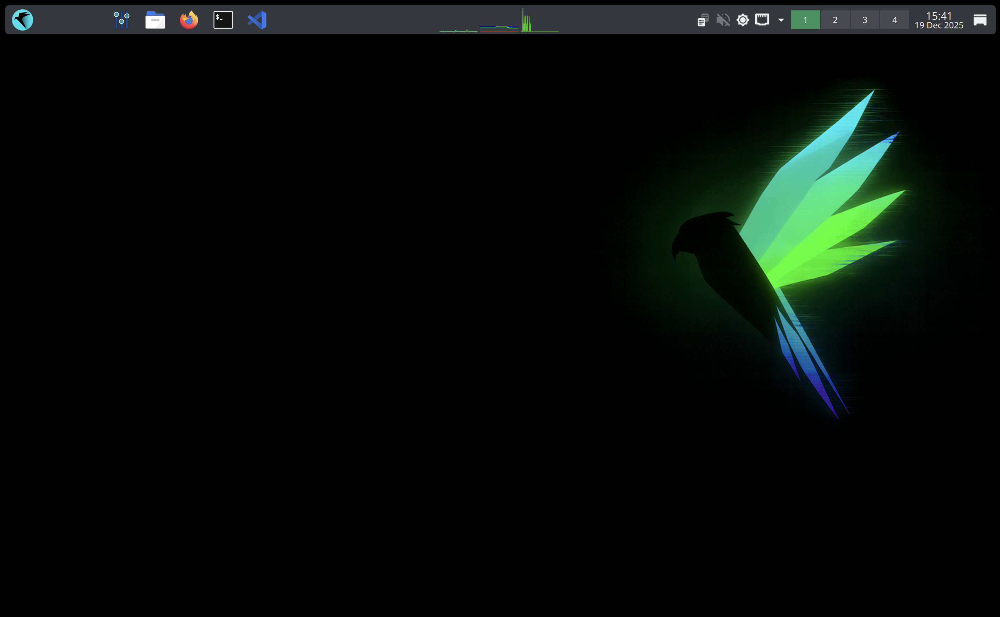

# What is Parrot OS?

**Parrot OS** is a Free and Open Source GNU/Linux distribution based on **Debian**, designed for security experts, developers, and privacy-aware people.

It includes a full portable arsenal for IT security and digital forensics operations. It also includes everything you need to develop your own programs or protect your privacy while surfing the net.

Parrot is available in two main editions: **Security** and **Home Edition**.

Users can also install Parrot on top of a standard Debian installation using the **Debian Conversion Script**.

It is also available as a Virtual Machine (Virtual Box, Parallels, and VMware), on **Raspberry Pi**, and on Docker.

*Parrot Security with KDE Plasma Desktop*

## History and Team

The first public release appeared on **April 10th, 2013** as the result of the work of **Lorenzo Faletra**, who continues to lead development.

Originally developed as part of *Frozenbox* (a community forum by the same creator of Parrot), the effort has grown to include a community of open source developers, professional security experts, advocates of digital rights, and Linux enthusiasts from all around the globe.

The project is headquartered in Palermo, Italy, and governed by **Parrot Security CIC**, a community interest company registered in the UK.

### Why "Parrot"?
> Because it was born as a game, and every pirate of the seven seas needs a parrot on his shoulder if he wants to board the galleons with his crew of jailbird filibusters.

## Who is it designed for?

The system is designed to be familiar to the security expert and easy to use for the new entry student, but it does not try to hide its internals as other general-purpose distributions try to do.

Parrot can be used as a **daily system**. It provides all the programs for day-to-day tasks, including a dedicated edition of the system (**Parrot Home Edition**) that doesn't include security tools.

## Software Management

The system has its own applications repository including all the packages supported by **Debian**, plus many other applications and tools that Debian cannot provide directly. This allows Parrot to offer a rolling-release update model, ensuring that users always have the latest security tools available.

## Should I use Parrot?

Even if we would like everyone to use the Parrot System or, at least, give it a try, there are some important considerations to make about who we expect to use Parrot and who may have a bad experience from it.

First of all, even if Parrot provides general purpose flavors, its core is still tuned for **Security** and **Forensics** operations. In this section we will explain how different Parrot is compared to other general purpose distributions and how different it is from other Pentest and Forensics distributions. Then we will present some categories of people and what kind of experience they may have by using this system.

### General purpose distributions
Parrot is different from a general purpose distribution (i.e. Ubuntu) because it does not try in any way to hide its internals.
Meaning that many automation tools are included in the system to make it easier to use, yet expose quite well what the system has under the hood.

A good example is the **parrot update reminder**: it is a simple yet powerful program that prompts the user to check for system upgrades once a week. But instead of hiding the upgrade process behind a progress bar, it shows the user the full upgrade process from the `apt` output.

Another important difference is that Parrot disables by default all the network services pre-installed in the system, not only to maintain a very low RAM footprint and offer better performance, but also to avoid services exposure in a target network. Every network service needs to be manually started when the user needs it.

### Pentest distributions
Pentest distributions are famous for integrating only security tools, allowing easy root access and taking down all the security system barriers that may influence the workflow of a pentester.

Parrot was designed to be a very comfortable environment for security experts and researchers. It includes many basic programs for daily use which pentesting distributions usually exclude (at the cost of less than an additional gigabyte of storage). This choice was taken to make Parrot not only a good system to perform security tests, but also a good environment where you can write reports, build your own tools, and communicate seamlessly with teammates, without the need for additional computers, operating systems or configuration.

Our goal is to allow any professional pentester to make a whole security test from the beginning, to the report with just a Parrot ISO and an average laptop.

### Secure distributions
Parrot Security ships with custom hardening profiles and configurations for **AppArmor** and other linux hardening technologies, and takes inspiration from the success of other projects that deliver the highest level of security in the GNU/Linux scenario, like **Tails** and **Whonix** to sandbox the system and deliver a layer of security above the average.

All this additional security comes with a cost: it is harder to adopt bad behaviors on Parrot. For instance it is not possible to log in as root with the whole desktop environment, or to start critical applications like browsers, media players or advanced document readers with unnecessary privileged permissions.

The user can still open root consoles, launch security tools with privileged permissions and use the system without limits. The only thing that changes is that all the critical user applications are now protected from very bad behaviors and common exploit techniques, or even zero-days, and the damages caused by advanced exploits are very limited.

### Forensics Distributions
Parrot comes with **automount functions disabled by default** to allow safe forensics acquisitions.
* **Kernel Level:** The `noautomount` option is passed at boot.
* **File Manager:** Settings are tuned to disable auto-mount and plug & play features.

:::warning Important
The no-automount behavior is consistent, but **no protection is provided in case of accidental manual mounts**. A hardware write blocker is always recommended in any digital forensics scenario.
:::

## In Summary
Parrot is made for:
* Security Experts
* Digital Forensics Experts
* AI Security Researchers
* Computer Science/Engineering Students
* Researchers
* Wannabe Hackers
* Software Developers