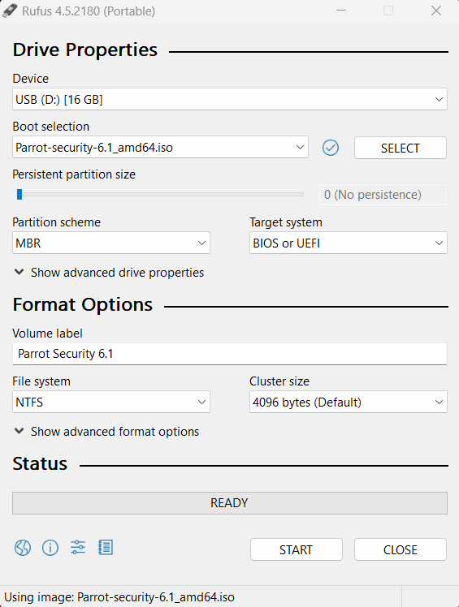
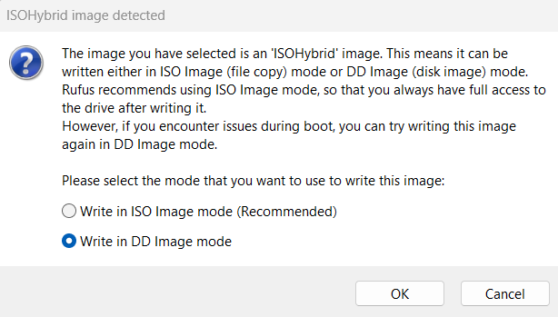
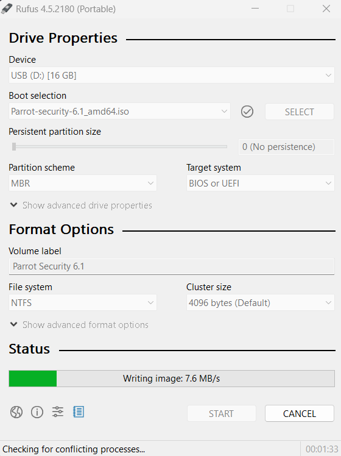

# Create a bootable USB

First of all, you need to download the latest ISO file from our [website](https://parrotsec.org/download/).

Then you can burn the iso to a flash drive using [Balena Etcher](https://www.balena.io/etcher/), [ROSA ImageWriter](http://wiki.rosalab.ru/en/index.php/ROSA_ImageWriter), or [Rufus](https://rufus.ie/en/). Balena Etcher and ROSA ImageWriter both work on Linux, macOS and Windows, while Rufus is only available for Windows 8 or later. 

For users on Linux or macOS, we recommend using Etcher, but you can also use the **DD command line tool** if you prefer. For users on Windows 8 or later, we recommend using Etcher or Rufus.

The Parrot .iso file uses the [ISO 9660 standard](https://docs.kernel.org/filesystems/isofs.html) (also known as ISOHybrid). It is a special ISO format that contains not only the partition content, but also the partition table.

Some ISO writing programs do not write the iso bit-per-bit into the usb drive at a low level. They create a custom partition table and just copy the file in the USB drive in an unofficial and non-standard way. This behavior is against what the ISOHybrid was created for, and may break core system functionalities and make the system uninstallable from such USB drives.

It is **highly recommended that you do not** use *unetbootin*, or any program that is not ISOHybrid compliant.

You will need a USB drive with a minimum size of 8 GB for the Security Edition and 4 GB for the Home Edition.

A quick summary of which tools you can use to create your Parrot USB:

- [Balena Etcher](how-to-create-a-parrot-usb-drive#balena-etcher)
- [DD Command Line Tool](how-to-create-a-parrot-usb-drive#dd-command-line-tool)
- [ROSA Image Writer](how-to-create-a-parrot-usb-drive#rosa-image-writer)
- [Rufus USB Formatting Utility](how-to-create-a-parrot-usb-drive#rufus-usb-formatting-utility)


## Balena Etcher

Plug your USB stick into your USB port and launch **Balena Etcher**. Download and unzip it.

Click on *.AppImage file*.


Click on **Flash from file**. Select the Parrot ISO and verify that the USB drive you are going to overwrite is the right one.


Then click on **Flash!** and the formatting process will start.


Once the burning is complete, you can use the USB stick as the boot device for your computer and boot Parrot OS.

## DD command line tool

**dd** (and its derivatives) is a command line tool integrated in every UNIX and UNIX-like system, and it can be used to write the ISO file into a block device bit per bit. Due to the potential to brick your system, if you are not familiar with Linux we strongly recommend using Etcher instead. 

```
sudo dd status=progress if=Parrot-<edition>-<version>_amd64.iso of=/dev/sdX
```


## ROSA image writer

Another tool you can use is ROSA image writer to create your USB with Parrot. Download it from the website and extract all files. Then, click on **RosaImageWriter**:


Select the ISO and USB.


Click on **Write** and wait for the writing procedure to finish.

## Rufus USB formatting utility

For those running a Windows 8 or later host, Rufus is the preferred USB formatting utility. Simply download the executable from the website and run it – no installation is necessary.

:::info Note
Note: Before using Rufus, please read the following from the Rufus FAQ regarding DD mode and ISO mode for ISOHybrid images:

[**Why doesn't Rufus recommend DD mode over ISO mode for ISOHybrid images? Surely DD is better!**](https://github.com/pbatard/rufus/wiki/FAQ#why-doesnt-rufus-recommend-dd-mode-over-iso-mode-for-isohybrid-images-surely-dd-is-better)
:::



Select the USB drive from the Device menu and the ISO from the Boot selection menu



Then click on *START* and wait for the writing procedure to finish.


