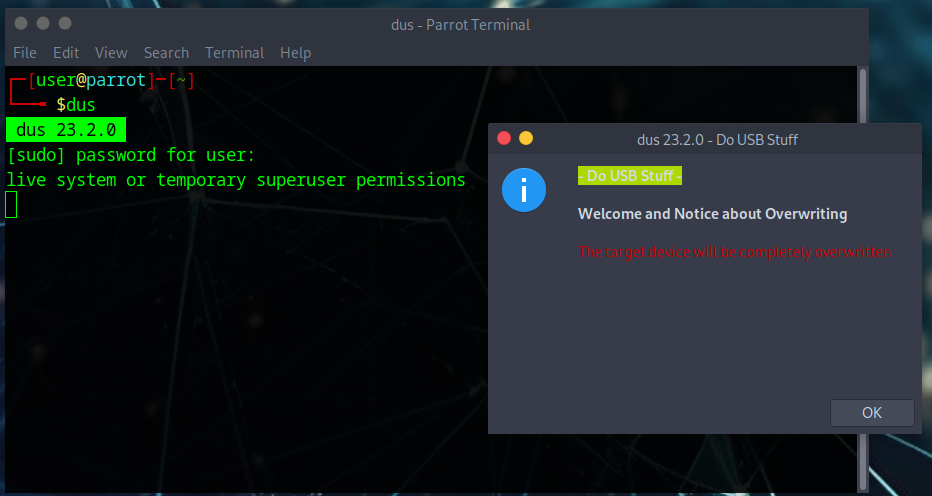
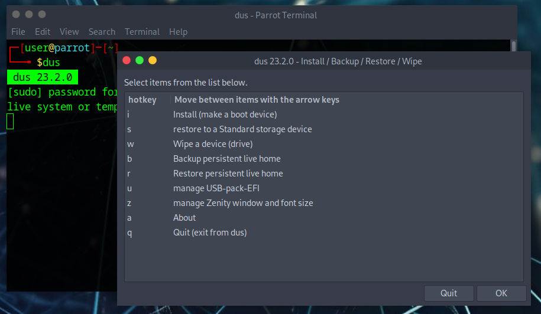
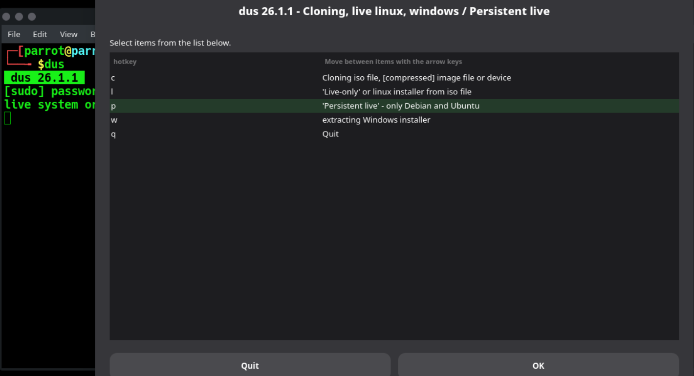
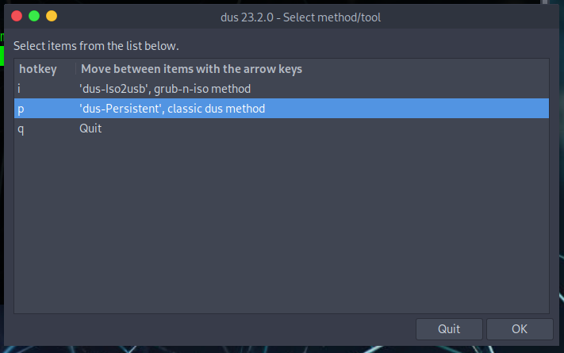
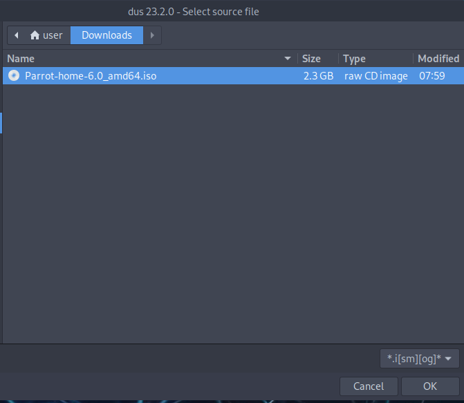
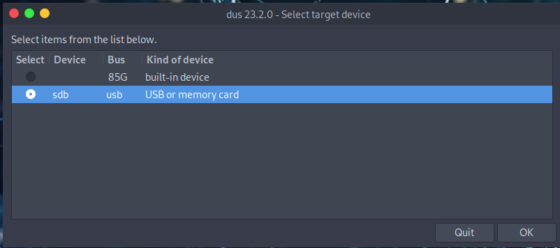
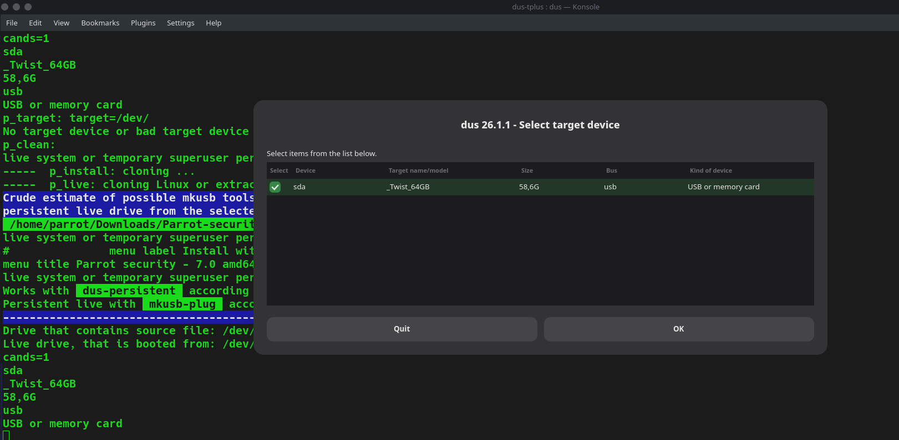
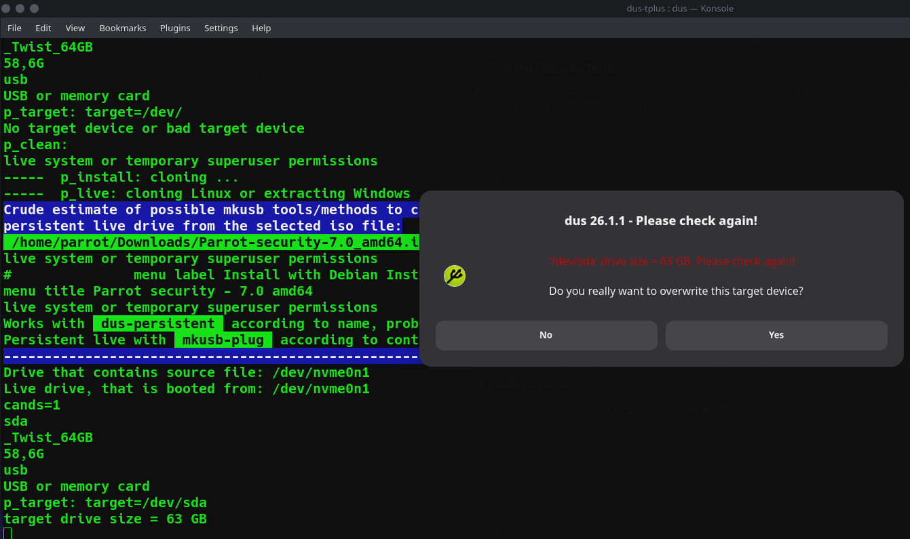
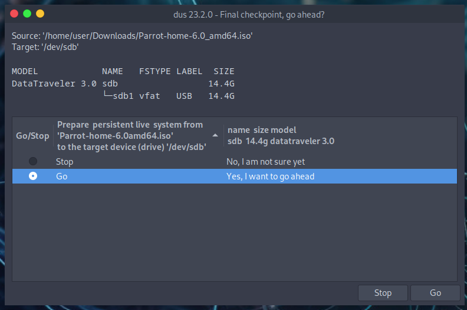
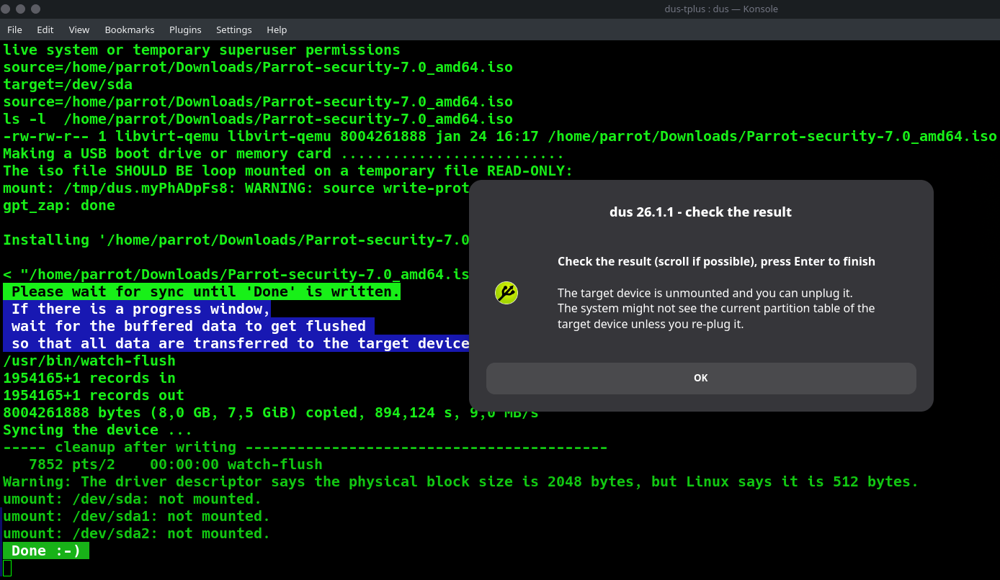

# Persistent partition

This guide shows how to create a persistent partition inside USB with ParrotOS.
To do this we will use the [**mkusb**](https://github.com/sudodus/tarballs) tool.

## Install mkusb

After downloading the ParrotOS *.iso* file from our website, download *mkusb* from the [repository](https://github.com/sudodus/tarballs).

```
git clone https://github.com/sudodus/tarballs.git
```

Navigate to the downloaded folder and unpack **dus-plus.tar.xz** with *tar*:

```
cd tarballs && tar -xf dus-plus.tar.xz
```

:::info Note
    Why only **dus-plus.tar.xz** instead of **dus.tar.xz**? In short, it contains the *usb-pack-efi* package needed to boot the partition.
:::

Go inside the newly extracted *dus-tplus* folder, and install the tool by typing:

```
cd dus-tplus/ && sudo ./dus-installer i
```

In the same terminal session, type dus (or open *guidus* from Parrot's menu) and it will start:

:::info Note
    dus will ask to install the *guidus* GUI as well, the functionality will remain the same.
:::



This tool can also be used to make a USB bootable, restore, format and other interesting things.



## Create the persistent partition

Select *install (make a boot device)*. Then, **Persistent-live** option.



Select **dus-Persistent** from the menu to choose the method to create the persistent partition.



Now select the *.iso* to install:



Select the USB where you want to install Parrot (we recommend using at least a 4GB USB key).



Select the *upefi* package and click *ok*.



You can allocate as much space as you like for the persistent partition from this window:



From here, click *Go* to confirm the operation. The persistent partition will be ready in a few minutes.




