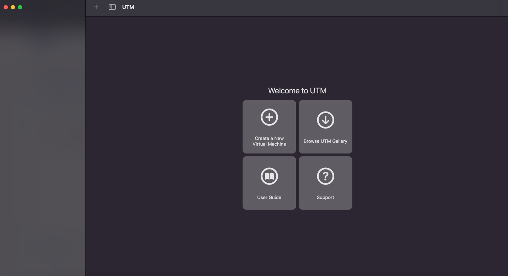
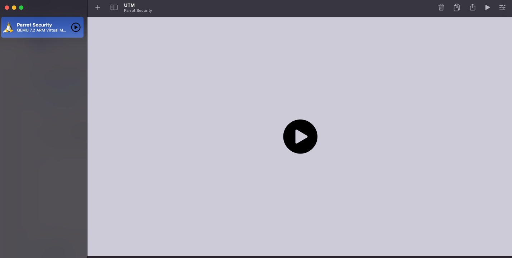

# UTM

ParrotOS can be easily virtualized on macOS systems equipped with Apple Silicon (M-series chips). To achieve this, we recommend using [UTM](https://mac.getutm.app/), a popular open-source virtualization software for Mac.

### 1. Download and Install UTM

First, download and install UTM from the official website. Once launched, you will be greeted by the main interface:

### 2. Download and Extract the ParrotOS VM

We provide a pre-configured Virtual Machine specifically for Apple Silicon, which already comes in the **.utm** format. 

Download the appropriate Apple edition from our website and extract the archive to retrieve the `.utm` file.

### 3. Import and Run

Once extracted, simply drag and drop the `.utm` file directly into the UTM application window.

The system will immediately recognize the Virtual Machine. Simply click the **Play** icon to start using ParrotOS on your Mac.