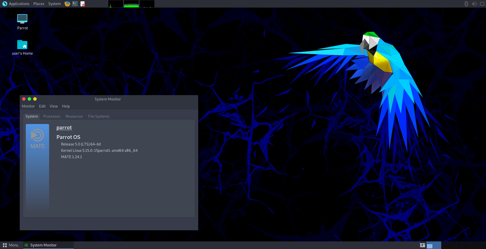

# O que é o ParrotOS?

Parrot Security (ParrotOS, Parrot) é uma distribuição GNU/Linux Livre e de Código Aberto baseada no *Debian Stable*, projetada para especialistas em segurança, desenvolvedores e pessoas preocupadas com privacidade.

Ela inclui um arsenal portátil completo para operações de segurança da informação e de forense digital. Também inclui tudo o que você precisa para desenvolver seus próprios programas ou proteger sua privacidade enquanto navega na internet.

O Parrot está disponível em três edições principais, [Security](https://parrotsec.org/download/?version=security), [Home](https://parrotsec.org/download/?version=home) e [Architect](https://parrotsec.org/download/?version=architect), inclusive como Máquina Virtual (Virtual Box, Parallels e VMware), no [Raspberry Pi](https://parrotsec.org/download/?version=raspberry) e também no Docker.

O sistema operacional vem por padrão com o Ambiente de Desktop MATE, mas é possível instalar outros DEs.

<h5 align="center">Parrot Security 6.0 "Lorikeet" com MATE Desktop</h5>

## História e Equipe

O primeiro lançamento público ocorreu em 10 de abril de 2013 como resultado do trabalho de Lorenzo Faletra, que continua liderando o desenvolvimento.

Originalmente desenvolvido como parte do Frozenbox (um fórum comunitário criado pelo mesmo autor do Parrot), o esforço cresceu para incluir uma comunidade de desenvolvedores de código aberto, especialistas profissionais em segurança, defensores dos direitos digitais e entusiastas do Linux ao redor do mundo.

O projeto tem sede em Palermo, Itália, e é administrado pela Parrot Security CIC, uma empresa de interesse comunitário registrada no Reino Unido.

## Por que "Parrot"?

*Porque nasceu como uma brincadeira, e todo pirata dos sete mares precisa de um papagaio no ombro se quiser abordar os galeões com sua tripulação de filibusteiros.*  

### Para quem é projetado

O sistema foi projetado para ser familiar para o especialista em segurança e fácil de usar para o estudante iniciante, mas não tenta esconder seus internos como outras distribuições de uso geral tentam fazer.

O Parrot pode ser usado como sistema diário. Ele fornece todos os programas para as tarefas do dia a dia, incluindo uma edição dedicada do sistema ([Parrot Home Edition](https://parrotsec.org/download/?version=home)) que não inclui ferramentas de segurança.

### Gerenciamento de Software

O sistema possui seu próprio repositório de aplicativos incluindo todos os pacotes suportados pelo Debian, além de muitos outros aplicativos e ferramentas que o Debian ainda não consegue fornecer. Todos eles são acessíveis diretamente pelo gerenciador de pacotes APT.

Além disso, o Parrot oferece suporte ao [Snap](https://snapcraft.io/), um sistema de distribuição de pacotes que fornece acesso fácil a muitos outros programas que distribuições GNU/Linux nem sempre incluem em seus repositórios oficiais.

O [Flatpak](https://flatpak.org/) é uma loja de software universal semelhante ao Snap. Pode ser instalado a partir do repositório oficial do Parrot.

O Parrot também suporta o [Wine](https://www.winehq.org/), uma camada de compatibilidade para executar aplicativos Windows em ambientes GNU/Linux.

## Devo usar o Parrot?

### Por que o Parrot é diferente

Mesmo que desejemos que todos usem o Sistema Parrot ou, pelo menos, o testem, há algumas considerações importantes a serem feitas sobre quem esperamos que use o Parrot e quem pode ter uma experiência ruim com ele.

Antes de tudo, mesmo que o Parrot forneça sabores de uso geral, seu núcleo ainda é ajustado para operações de Segurança e Forense. Nesta seção explicaremos como o Parrot é diferente de outras distribuições de uso geral e como ele difere de outras distribuições de Pentest e Forense. Em seguida, apresentaremos algumas categorias de pessoas e que tipo de experiência elas podem ter ao usar este sistema.

### Distribuições de uso geral

O Parrot é diferente de uma distribuição de uso geral (ex.: Ubuntu) porque não tenta de forma alguma esconder seus internos.

Isso significa que muitas ferramentas de automação estão incluídas no sistema para torná-lo mais fácil de usar, mas ainda expõem muito bem o que há por baixo dos panos.

Um bom exemplo é o lembrete de atualização do Parrot: é um programa simples e poderoso que solicita ao usuário verificar por atualizações do sistema uma vez por semana. Mas, em vez de esconder o processo de atualização atrás de uma barra de progresso, ele mostra ao usuário toda a saída do apt durante a atualização.

Outra diferença importante é que o Parrot desativa por padrão todos os serviços de rede pré-instalados no sistema, não apenas para manter um uso de RAM muito baixo e oferecer melhor desempenho, mas também para evitar exposição de serviços em uma rede alvo. Todo serviço de rede precisa ser iniciado manualmente quando o usuário precisar.

### Distribuições de Pentest

As distribuições de Pentest são famosas por integrar apenas ferramentas de segurança, permitindo fácil acesso root e derrubando todas as barreiras de segurança do sistema que possam influenciar o fluxo de trabalho de um pentester.

O Parrot foi projetado para ser um ambiente muito confortável para especialistas e pesquisadores de segurança. Ele inclui muitos programas básicos para uso diário que distribuições de pentest geralmente excluem (ao custo de menos de um gigabyte adicional de armazenamento). Essa escolha foi feita para que o Parrot não seja apenas um bom sistema para realizar testes de segurança, mas também um bom ambiente onde você pode escrever relatórios, desenvolver suas próprias ferramentas e se comunicar sem problemas com colegas, sem precisar de computadores, sistemas operacionais ou configurações adicionais.

Nosso objetivo é permitir que qualquer pentester profissional faça um teste de segurança completo, desde o início até o relatório, apenas com uma ISO do Parrot e um laptop comum.

### Distribuições Seguras

O Parrot Security vem com perfis e configurações de endurecimento personalizados para o AppArmor e outras tecnologias de segurança do Linux, e se inspira no sucesso de outros projetos que oferecem o mais alto nível de segurança no cenário GNU/Linux, como Tails e Whonix, para isolar o sistema e fornecer uma camada de segurança acima da média.

Toda essa segurança adicional tem um custo: é mais difícil adotar comportamentos ruins no Parrot. Por exemplo, não é possível fazer login como root com todo o ambiente de desktop ou iniciar aplicativos críticos como navegadores, players de mídia ou leitores de documentos avançados com permissões privilegiadas desnecessárias.

O usuário ainda pode abrir consoles root, lançar ferramentas de segurança com permissões privilegiadas e usar o sistema sem limites. A única diferença é que agora todos os aplicativos críticos do usuário estão protegidos contra maus hábitos e técnicas comuns de exploração, ou mesmo contra zero-days, e os danos causados por exploits avançados são muito limitados.

### Distribuições Forenses

Especialistas em forense digital precisam de um ambiente que não comprometa suas evidências.

O Parrot vem com funções de montagem automática desabilitadas por padrão, para permitir que aquisições forenses sejam realizadas de forma segura. A política global de montagem automática é configurada de forma redundante em todas as camadas da pilha do sistema, desde a opção de kernel `noautomount` passada por padrão no boot, até as configurações específicas do gerenciador de arquivos para desabilitar automount e recursos de plug & play.

Não se esqueça de que os discos ainda são reconhecidos pelo sistema e que ele irá montá-los sem proteções se o usuário abri-los acidentalmente.

O comportamento de não automontagem é consistente e estável, mas nenhuma proteção é fornecida em caso de montagens acidentais. Um bloqueador de escrita é sempre recomendado em qualquer cenário de forense digital.

Em resumo, o Parrot é feito para:

- Especialistas em Segurança  
- Especialistas em Forense Digital  
- Estudantes de Ciência/Engenharia da Computação  
- Pesquisadores  
- Futuros Hackers  
- Desenvolvedores de Software  
