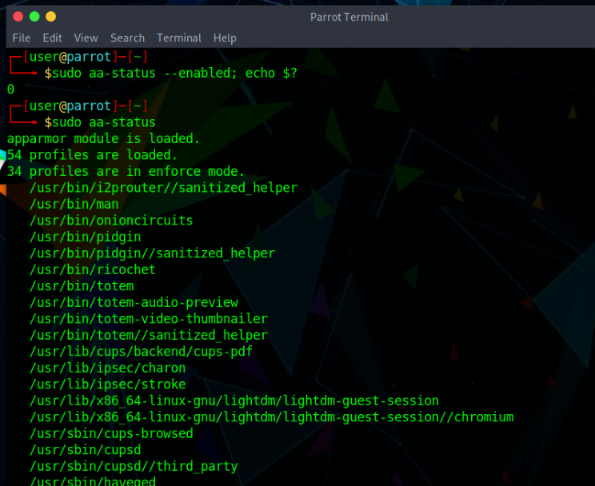

AppArmor is a Linux security module that helps protect the system by restricting what applications can do.

It works by using security profiles that define which files, directories, capabilities, and system resources an application is allowed to access. This helps reduce the impact of compromised or vulnerable applications by limiting their behavior.

AppArmor can be especially useful for desktop systems, servers, and security-focused environments because it provides an additional layer of protection without requiring major changes to how applications are used.

## How AppArmor Works

AppArmor uses profiles to define application permissions.

A profile can be loaded in different modes:

| Mode | Description |
|---|---|
| `enforce` | The profile is active and AppArmor blocks actions that are not allowed by the policy |
| `complain` | The profile does not block actions, but logs what would have been denied |
| `unconfined` | The application is not restricted by an AppArmor profile |

The most common workflow is:

1. Run a profile in `complain` mode.
2. Review the generated logs.
3. Adjust the profile if needed.
4. Switch the profile to `enforce` mode.

This makes it easier to test profiles before actively blocking application behavior.

## Check if AppArmor Is Enabled

AppArmor and its profiles should already be enabled and running on Parrot OS.

To check whether AppArmor is enabled, run:

```bash
sudo aa-status --enabled
echo $?
```

If AppArmor is enabled, the command should return:

```text
0
```

You can also inspect the current AppArmor status with:

```bash
sudo aa-status
```

This command shows loaded profiles and their current status, such as `enforce`, `complain`, or `unconfined`.



Another simple way to check whether AppArmor is enabled is:

```bash
cat /sys/module/apparmor/parameters/enabled
```

If AppArmor is enabled, the output should be:

```text
Y
```

## Install AppArmor

If AppArmor is not installed, you can install it with:

```bash
sudo apt update
sudo apt install apparmor apparmor-utils auditd
```

Package description:

| Package | Description |
|---|---|
| `apparmor` | Main AppArmor package |
| `apparmor-utils` | Utilities for managing AppArmor profiles |
| `auditd` | Audit daemon used for logging and profile analysis |

## Enable AppArmor

To enable AppArmor through the kernel boot parameters, create the GRUB configuration directory if it does not already exist:

```bash
sudo mkdir -p /etc/default/grub.d
```

Create an AppArmor GRUB configuration file:

```bash
echo 'GRUB_CMDLINE_LINUX_DEFAULT="$GRUB_CMDLINE_LINUX_DEFAULT apparmor=1 security=apparmor"' | sudo tee /etc/default/grub.d/apparmor.cfg
```

Update GRUB:

```bash
sudo update-grub
```

Reboot the system:

```bash
sudo reboot
```

After rebooting, check the current AppArmor status:

```bash
sudo aa-status
```

## Install Additional AppArmor Profiles

Additional profiles can be installed with:

```bash
sudo apt install apparmor-profiles apparmor-profiles-extra
```

AppArmor profiles are usually stored in:

```text
/etc/apparmor.d/
```

Profiles provided by packages are normally loaded automatically when the package installs a policy file in `/etc/apparmor.d/`.

You can also manually load or reload profiles with `apparmor_parser`.

Example:

```bash
sudo apparmor_parser -r /etc/apparmor.d/profile-name
```

Replace `profile-name` with the profile you want to reload.

## Manage AppArmor Profiles

### Set a Profile to Complain Mode

Complain mode allows the application to run normally while AppArmor logs actions that would have been denied in enforce mode.

Example:

```bash
sudo aa-complain /etc/apparmor.d/profile-name
```

### Set a Profile to Enforce Mode

Enforce mode actively blocks actions that are not allowed by the profile.

Example:

```bash
sudo aa-enforce /etc/apparmor.d/profile-name
```

### Disable a Profile

To disable an individual profile, use:

```bash
sudo aa-disable /etc/apparmor.d/profile-name
```

Example:

```bash
sudo aa-disable /etc/apparmor.d/usr.bin.pidgin
```

To enable it again in enforce mode:

```bash
sudo aa-enforce /etc/apparmor.d/usr.bin.pidgin
```

## Use Extra Profiles

Some extra AppArmor profiles may be available under:

```text
/usr/share/doc/apparmor-profiles/extras
```

To copy them into the AppArmor profile directory:

```bash
cd /usr/share/doc/apparmor-profiles/extras
sudo cp -i * /etc/apparmor.d/
```

To place all copied extra profiles into complain mode:

```bash
for profile in /etc/apparmor.d/*; do
    sudo aa-complain "$profile"
done
```

To place profiles into enforce mode, use `aa-enforce` instead:

```bash
sudo aa-enforce /etc/apparmor.d/profile-name
```

> Some extra profiles may need adjustments before they work correctly in enforce mode. If an application starts behaving unexpectedly, switch the profile to complain mode, review the logs, and update the profile as needed.

## Check Confined Processes

To list processes currently confined by AppArmor, run:

```bash
ps auxZ | grep -v '^unconfined'
```

You can also use:

```bash
sudo aa-status
```

The `aa-status` command provides a summary of:

- loaded profiles
- profiles in enforce mode
- profiles in complain mode
- confined processes
- unconfined processes with profiles available

## Find Unconfined Network Services

To list processes using TCP or UDP ports that do not have AppArmor profiles loaded, run:

```bash
sudo aa-unconfined
```

For a more detailed check, use:

```bash
sudo aa-unconfined --paranoid
```

This can be useful when identifying services that may benefit from additional AppArmor confinement.

## Debug AppArmor

AppArmor logs can help identify whether a problem is related to profile restrictions.

### Monitor Denied Events

To watch denied events in the system log, use:

```bash
sudo tail -f /var/log/syslog | grep DENIED
```

If `auditd` is installed, denied events may also appear in the audit log:

```bash
sudo tail -f /var/log/audit/audit.log | grep DENIED
```

Denied log entries usually show:

- the affected profile
- the process name
- the requested operation
- the denied path or resource
- the access type that was blocked

Profiles in complain mode may generate `ALLOWED` entries for actions that would normally be denied in enforce mode. These logs can be used to adjust profiles before enabling enforcement.

### Use `aa-notify`

The `aa-notify` command can display desktop notifications when AppArmor denies an action.

Install the notification tool if it is not already installed:

```bash
sudo apt install apparmor-notify
```

To allow your user to read system logs, add it to the `adm` group:

```bash
sudo adduser "$USER" adm
```

Log out and log back in for the group change to take effect.

Then start `aa-notify` with:

```bash
aa-notify -p
```

If you are using `auditd`, start it with:

```bash
sudo aa-notify -p -f /var/log/audit/audit.log
```

On desktop systems, `aa-notify` may also start automatically on login through:

```text
/etc/xdg/autostart/apparmor-notify.desktop
```

## Diagnose Application Issues

If an application is not working as expected, AppArmor may be restricting one of its actions.

A useful troubleshooting workflow is:

1. Check whether AppArmor is enabled:

```bash
cat /sys/module/apparmor/parameters/enabled
```

2. Check loaded profiles:

```bash
sudo aa-status
```

3. Check whether the application is confined:

```bash
ps auxZ | grep application-name
```

4. Review denied events:

```bash
sudo tail -f /var/log/syslog | grep DENIED
```

Or, if using `auditd`:

```bash
sudo tail -f /var/log/audit/audit.log | grep DENIED
```

5. Temporarily switch the profile to complain mode:

```bash
sudo aa-complain /etc/apparmor.d/profile-name
```

6. Test the application again.

7. If the issue disappears, review the logs and adjust the profile before returning it to enforce mode:

```bash
sudo aa-enforce /etc/apparmor.d/profile-name
```

## Disable AppArmor

You can disable individual profiles with:

```bash
sudo aa-disable /etc/apparmor.d/profile-name
```

If you want to disable AppArmor entirely, create or update the AppArmor GRUB configuration file:

```bash
sudo mkdir -p /etc/default/grub.d
```

```bash
echo 'GRUB_CMDLINE_LINUX_DEFAULT="$GRUB_CMDLINE_LINUX_DEFAULT apparmor=0"' | sudo tee /etc/default/grub.d/apparmor.cfg
```

Update GRUB:

```bash
sudo update-grub
```

Reboot the system:

```bash
sudo reboot
```

After rebooting, verify the status:

```bash
cat /sys/module/apparmor/parameters/enabled
```

If AppArmor is disabled, the output should be:

```text
N
```

> Disabling AppArmor entirely reduces the system security posture. Prefer disabling or adjusting individual profiles whenever possible.

## Practical Recommendations

When working with AppArmor, follow these recommendations:

| Recommendation | Reason |
|---|---|
| Use `complain` mode before `enforce` mode | Helps test profiles without breaking applications |
| Review logs before enforcing profiles | Makes it easier to identify missing permissions |
| Avoid disabling AppArmor globally | Keeps the system protected |
| Disable only specific profiles when troubleshooting | Reduces security impact |
| Keep profiles updated | Improves compatibility and security |
| Use `aa-status` regularly | Helps monitor loaded and active profiles |

## Summary

AppArmor provides an additional security layer by restricting what applications can access on the system.

The most useful commands are:

| Command | Purpose |
|---|---|
| `sudo aa-status` | Shows AppArmor status and loaded profiles |
| `sudo aa-complain profile` | Sets a profile to complain mode |
| `sudo aa-enforce profile` | Sets a profile to enforce mode |
| `sudo aa-disable profile` | Disables a profile |
| `sudo aa-unconfined` | Lists processes that may be running without confinement |
| `aa-notify -p` | Shows AppArmor notifications |
| `sudo tail -f /var/log/syslog \| grep DENIED` | Monitors denied events in logs |
| `sudo tail -f /var/log/audit/audit.log \| grep DENIED` | Monitors denied events through auditd |

Using AppArmor correctly helps improve system security while still allowing applications to work as expected.