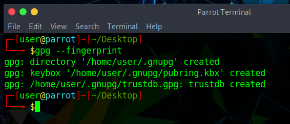
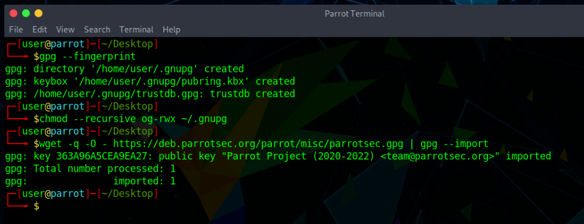
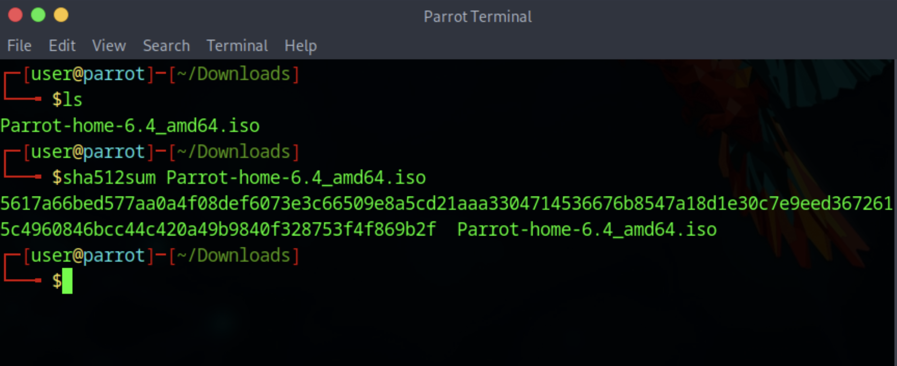
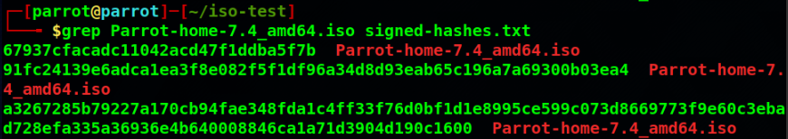
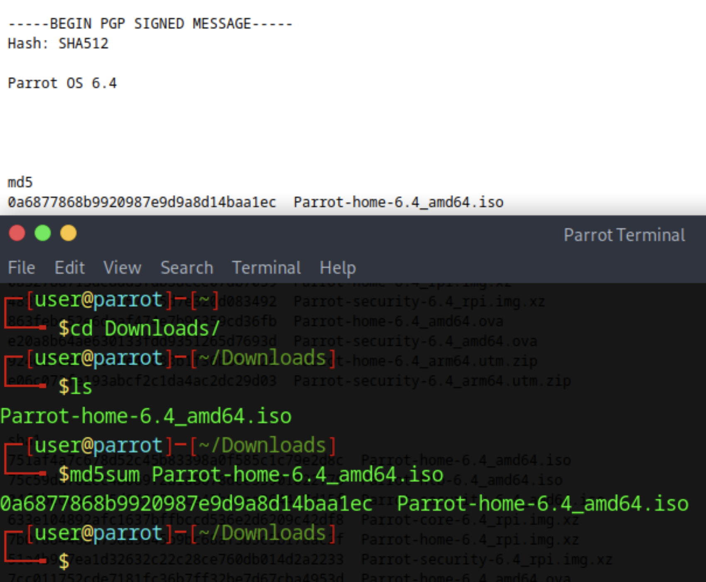

## Why should anyone verify keys and signatures?

Most people — even programmers — are confused about the basic concepts underlying digital signatures. Therefore, most people should read this section, even if it looks trivial at first sight.

Digital signatures can both prove authenticity and integrity to a reasonable degree of certainty. Authenticity ensures that a given file was indeed created by the person who signed it (i.e. that it was not forged by a third party). Integrity ensures that the contents of the file have not been tampered with (i.e., that a third party has not undetectably altered its contents en route).

Digital signatures cannot prove any other property (e.g., that the signed file is not malicious). There is nothing that could stop someone from signing a malicious program (and it happens from time to time in reality).

The point is that we must decide who we will trust (e.g., Linus Torvalds, Microsoft, or the Parrot Project) and assume that if a given file was signed by a trusted party, then it should not be malicious or negligently buggy. The decision of whether to trust any given party is beyond the scope of digital signatures. It’s more of a sociological and political decision.

Once we decide to trust certain parties, digital signatures are useful. They make it possible for us to limit our trust only to those few parties we choose and not to worry about all the bad things that can happen between us and them, e.g., server compromises ([parrotsec.org](https://parrotsec.org) will surely be compromised one day, so don’t blindly trust the live version of this site), dishonest IT staff at the hosting company, dishonest staff at the ISPs, Wi-Fi attacks, etc...

By verifying all the files we download that purport to be authored by a party we’ve chosen to trust, we eliminate concerns about the bad things discussed above, since we can easily detect whether any files have been tampered with (and subsequently choose to refrain from executing, installing, or opening them).

However, for digital signatures to make any sense, we must ensure that the public keys we use for signature verification are indeed the original ones. Anybody can generate a GPG key pair that purports to belong to the “Parrot OS” but of course only the key pair that we (i.e. the Parrot Team) generated is the *legitimate one*. The next section explains how to verify the validity of the ParrotOS signing keys in the process of verifying a Parrot OS ISO. However, the same general principles apply to all cases in which you may wish to verify a PGP signature, such as verifying repositories, not just ISOs.

## Import the Parrot signing key

Complete the steps below if you are unfamiliar with GnuPG or if they haven't already been performed. They also fix eventual *GPG: WARNING: unsafe ownership* warnings.

### 1. Make sure GnuPG has initialized your user data folder



### 2. Set warning free permissions

```bash
chmod --recursive og-rwx ~/.gnupg
```

### 3. Get the ParrotOS key

```bash
wget -q -O - https://deb.parrot.sh/parrot/misc/parrotsec.gpg | gpg --import
```



:::caution
Checking the GPG signature timestamp makes sense. For example, if you previously saw a signature from 2018 and now see a signature from 2017, then this might be a targeted rollback (downgrade) or indefinite freeze attack.
:::

## ISO Verification

Verification is a two-step process, and both steps are needed. A checksum on its own only proves that the file you downloaded matches the list you read; it proves nothing if an attacker controls the server serving both. Verifying the signature on the hash list first is what makes the comparison meaningful.

### 1. Download and verify the signed hash list

Each release directory contains a `signed-hashes.txt` file: a clearsigned PGP message listing the `md5`, `sha256` and `sha512` checksums of every published image. Download the one matching your release from the [ParrotOS ISO archive](https://download.parrot.sh/parrot/iso/):

```bash
wget https://download.parrot.sh/parrot/iso/7.1/signed-hashes.txt
```

Verify that it was really signed by the Parrot team:

```bash
gpg --verify signed-hashes.txt
```

The output must contain a **Good signature** line naming the Parrot key you imported above:

```text
gpg: Signature made Wed Feb 11 01:15:48 2026 CET
gpg:                using RSA key B711822346552E4D92DA02DF7A8286AF0E81EE4A
gpg: Good signature from "Parrot Project (2024-2026) <team@parrotsec.org>" [unknown]
```

:::danger
If GPG reports **BAD signature**, the file has been altered. Stop here and do not trust any checksum it contains.
:::

A `WARNING: This key is not certified with a trusted signature` notice is expected: it only means you have not personally assigned trust to the key, not that the signature is invalid.

### 2. Compare the checksum of your image

Now compute the checksum of the file you downloaded. Prefer SHA512 or SHA256:

```bash
sha512sum Parrot-home-7.1_amd64.iso
```



Then find the matching entry in the `sha512` section of the verified `signed-hashes.txt`:

```bash
grep Parrot-home-7.1_amd64.iso signed-hashes.txt
```



Compare the alphanumeric string produced by your machine with the one on the corresponding line. They must match exactly.



If the two hashes match, the downloaded file is intact and authentic. If they do not, the download was either corrupted or served by a faulty mirror: download the file again, from a different mirror if you suspect a server error.

If you repeatedly receive an erroneous file from a server, please notify the Parrot team about that mirror so we can investigate.

:::note[Why not MD5?]
`signed-hashes.txt` still lists MD5 checksums for backwards compatibility, and `md5sum` works the same way as the command above. MD5 is broken against deliberate collisions, though, so it can only tell you that a download was not accidentally corrupted. Use SHA256 or SHA512 whenever you care about tampering.
:::
