Initially, Parrot uses the Nvidia **nouveau open source drivers**, since they support most Nvidia cards. These guarantee good stability and allow you to use your GPU without problems for everyday use. 

However, it may be necessary to use other drivers that give greater compatibility with different software and make the most of your GPU. For this reason, you can install **Nvidia's official (closed source) drivers**.

You have two ways to install, either via [the Parrot repository](#install-the-driver-via-the-parrot-repositories) or [from the official Nvidia website](#install-the-driver-from-the-official-nvidia-website).


:::note[Note]
  Please note the driver installation and configuration may be different for laptop or desktop computers. For example, the user could have a CPU with an iGPU (integrated GPU) and a dGPU (dedicated GPU). Users with hybrid setups (iGPU + dGPU) must configure their system to correctly offload rendering to the dedicated GPU.

  [The differences will be highlighted in this document](#nvidia-driver-on-a-computer-with-igpu-and-dgpu).

  Every step described here has been tested, so it is highly recommended that you read everything in this document very carefully.
:::

## Install the driver via the Parrot repositories

If you don't know your GPU model, open the terminal and type this command:

```bash
lspci | grep VGA
```

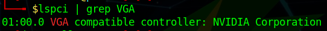

It will show your GPU model and its architecture. For further information use:

```bash
inxi -F
```

This will show your computer information, including the GPU model and also the type of driver used.

Once you have ascertained that you are using the nouveau driver and you want to use the proprietary driver instead, for reasons of driver conflict, you must first disable the nouveau driver. This command will automatically create the configuration file with the necessary rules:

```bash
echo -e "blacklist nouveau\noptions nouveau modeset=0\nalias nouveau off" | sudo tee /etc/modprobe.d/blacklist-nouveau.conf
```

Once the file has been saved, proceed with the installation of the Nvidia driver using the following command:

```bash
sudo apt update && sudo apt install nvidia-driver
```

This completes the installation, but we recommend that you check that everything went well. To do this, you can use the official utility from Nvidia called [nvidia-smi](https://developer.nvidia.com/nvidia-system-management-interface).

Install it by running:

```bash
sudo apt install nvidia-smi
```

Start it with the following command:

```bash
nvidia-smi
```

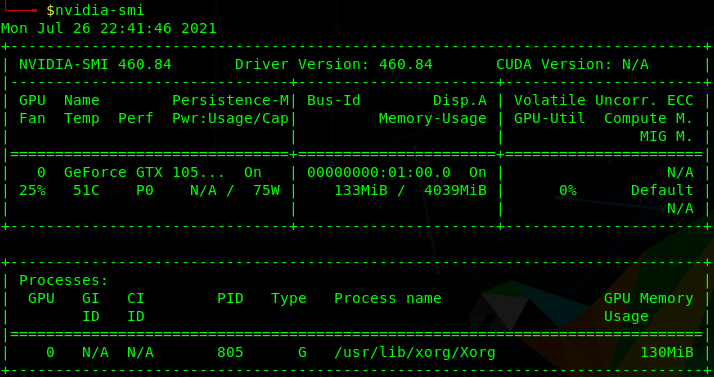

In addition, the settings manager will be automatically installed together with the drivers. From here you can change parameters such as the resolution and refresh rate of your monitor.

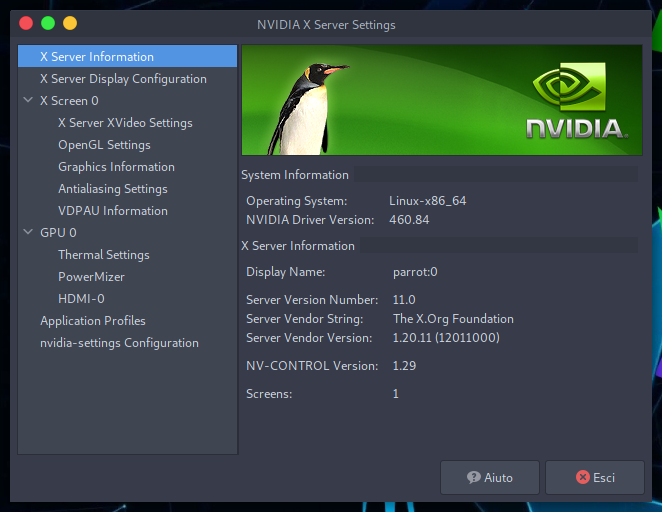

### Nvidia Driver on a computer with iGPU and dGPU 

Most modern computers come with an integrated video card in the CPU (iGPU, like an Intel Graphic Card or AMD in most cases) and a dedicated video card (dGPU, Nvidia).

In this guide we'll deal with the drivers for both video cards and show how to switch between them.

#### Step 1 - Install Nvidia Drivers and CUDA Toolkit

Open a terminal window and type:

```bash
sudo apt update 
```

```bash
sudo apt install bumblebee-nvidia primus-nvidia primus-vk-nvidia nvidia-smi nvidia-cuda-dev nvidia-cuda-toolkit
```

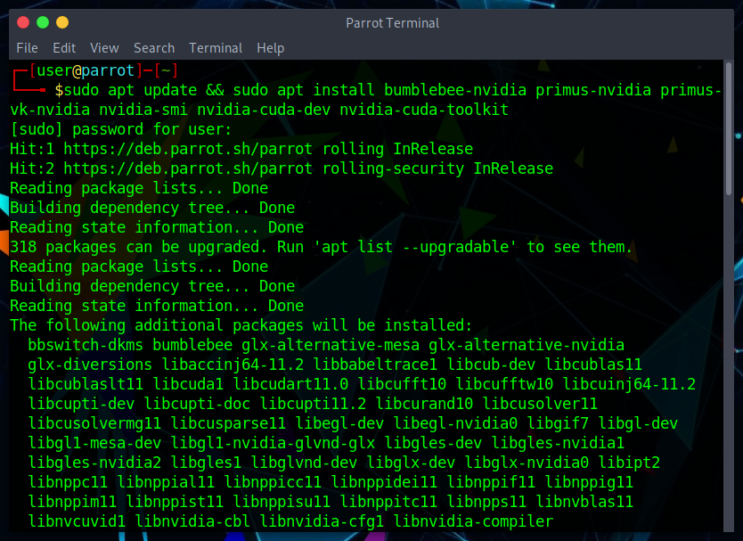

Wait for the installation to proceed. When a warning notifying **nouveau** driver conflicting with **Nvidia** driver appears, click **ok**:

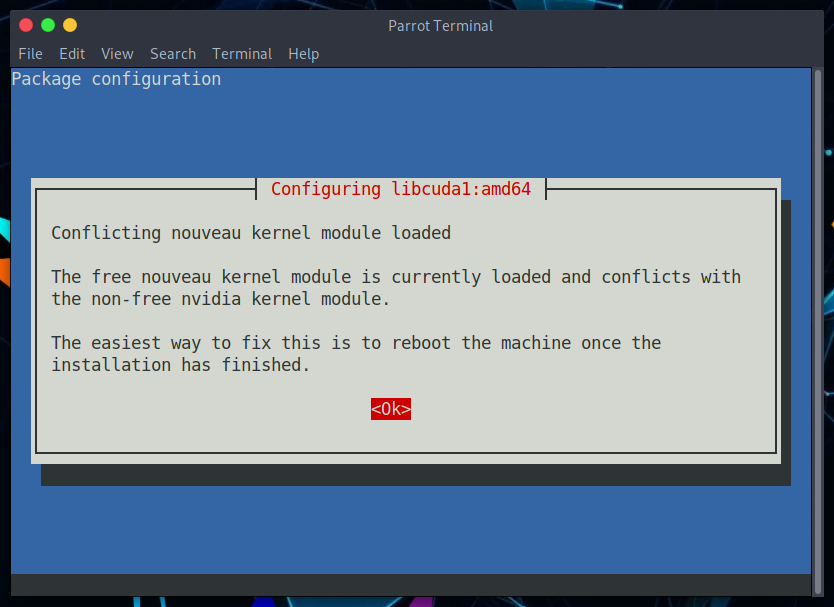

#### Step 2 - Blacklist Nouveau

:::note[Note]
  If you have already followed [the Nvidia installation via the Parrot repo](#install-the-driver-via-the-parrot-repositories) you can go to [step 3](#step-3---configure-bumblebee).
:::

After the installation has finished, it's time to blacklist the **nouveau** driver in order to make the Nvidia driver work.

In the terminal, run the following command to create the file and add the rules automatically:

```bash
echo -e "blacklist nouveau\noptions nouveau modeset=0\nalias nouveau off" | sudo tee /etc/modprobe.d/blacklist-nouveau.conf
```

Save your work and reboot.
 
#### Step 3 - Configure Bumblebee

Now it's time to tell **bumblebee** which driver should be used.

In the terminal open **bumblebee.conf**:

```bash
sudo nano /etc/bumblebee/bumblebee.conf
```

Look for the string **Driver=** and add **nvidia**, then look for the string **KernelDriver=** and add **nvidia-current**.

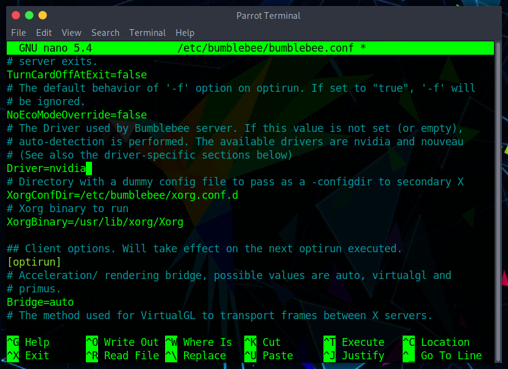

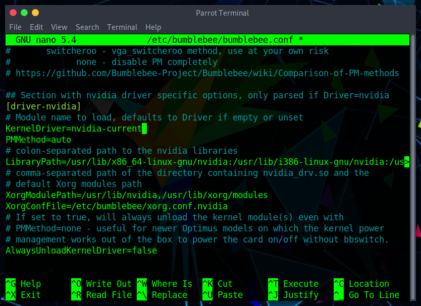

Save the file and reboot.

#### Step 4 - Testing the Drivers

Open a terminal and type:

```bash
watch nvidia-smi
```

In a new terminal enter the following command:

```bash
optirun hashcat -b -d 1
```

The result should be similar to this:

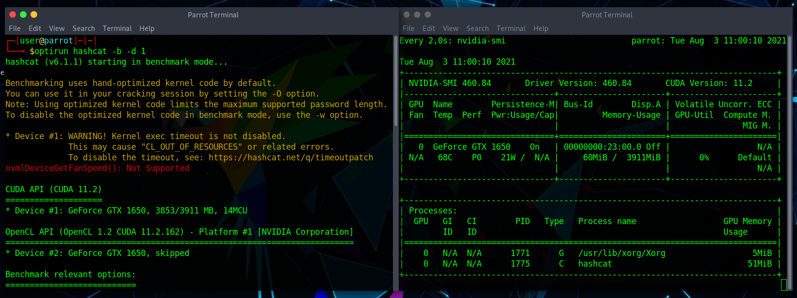

In `nvidia-smi` interface, `hashcat` should appear running using your Nvidia video card.

:::note[Note]
  Launching application with **primusrun** will use PRIMUS Technology, while using **optirun** will use VirtualGL.
:::

## Install the driver from the official Nvidia website

As mentioned at the beginning of this document, drivers can also be installed from the official Nvidia website.

You can download the latest driver directly from [here](https://www.nvidia.com/en-us/drivers/unix/), where there are also older drivers for old GPUs.

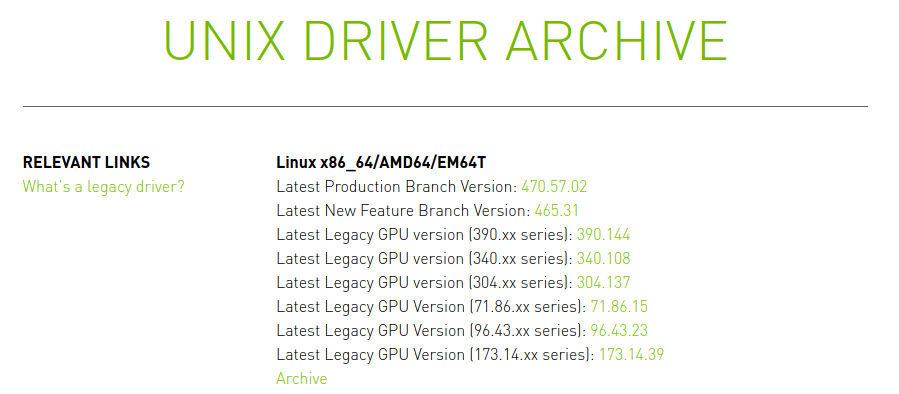

**OR**

Select the model of your GPU, the operating system (Linux 64 bit) and the branch [here](https://www.nvidia.com/Download/index.aspx?lang=en-us).

From the Nvidia website: 

"*Production Branch*: Production Branch drivers provide ISV certification and optimal stability and performance for Unix customers. This driver is most commonly deployed at enterprises, providing support for the sustained bug fix and security updates commonly required.

*New Feature Branch*: New Feature Branch drivers provide early adopters and bleeding edge developers access to the latest driver features before they are integrated into the Production Branches."

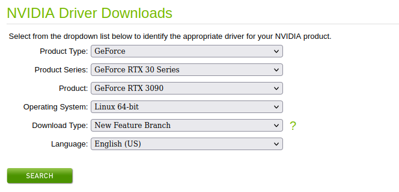

Click on **download**, and a file with this name will be downloaded:

`NVIDIA-Linux-x86_64-<driver version>.run` (about 260 MB)

To avoid conflicts with the X graphics server, we will have to use Parrot without a graphical interface (we will have to drop to [Runlevel 3](https://en.wikipedia.org/wiki/Runlevel)). 

We can do this simply via systemd, with the systemctl command:

```bash
sudo systemctl set-default multi-user.target
```

:::note[Note]
If by any chance you want to go back and reuse Parrot with KDE Plasma, use the following commands:

```bash  
sudo systemctl set-default graphical.target 
```

```bash
reboot
```
:::

To avoid conflicts with the installation of the new driver, remember to blacklist the nouveau driver by running:

```bash
echo -e "blacklist nouveau\noptions nouveau modeset=0\nalias nouveau off" | sudo tee /etc/modprobe.d/blacklist-nouveau.conf
```

Run the following command to regenerate the initramfs image.

```bash
sudo update-initramfs -u
```

The last step is to disable nouveau drivers by rebooting the machine:

```bash
reboot
```

Now navigate to the folder where you downloaded the **.run** file and give it execute permissions:

```bash
sudo chmod +x NVIDIA-Linux-x86_64-<driver version>.run
```


:::note[Note]
If you don't remember what chmod does, it is recommended that you read the [File and Directory permissions](./file-and-directory-permissions) document.
:::

After that you can start the **.run** file:

```bash
sudo ./NVIDIA-Linux-x86_64-<driver version>.run
```

The installation wizard process will start and the drivers will be installed along with all utilities (including Nvidia Driver X Settings).

Return to KDE Plasma via the commands:

```bash
sudo systemctl isolate graphical.target
sudo systemctl set-default graphical.target
```

You will go from Runlevel 3 back to your graphical interface, and finally you will be able to use the Nvidia driver. 

To verify that everything went well, start nvidia-smi (already installed through *.run* file):

```bash
nvidia-smi
```

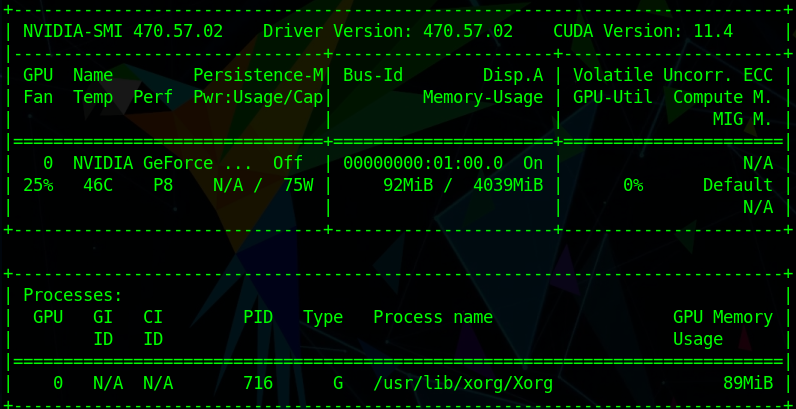

Notice that in this case, the Nvidia driver was successfully installed (version shown in the image as an example).