Thanks to [**CUPS**](https://openprinting.github.io/cups/doc/overview.html), we can print any document we want.

:::note[Note]
  These instructions apply to any printer; this guide uses an HP printer as an example.
  For this reason, it may be necessary to install [HPLIP](https://developers.hp.com/hp-linux-imaging-and-printing/tech_docs/overview) (which provides also the necessary drivers for the printer) with this command:
  ```
  sudo apt install hplip -y
  ```
:::

## Install CUPS

It should already be installed on ParrotOS, but if not, open a terminal window and run:

```
sudo apt update && sudo apt install cups
```

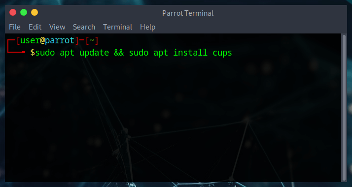

After installation, it may be necessary to add your user to the lpadmin group in order to perform administrative tasks via the web interface. For this reason, it is necessary to authenticate to the lpadmin group. Otherwise CUPS will not authenticate a user without a password:

```
sudo adduser user lpadmin
```

:::note[Note]
  Change the *user* user name in the command to match your system's user name.
:::

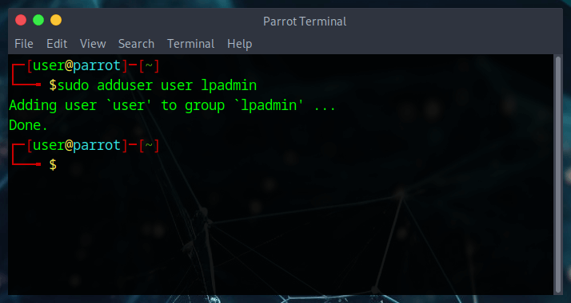

Learn more about what lpadmin is [here](https://www.cups.org/doc/admin.html)

Start CUPS service:

```
sudo service cups start
```

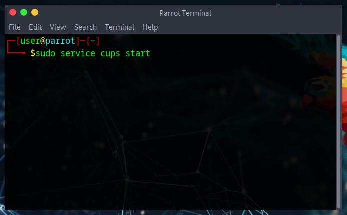

## Open CUPS Web Interface

Now that the CUPS services are up and running, it is time for access to its interface.

CUPS is accessible from your favorite browser at **http://localhost:631/admin**

This is what you will see:

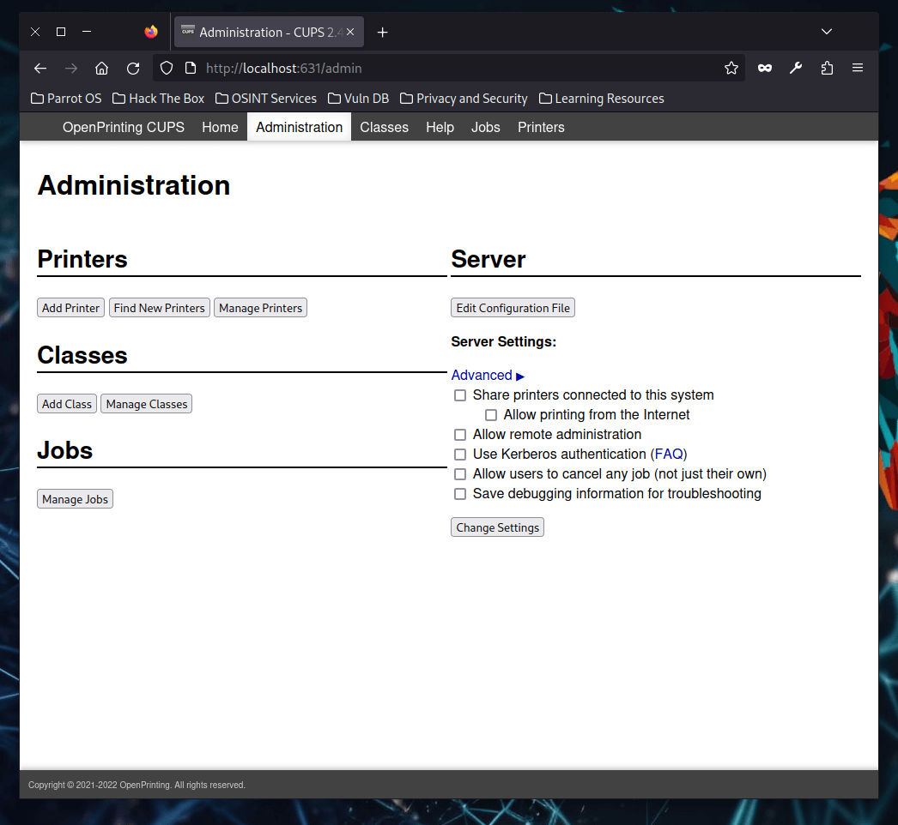

## Adding new printer

From the CUPS web interface, click *Add Printer*. You will be prompted for your username and password.

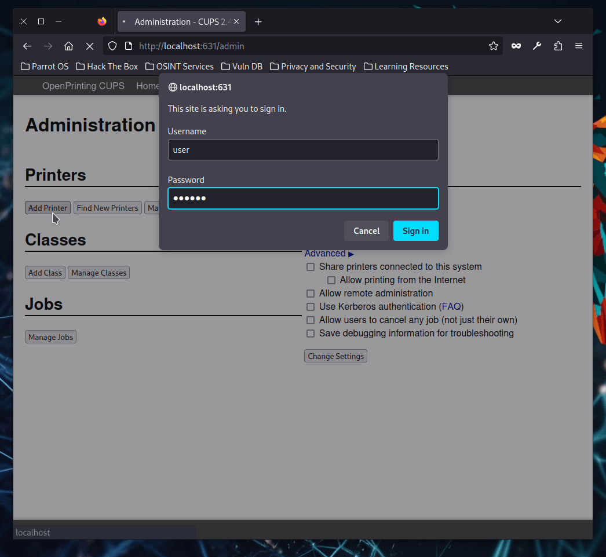

The service searches for all network and local printers. 

The new printer should appear under **Discovered Network Printers**. 
Select it and click on **Continue**.

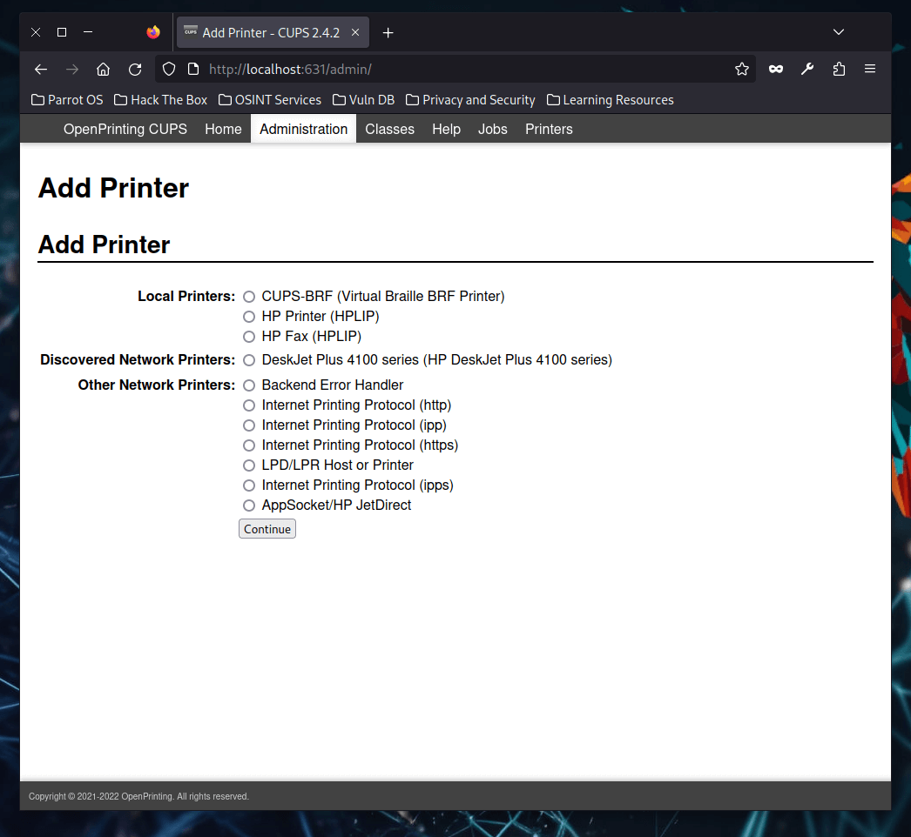

The next page allows you to customize printer details such as Name and Description.

Select the **Share This Printer** check box so that other clients can use the printer, and then click *Continue*.

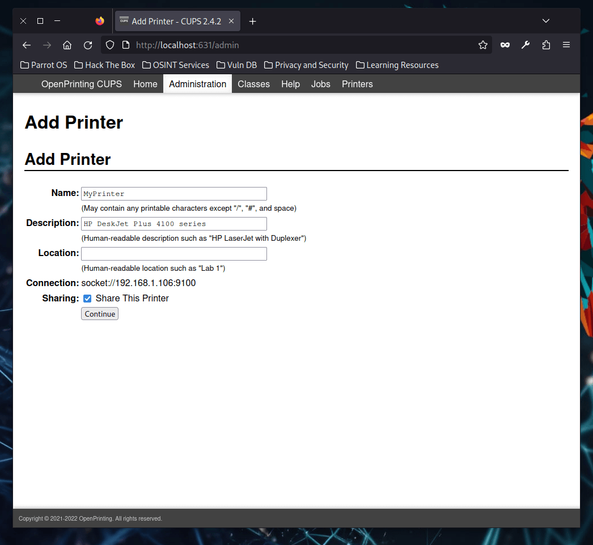

The next page allows you to make the final settings for the printer.

Select printer Manufacturer and Model from the ***Make*** and ***Model*** sections or, if necessary, it is possible to provide printer drivers from *PPD* file. 

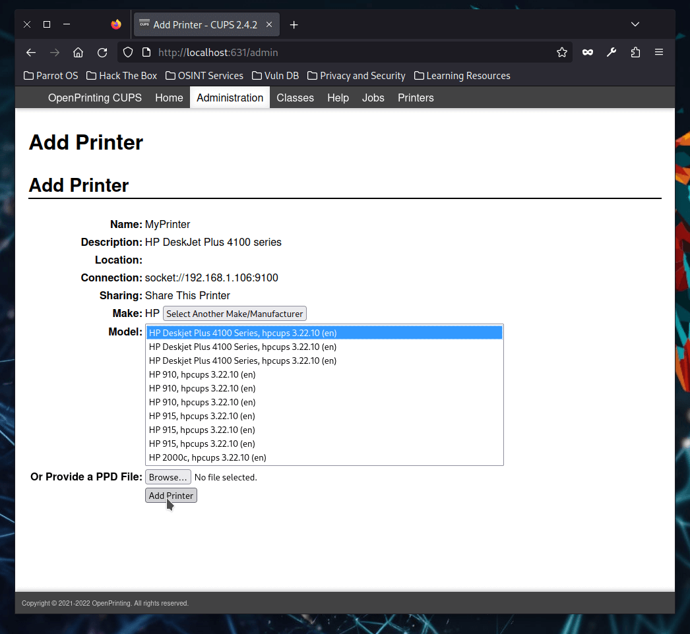

Then click on **Add Printer**.

If everything has been done correctly, you will see this page: 

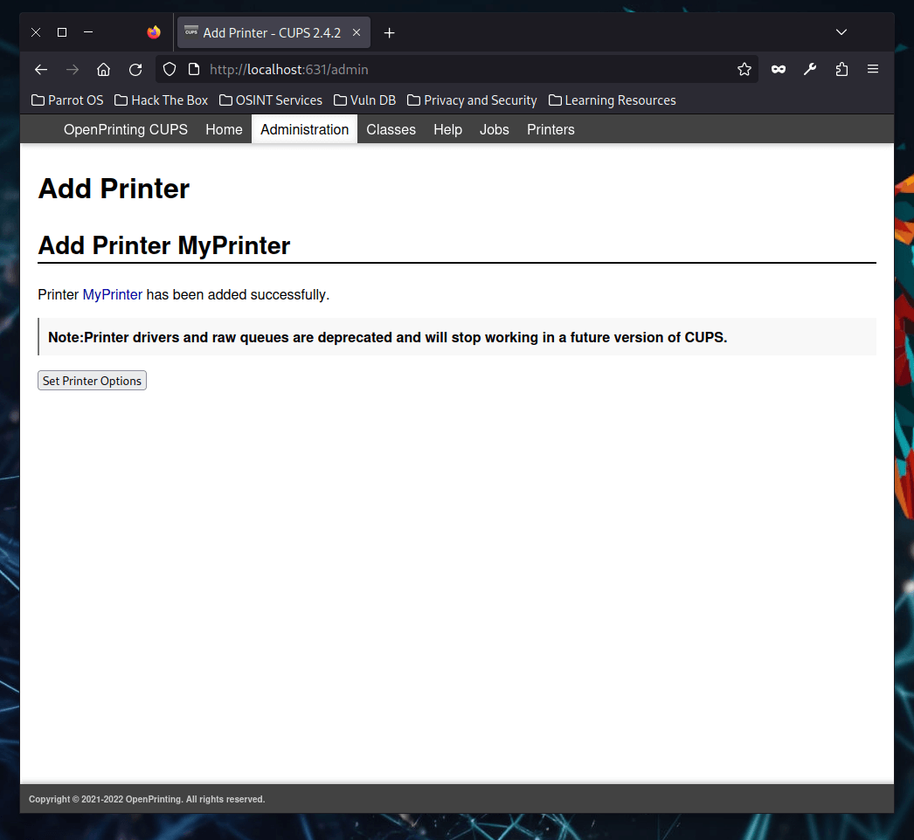

## Verify printer installation

Let's check if the printer is set up correctly. From the CUPS web interface, click the **Printers** tab at the top right of the page. The printer should appear.

Click on the selected name.

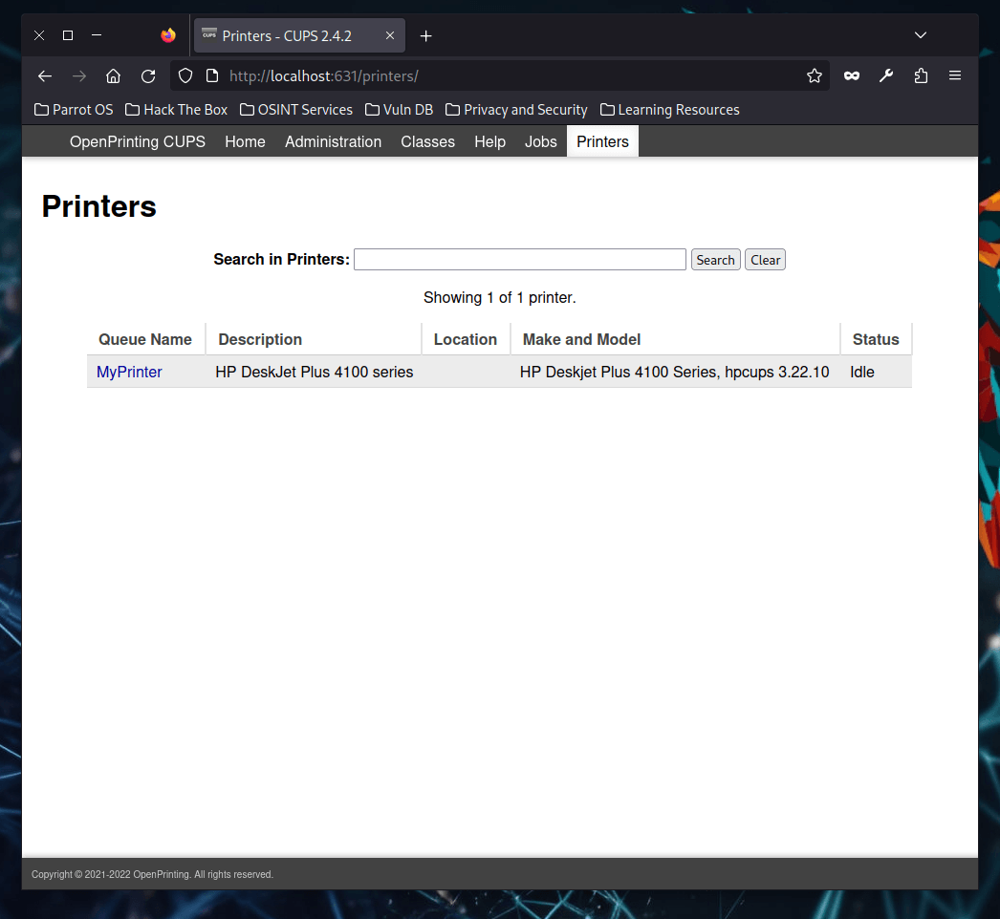

From this page, you can perform many operations (such as printing a test page) and manage the print queue.

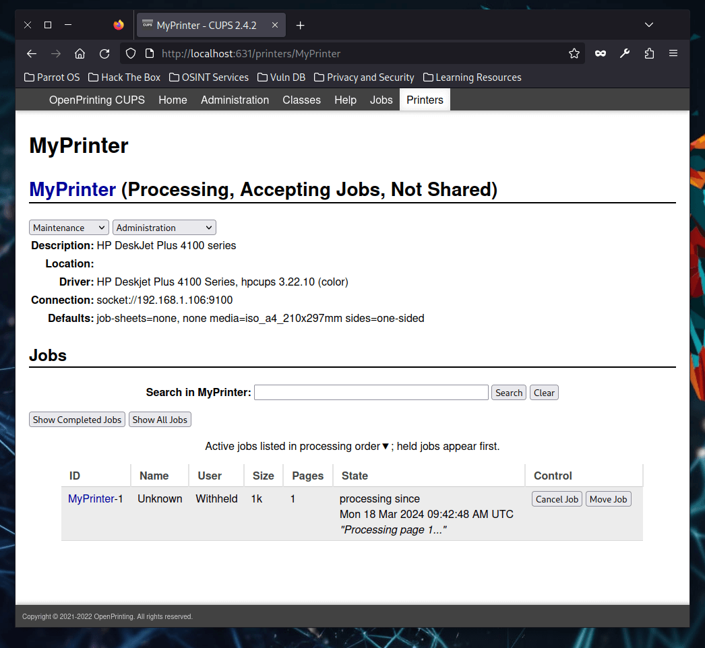

That's all you need to set up a printer under ParrotOS.
