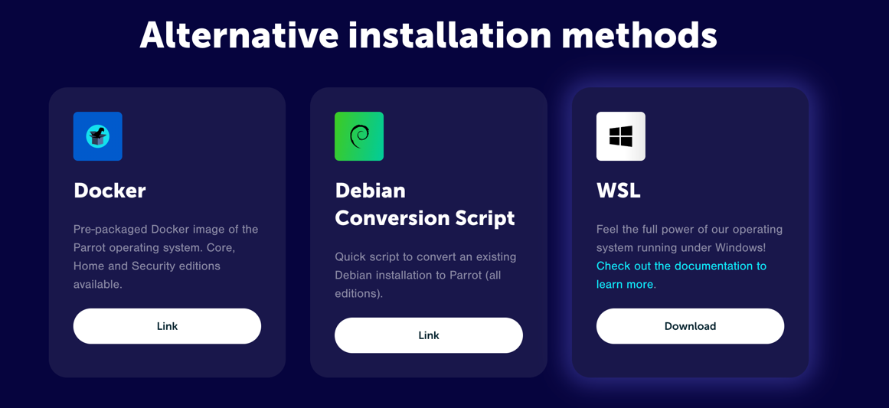
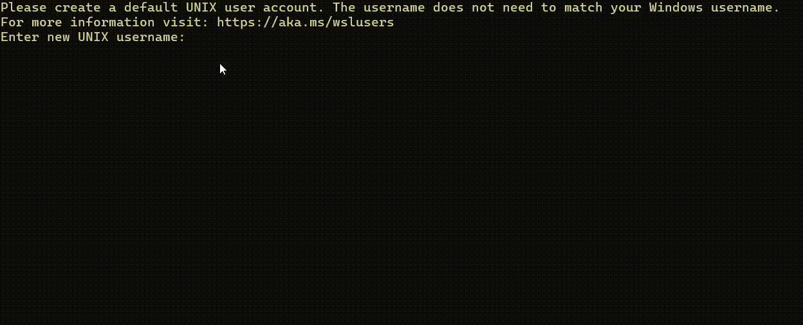

Install ParrotOS on WSL (Windows Subsystem for Linux).

Compatible with the latest versions of **Windows 10** and **Windows 11**.

Currently, only the Core Edition is available.
A complete Security Edition will probably be released in the future.

However, any tool from the Security Edition can be installed using `apt`.

## Installing WSL

If you already have WSL installed on your machine, *you can skip this section*.

Open up PowerShell or Windows Terminal as administrator (Right-click -> Run as Administrator), and type:

```powershell
wsl --install
```

If you see the help text, that means you have WSL already installed; otherwise, wait for the installation to finish.

## Running ParrotOS on WSL

### Manual Install

Download the `.wsl` archive containing the needed files from [the ParrotOS website](https://www.parrotsec.org/download/).



Double-click the `parrot-core_7.wsl` file and an installation window will pop up.

Now, enter your username and password for your user account.



Your WSL "Hard Drive" will be created as a `.vhdx` file in the folder where you launched the installer.

All updates can be performed via a standard `apt upgrade` / `apt update`. However, if you wish to rerun the installer, you must run `wsl --unregister parrot`, and rerun the `.wsl` file.

Congrats, you now have a working ParrotOS WSL instance!

### Microsoft Store

Coming soon...

## Troubleshooting

Packages requiring systemd (e.g., PowerShell Empire) are not working on default installs.

This can be fixed, however, by editing `/etc/wsl.conf` and adding:

```ini
[boot]
systemd=true
```

Finally, restart your WSL instance.

## Unknown Issues

Please open an issue in [The WSL GitLab Project](https://gitlab.com/parrotsec/build/wsl) for any bugs you encounter.