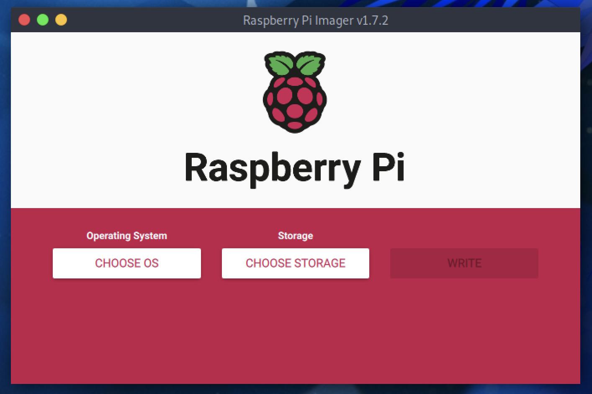
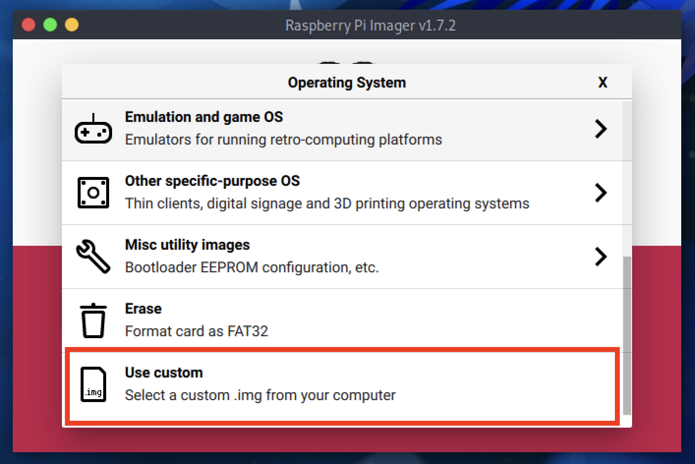

ParrotOS is available for Raspberry Pi in all main editions: [Core, Home, and Security](https://parrotsec.org/download/?version=raspberry).

## Prerequisites

To proceed with the installation, you will need:
* A **microSD card** with at least **8 GB** of storage (the Core edition can run on 4 GB, but 8 GB is recommended).
* A computer with a microSD card reader.
* **Raspberry Pi Imager** or **Balena Etcher** installed on your computer.

:::note[Note]
  This procedure applies to any edition of ParrotOS on Raspberry Pi. Currently, ParrotOS has been successfully tested on Raspberry Pi models **3B, 4B, 400, and 5**.
:::

## Installation Process

1.  **Download the Image:**
    Go to the [official download page](https://parrotsec.org) and download the ParrotOS edition of your choice.
    * *Note: The file will be in a compressed format (e.g., `.img.xz`). You do **not** need to extract it manually; the imaging tool will handle this.*

2.  **Prepare the Tool:**
    Insert the microSD card into your computer and open **Raspberry Pi Imager**.

    

3.  **Select OS:**
    Click on **CHOOSE OS**, scroll down to the bottom, and select **Use custom**.

    

4.  **Select the Image:**
    Locate and select the ParrotOS image file (`.img.xz`) you downloaded in Step 1.

5.  **Select Storage:**
    Click on **CHOOSE STORAGE** and select your microSD card.
    * *Warning: Make sure to select the correct drive, as all data on the card will be erased.*

6.  **Write:**
    Click on **WRITE**. The verification and writing process will begin.

Once finished, insert the microSD card into your Raspberry Pi and power it on. You are ready to go!

For any questions or troubleshooting, please contact the community through [our social channels](https://parrotsec.org/community/).