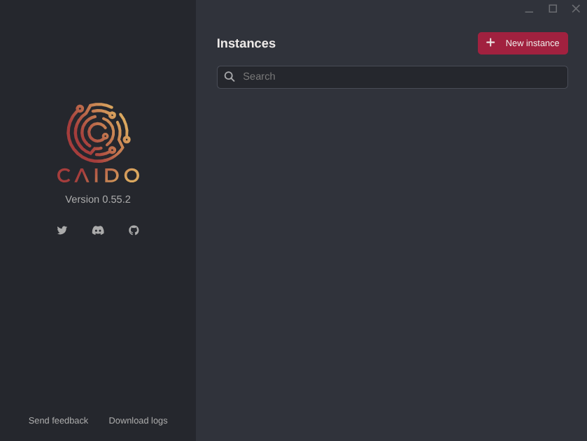
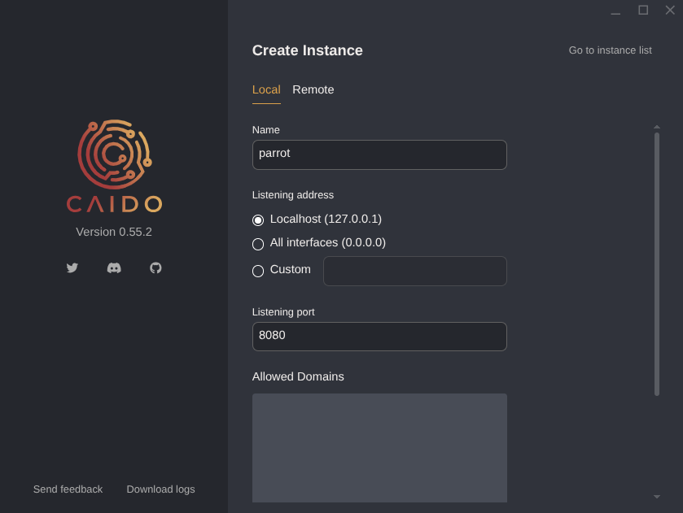
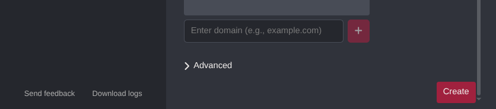
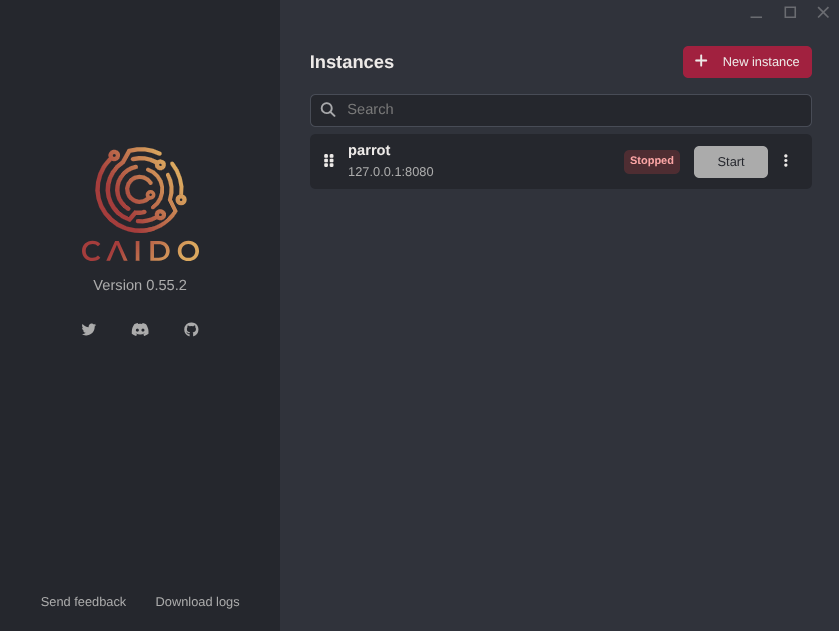
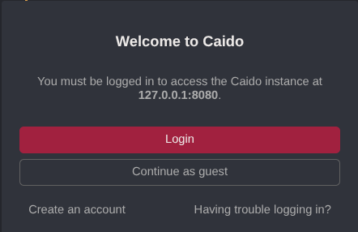

Caido is a modern web security auditing toolkit that sits as an interception 
proxy between your browser and target web applications. The backend is written 
in Rust and the frontend in Vue.js, so it's fast and light. You can use it 
through a browser-based GUI or the CLI.

It is installed by default in Parrot Security. If not, you can install it with:

```bash
sudo apt install caido
```

## Launching Caido

### GUI

Start Caido from the Parrot menu under 
**Applications > Pentesting > Web Application Analysis > Web Application Proxies > Caido**, 
or run it from the terminal:

```bash
caido
```

The Caido launcher will open, showing the Instances screen.



Click **+ New instance**. Give it a name, set the listening address and port 
(the defaults — `127.0.0.1` and `8080` — are fine for local use), then click 
**Create**.





Your instance will appear in the list. Click **Start** to launch it.



Once it's running, open your browser and go to `http://127.0.0.1:8080`. 
You can sign in with a Caido account or use **Guest Mode** to skip that.



### CLI / Headless

If you're working on a remote server or just prefer the terminal, you can run 
Caido headlessly:

```bash
caido --listen 0.0.0.0:8080
```

The web interface will then be reachable from any machine that can hit that address.

## Browser Proxy Configuration

For Caido to intercept traffic, your browser needs to send requests through it 
(default: `127.0.0.1:8080`).

The easiest way to manage this is with the **FoxyProxy** browser extension — 
it lets you switch the proxy on and off with one click:

1. Install [FoxyProxy Standard](https://getfoxyproxy.org/) for your browser.
2. Add a new proxy entry: **Host** `127.0.0.1`, **Port** `8080`, **Type** HTTP.
3. Turn it on when you want Caido to intercept, turn it off for normal browsing.

### CA Certificate Installation

To see HTTPS traffic in plain text, you need to install Caido's CA certificate 
in your browser:

1. With the proxy enabled, navigate to `http://caido.localhost/` in your browser.
2. Download the CA certificate from the settings page.
3. Import it into your browser's certificate store under 
**Trusted Certificate Authorities**.

## Key Features

| Feature               | Description                                                                      |
|-----------------------|----------------------------------------------------------------------------------|
| **Proxy / Intercept** | Intercept, inspect, and forward HTTP/S and WebSocket traffic in real time        |
| **HTTP History**      | Full log of all proxied requests and responses, searchable with HTTPQL           |
| **Replay**            | Resend and modify requests to test how the application responds                  |
| **Automate**          | Automated payload injection across request parameters (similar to Burp Intruder) |
| **Match & Replace**   | Rules to automatically transform requests or responses on the fly                |
| **Sitemap**           | Visual map of all discovered endpoints and application structure                 |
| **Scope**             | Define target domains and paths to cut out noise                                 |
| **Workflows**         | Node-based automation for encoding, decoding, and data transformation            |
| **Plugins**           | Extend Caido with community or custom JavaScript plugins                         |
| **HTTPQL**            | Query language built for filtering requests and responses                        |
| **Projects**          | Separate workspaces per target to keep things organised                          |

## How It Works

Caido sits in the middle of every request your browser makes. When you point 
your browser's proxy settings at Caido, all HTTP and HTTPS traffic flows through 
it before reaching the server and all responses come back through it too.

That means Caido can:

- **Read** every request and response in plain text (including TLS traffic, 
once the CA cert is installed).
- **Modify** headers, bodies, parameters, and methods before forwarding.
- **Drop** or **replay** requests independently of the browser.
- **Automate** repeated requests with varying payloads to probe for vulnerabilities.

Because the backend is Rust, it stays lean on memory. The frontend runs entirely in the browser via Vue.js, so 
there are no native GUI dependencies to worry about.

## Further Reading

Caido has thorough upstream documentation covering everything in more depth:

- **Official docs**: [docs.caido.io](https://docs.caido.io)
- **Source code**: [github.com/caido](https://github.com/caido)
- **Community Discord**: [caido.io/discord](https://caido.io/discord)
