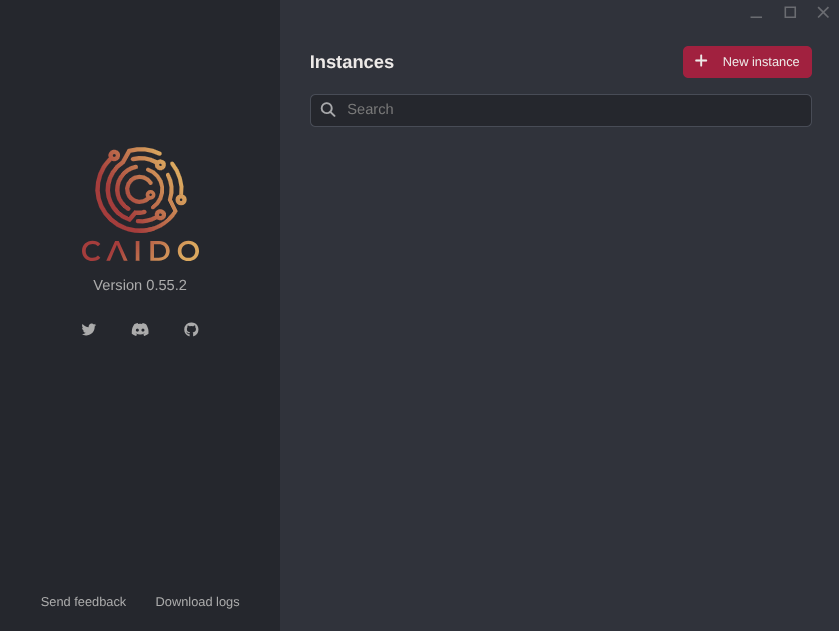
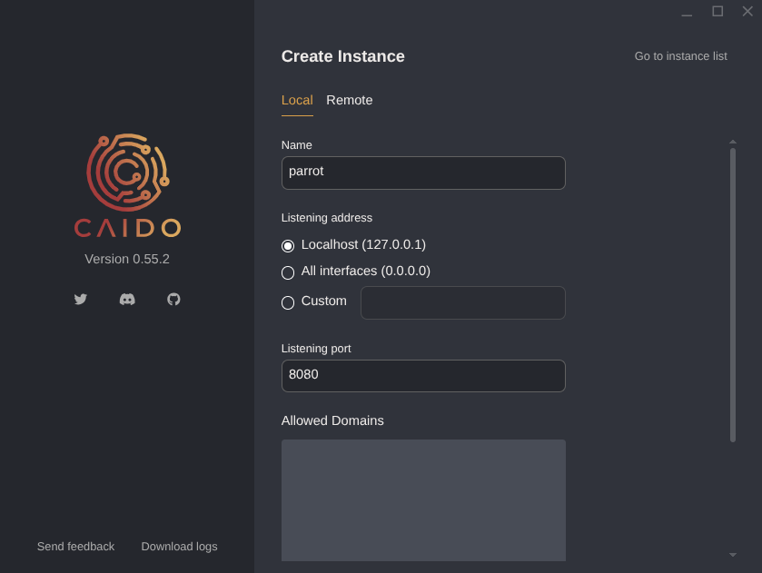
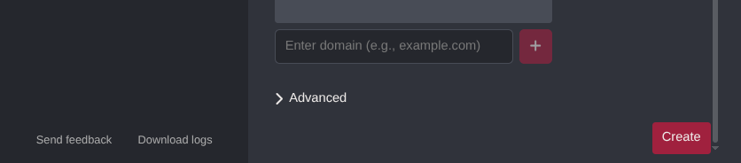
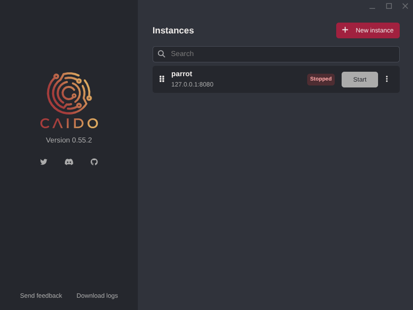
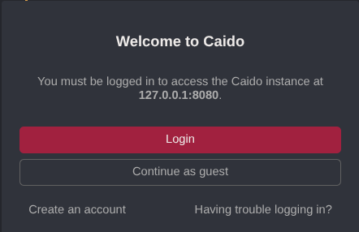

import { Image } from 'astro:assets';
import caidoLogo from './images/caido/caido-logo.png';

<div className="tool-intro">
  <Image src={caidoLogo} alt="Caido logo" width={160} height={160} />
  <div>
    <p>
      <a href="https://caido.io/">Caido</a> is a web application security testing proxy. Configure a browser or client to send traffic to it, then inspect and replay HTTP and WebSocket requests from its browser-based interface.
    </p>
    <p>
      Use Caido only with applications you own or are authorized to test. HTTPS contents are readable only after you install Caido's CA certificate in the client you are testing.
    </p>
  </div>
</div>

## Install and launch

Caido is included with Parrot Security. If it is not installed, add the package:

```bash
sudo apt install caido
```

Open Caido from **Applications > Pentesting > Web Application Analysis > Web Application Proxies > Caido**, or start it from a terminal:

```bash
caido
```

The launcher opens on the **Instances** screen. Select **+ New instance**, give the instance a name, and choose its listening address and port. For local use, the defaults (`127.0.0.1` and `8080`) are a good choice.



Review the settings and select **Create**:





Your new instance appears in the list. Select **Start**, then open `http://127.0.0.1:8080` in your browser. Sign in with a Caido account or choose **Guest Mode**.





## Headless mode

On a remote server, you can start Caido from the terminal and keep its listener on the local interface:

```bash
caido --listen 127.0.0.1:8080
```

To reach the instance from another machine, forward the port over SSH rather than exposing the interface to an untrusted network:

```bash
ssh -L 8080:127.0.0.1:8080 user@server
```

## Configure a browser

Caido only receives traffic from clients configured to use its proxy. In the browser you want to test, set an HTTP proxy to `127.0.0.1` on port `8080`. FoxyProxy Standard is one way to switch the proxy on only when needed:

1. Install [FoxyProxy Standard](https://getfoxyproxy.org/) in the browser.
2. Add a proxy entry with **Host** `127.0.0.1`, **Port** `8080`, and **Type** HTTP.
3. Enable it for the authorized test session and turn it off when finished.

### Inspect HTTPS traffic

To inspect HTTPS contents, install Caido's CA certificate in the browser profile used for testing:

1. Enable the proxy and visit `http://caido.localhost/`.
2. Download the certificate from Caido's settings.
3. Import it into the browser's trusted certificate authorities.

Trust this certificate only in a browser profile used for authorized testing, and remove it when you no longer need it.

## What Caido can do

| Feature               | Description                                                                      |
|-----------------------|----------------------------------------------------------------------------------|
| **Proxy / Intercept** | Intercept, inspect, and forward HTTP/S and WebSocket traffic in real time        |
| **HTTP History**      | Review proxied requests and responses, and search them with HTTPQL              |
| **Replay**            | Resend and edit requests within the authorized test scope                        |
| **Automate**          | Run repeatable tests against in-scope request parameters                          |
| **Match & Replace**   | Apply rules to change requests or responses                                      |
| **Sitemap and Scope** | Organize discovered endpoints and focus work on selected domains and paths       |
| **Workflows**         | Chain steps for encoding, decoding, and data transformation                      |
| **Plugins**           | Extend Caido with community or custom JavaScript plugins                         |
| **Projects**          | Keep work for separate applications in distinct workspaces                       |

## How traffic flows

Only traffic sent to Caido's configured proxy listener appears in its history; it does not automatically redirect all system traffic. When your browser uses the proxy, its requests pass through Caido before reaching the application, and the responses return through the same path. Installing Caido's CA certificate lets it inspect HTTPS contents from that browser profile.

## Further Reading

For current details and advanced configuration, see Caido's upstream resources:

- [Official documentation](https://docs.caido.io)
- [Source code](https://github.com/caido)
- [Community Discord](https://caido.io/discord)
