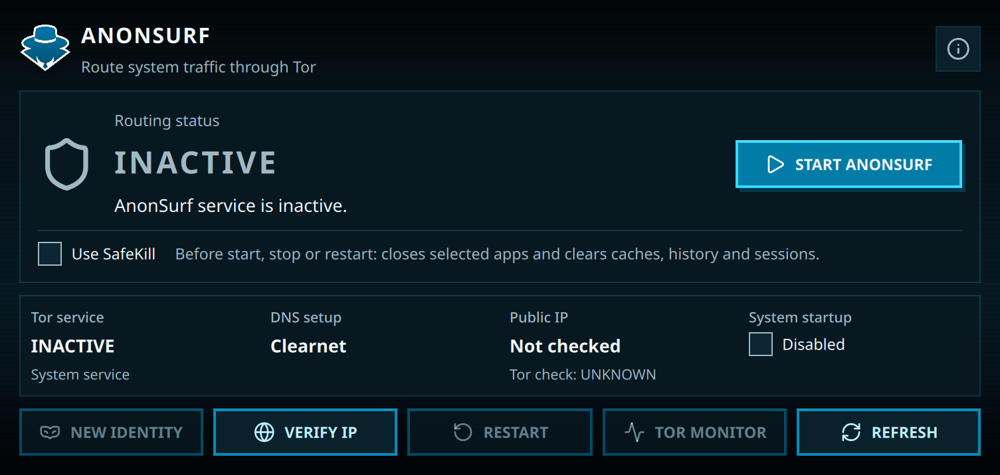

import { Image } from 'astro:assets';
import anonsurfLogo from './images/anonsurf/logo.png';

<div className="tool-intro">
  <Image src={anonsurfLogo} alt="AnonSurf logo" width={288} height={288} />
  <div>
    <p>
      <a href="https://gitlab.com/parrotsec/packages/anonsurf">AnonSurf 6</a> routes supported system traffic through Tor on ParrotOS. Its Go-based CLI controls systemd-managed services, and KDE Plasma users can also manage it through the Qt 6/QML desktop app.
    </p>
    <p>
      AnonSurf redirects supported TCP connections and DNS lookups. It is not a VPN: arbitrary UDP traffic is not tunneled, loopback and private-network traffic are excluded, and IPv6 is disabled while routing is active. Connections already open when you start AnonSurf are not moved to Tor, so affected applications may need to reconnect.
    </p>
  </div>
</div>

## Installation

The service and its front ends are packaged separately. For a terminal-only installation, install the CLI:

```bash
sudo apt install anonsurf-cli
```

For the desktop interface and CLI, install the GUI package instead; it brings in the CLI and core service as dependencies:

```bash
sudo apt install anonsurf-gui
```

After installation, search the application menu for **AnonSurf GUI** or start it from a terminal with `anonsurf-gui`.

## Desktop interface

The dashboard brings the main controls and status into one place: routing state, Tor service, DNS setup, public IP check, and startup options. Select **Start AnonSurf** to enable routing or **Stop AnonSurf** to restore the previous network settings.



The screenshot shows AnonSurf in its inactive state; local DNS details are redacted.

Use **Verify IP** to check the public IP seen for that request; it does not check the traffic of every application. **New Identity** requests new Tor circuits for future connections, but Tor may keep the same exit IP and existing connections are unchanged. **Tor Monitor** opens Nyx.

The **System startup** toggle controls whether AnonSurf starts at boot. Traffic sent before the service starts is not covered. Closing the interface does not stop routing, so use **Stop AnonSurf** when you want to return to the previous network configuration.

**SafeKill** is optional. When enabled, it tries to close listed networked applications and runs BleachBit to clear configured caches, history, and sessions before a start, stop, or restart. It can close applications and remove data, so leave it disabled unless you specifically want that cleanup.

## Command-line interface

Run `anonsurf` from a terminal as your regular user. The CLI requests `sudo` only for operations that need administrative privileges.

| Command | Action |
| --- | --- |
| `anonsurf start` | Start system-wide Tor routing. |
| `anonsurf stop` | Stop routing and restore the previous network settings. |
| `anonsurf restart` | Restart Tor routing. |
| `anonsurf status [--json]` | Show AnonSurf, Tor, and DNS status; `--json` prints machine-readable output. |
| `anonsurf ip [--json]` | Check the public IP and Tor status for this request; `--json` prints machine-readable output. |
| `anonsurf changeid` | Request new Tor circuits for future connections. |
| `anonsurf monitor` or `anonsurf status --nyx` | Open Nyx, the Tor monitor. |
| `anonsurf boot enable`, `disable`, or `status` | Enable, disable, or check startup integration. |

The `start`, `stop`, and `restart` commands also accept `--safe-kill` (or `-k`) to run SafeKill before changing service state.

`status` reports local service and DNS state, but an active status alone does not prove that every application's traffic is routed through Tor. The `ip` command checks only its own request.

## Lifecycle and recovery

Systemd manages AnonSurf's routing and Tor services. AnonSurf saves the previous DNS, firewall, IPv6, and Tor configuration before changing it, then restores that state when routing stops. If a session is interrupted, a recovery service restores the configuration at the next startup before Tor starts.

## Build from source

AnonSurf 6 uses Go and Qt 6. The [upstream README](https://gitlab.com/parrotsec/packages/anonsurf/-/blob/master/README.md) lists the current build and runtime dependencies. Once they are installed, build and install it with:

```bash
git clone https://gitlab.com/parrotsec/packages/anonsurf/
cd anonsurf
make build
make check
sudo make install
```
