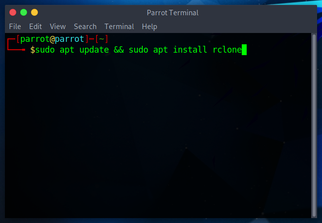
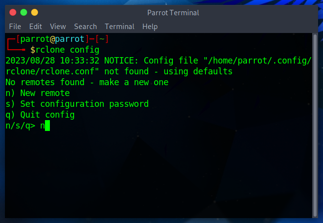
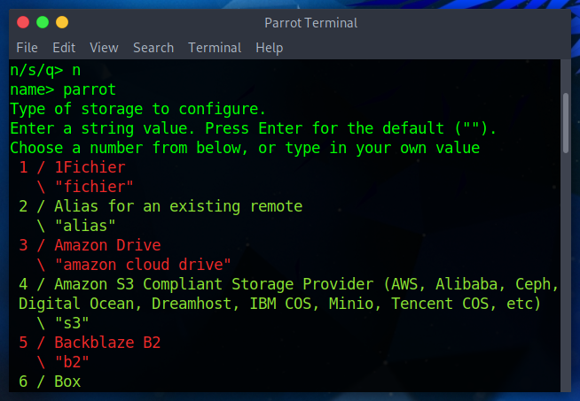
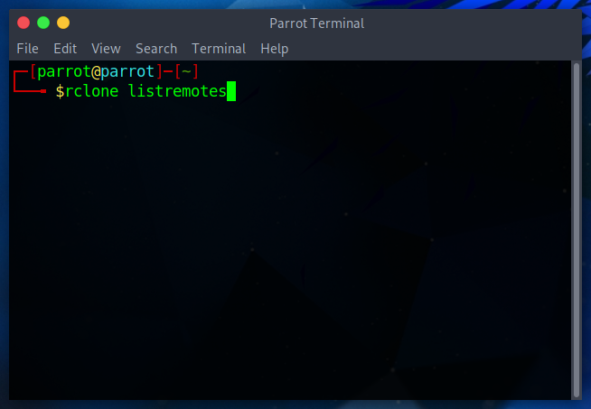
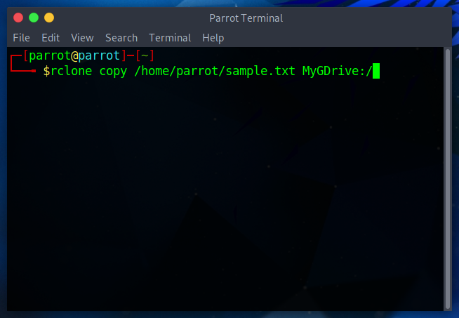
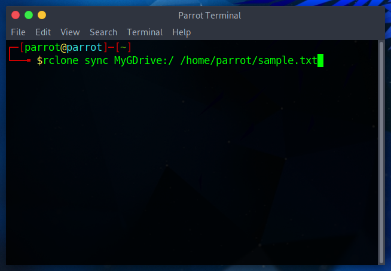
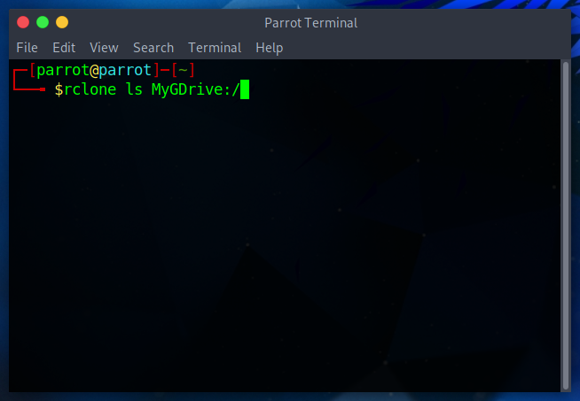
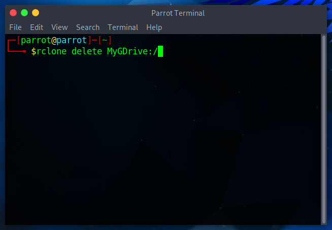

rclone is a CLI tool that makes it easier to manage and sync files and directories in cloud storage and remote systems. It's officially supported by Google Drive, Dropbox, Amazon S3, and many other services.

Common `rclone` use cases:

- **Mounting a remote**: Mount a remote storage system as a local filesystem using `rclone mount`.

- **Filters and Exclusions**: Use filters to include or exclude files based on patterns.

- **Limit bandwidth on transfer**: Limit the transfer rate to avoid using excessive bandwidth.

- **Encrypt files and Cache**: Use the `crypt` backend to encrypt files and the `cache` backend to cache files for faster access.

- **Schedule Backups**: Schedule `rclone` commands using _cron jobs_ or other task scheduling mechanisms.

Let's see in detail how to use `rclone`.

First, open a terminal window and launch

```
sudo apt update && sudo apt install rclone
```


This will install `rclone` in your system. Now it needs to be configured:

```
rclone config
```
 
 
 

The configuration wizard will ask for the remote name, storage type, and credentials (whether they are API keys, authentication tokens, etc.), so be sure to check the instructions given by your provider and take note of these credentials.
 After that, `rclone` is ready to be used.
 
## Basic Usage
 
:::info Note
 
It's good practice to test every command by attaching the `--dry-run` flag. After ensuring that everything is okay, repeat the command without `--dry-run` option.

:::
 
1. List all of the remotes configured
 
  ```
  rclone listremotes
  ```

 
 
2. Copy files from source storage to destination storage
 
  ```
  rclone copy source:path dest:path
  ```
 
 
 
 where `source:path` is the source storage and `dest:path` is the remote storage of destination (e.g a personal folder sent to a remote, or a file sent from a remote to another)


3. Sync storage

  ```
  rclone sync source:path dest:path
  ```
  
  

4. List all of the files in a remote
  
  ```
  rclone ls remote:path
  ```

  

  
5. Delete all files from a specific path in the remote
  
  ```
  rclone delete remote:path
  ```
  
  

