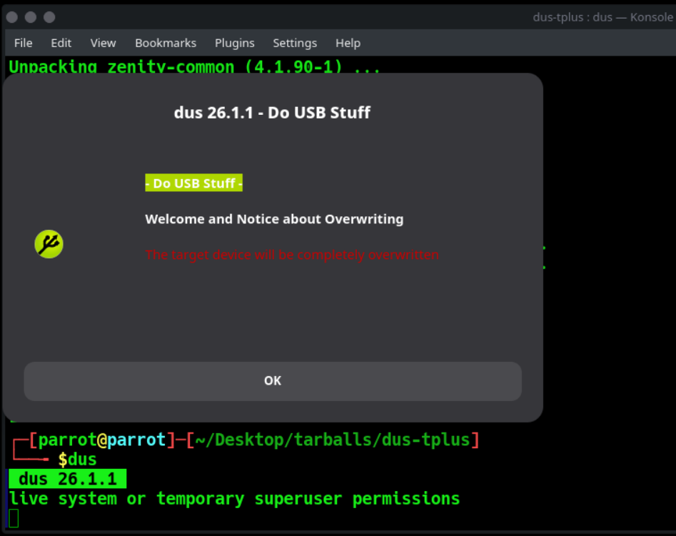
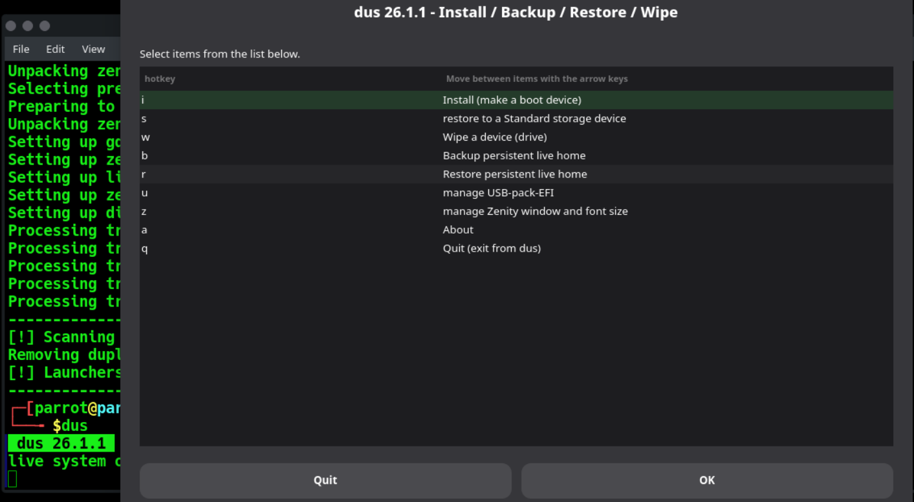
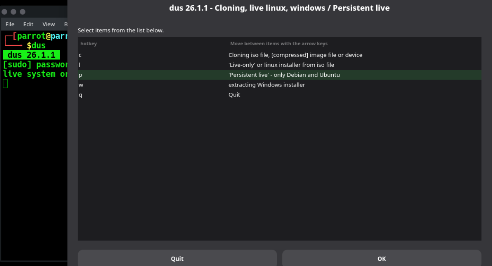
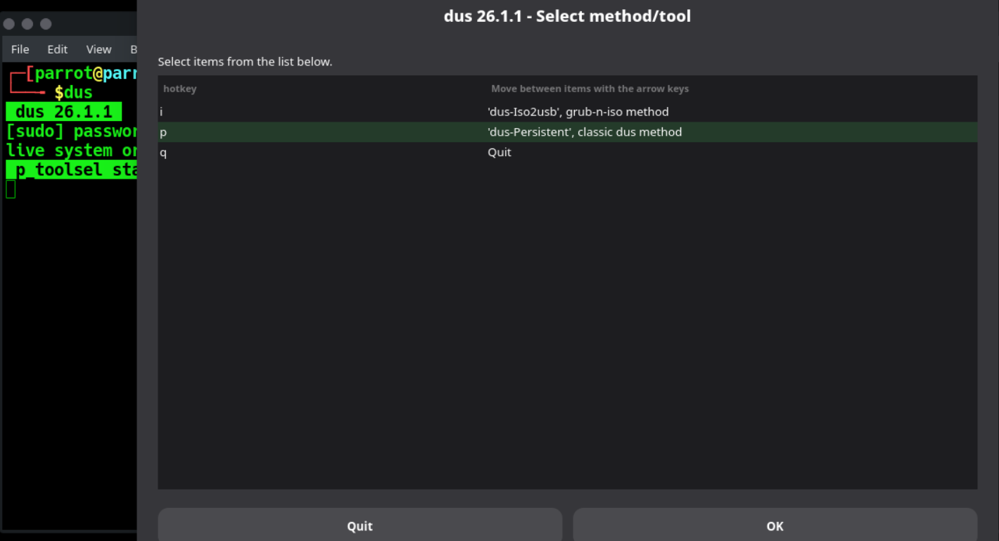
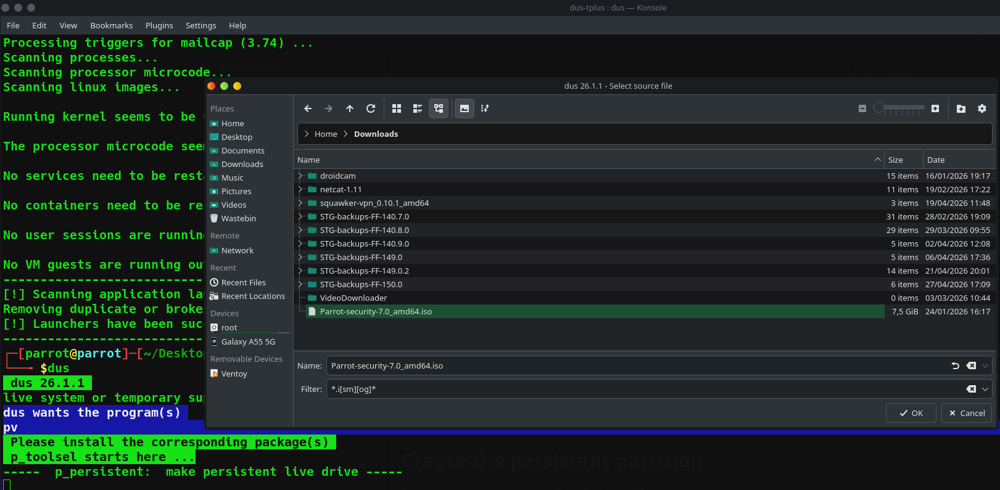
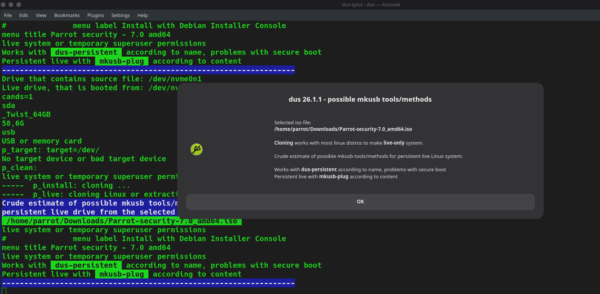
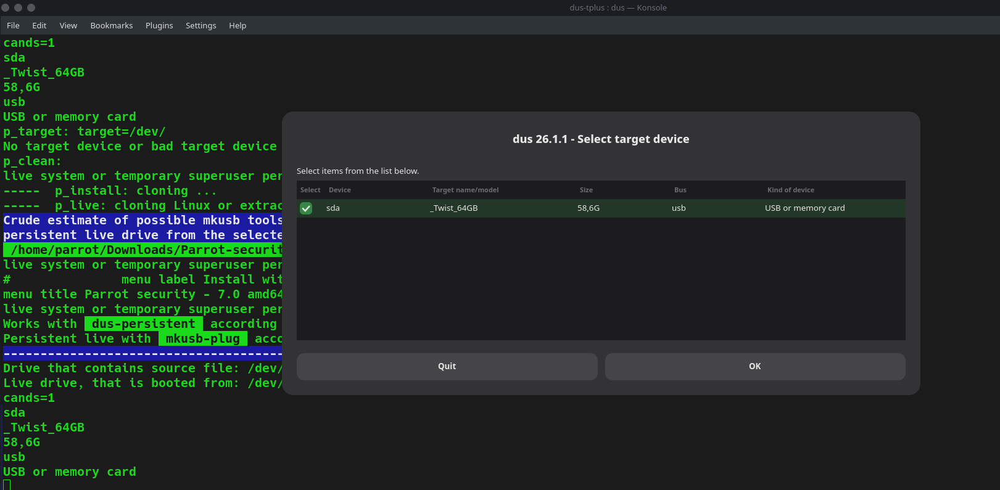
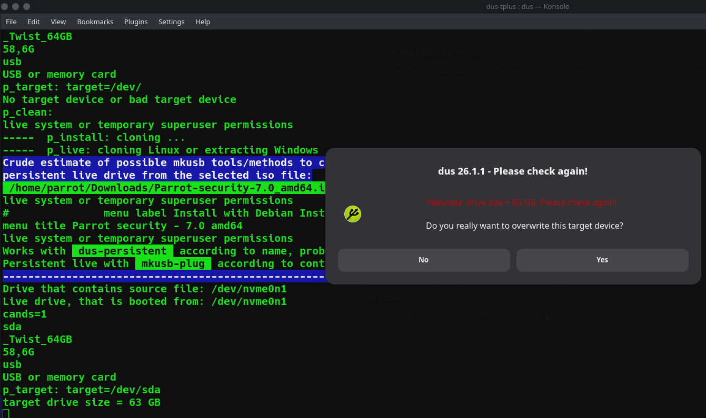
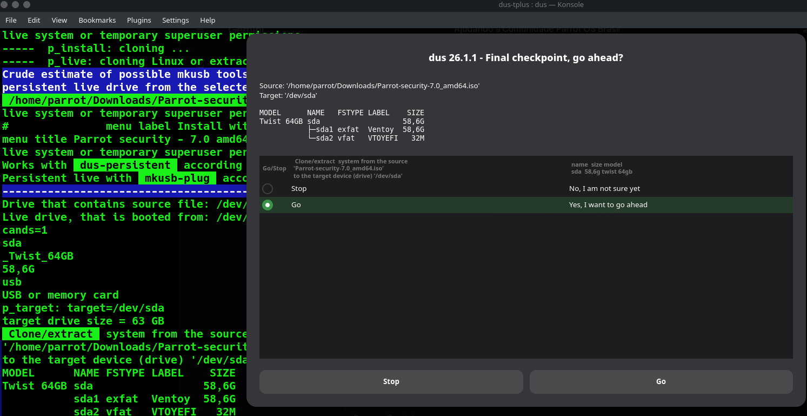
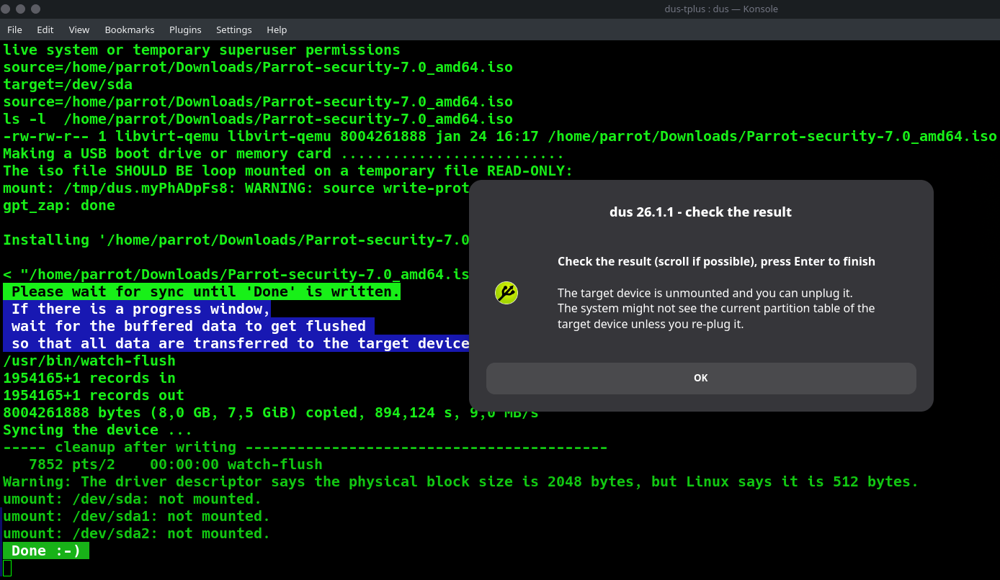

This guide shows how to create a persistent partition on a USB drive with Parrot OS.
To do this, we will use the [mkusb](https://github.com/sudodus/tarballs) tool.

## Install mkusb

Before downloading the tool, ensure you have the necessary dependencies installed:

```bash
sudo apt update
sudo apt install gdisk dialog zenity -y
```

After downloading the Parrot OS *.iso* file from our website, download *mkusb* from the [repository](https://github.com/sudodus/tarballs):

```bash
git clone https://github.com/sudodus/tarballs.git
```

Navigate to the downloaded folder and unpack **dus-plus.tar.xz** using *tar*:

```bash
cd tarballs && tar -xf dus-plus.tar.xz
```

:::note
Why only **dus-plus.tar.xz** instead of **dus.tar.xz**? In short, it contains the *usb-pack-efi* package needed to boot the partition.
:::

Go inside the newly extracted *dus-tplus* folder, and install the tool by typing:

```bash
cd dus-tplus/ && sudo ./dus-installer i
```

In the same terminal session, type `dus` (or open *guidus* from the Parrot menu) and it will start. You will be greeted by a warning about overwriting the target device. Click **OK**.

:::note
`dus` will ask to install the *guidus* GUI as well. The functionality will remain the same.
:::



This tool can also be used to make a USB bootable, restore, format, and perform other operations.



## Create the persistent partition

From the main menu, select **i - Install (make a boot device)**. Then, select the **p - 'Persistent live'** option.



Select **p - 'dus-Persistent'** from the menu to choose the method to create the persistent partition.



Now select the *.iso* file you want to install:



An information window will appear detailing the possible methods. Click **OK** to proceed.



Select the USB drive where you want to install Parrot OS (we recommend using at least a 4GB USB drive) and click **OK**.



A warning prompt will appear asking you to verify the drive size. Click **Yes** to confirm you want to overwrite this target device.



At the final checkpoint, select the **Go** radio button and confirm the operation. The persistent partition will be ready in a few minutes.



Once the process is complete, a success window will appear. Press **Enter** or click **OK** to finish.

