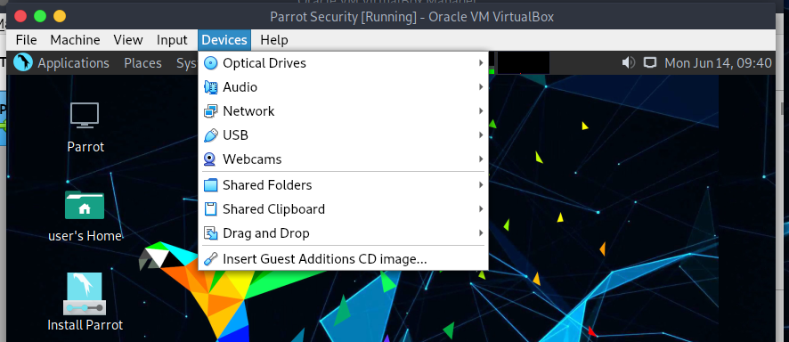
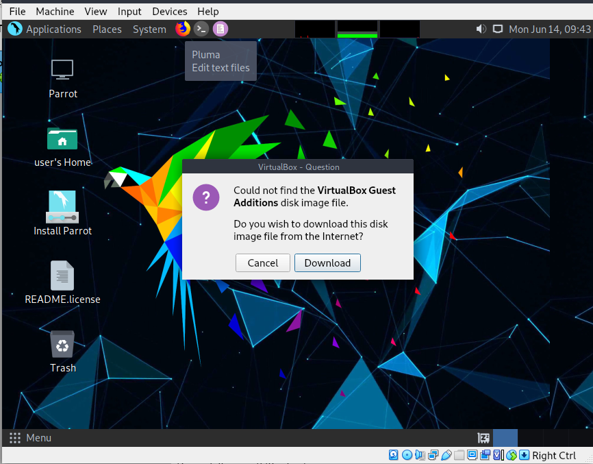
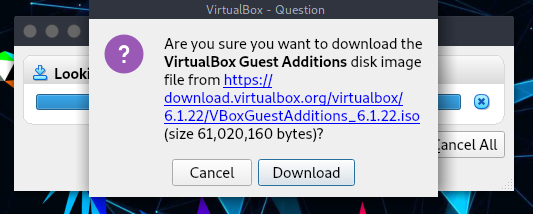
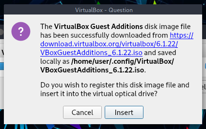
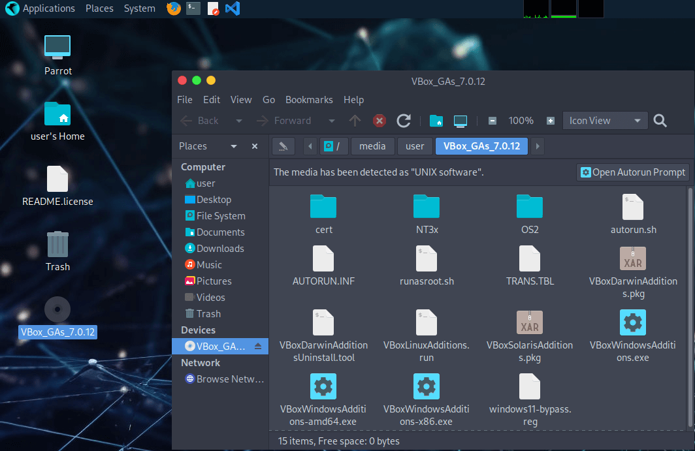
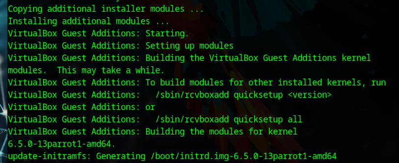

The Guest Additions are designed to be installed inside a virtual machine after the guest operating system has been set up. They consist of device drivers and system applications that optimize the guest operating system for better performance and usability.

## Features of VirtualBox Guest Additions

  * **Mouse pointer integration:** Pressing the Host key is no longer required to "free" the mouse from being captured by the guest OS.
  * **Shared folders:** Easily share directories between the Host and the Parrot VM.
  * **Better video support:** Provides custom video drivers that allow for extra high and non-standard video modes, accelerated video performance, and dynamic monitor resolution resizing.
  * **Seamless windows:** Allows individual windows displayed on the desktop of the virtual machine to be mapped on the host's desktop, as if the application was running natively on the host.
  * **Generic host/guest communication channels:** Enables control and monitoring of guest execution through specific "guest properties," exchanging data bits between the guest and host.
  * **Time synchronization:** Automatically synchronizes the date and time from the host to the Parrot VM.
  * **Shared clipboard:** Allows copying and pasting text or files between the host and Parrot.

For more information, please refer to the [official VirtualBox manual](https://www.virtualbox.org/manual/ch04.html).

---

# Guest Additions Installation

## Method 1 (Recommended & Easiest)

The most reliable way to install Guest Additions on Parrot OS is via the official APT repository.

**1.** Open a terminal and update your package list:

    sudo apt update

**2.** Install the Guest Additions packages:

    sudo apt install -y virtualbox-guest-utils virtualbox-guest-x11

**3.** Once the installation is complete, reboot your virtual machine:

    sudo reboot

**4.** After rebooting, you can verify if the Guest Additions are running correctly with:

    sudo /usr/sbin/VBoxService -V

---

## Method 2 (From VirtualBox ISO)

If you prefer to install the additions directly from the VirtualBox hypervisor ISO, follow these steps:

**1.** On the Virtual Machine menu bar, select `Devices > Insert Guest Additions CD image...`.

**2.** VirtualBox may prompt you to download the Guest Additions if they are not present on your host. Click **Download**. 

Click on **Insert**. 

:::note[Note]
If it returns an error stating it cannot mount the ISO, turn off the virtual machine. From the main VirtualBox screen, go to **Settings > Storage**, add a new optical drive, set it as Secondary (to avoid boot issues), and manually load the downloaded ISO.
:::

**3.** Navigate to the mounted Guest Additions directory, open a terminal there, and grant execution permissions to the installer:

    sudo chmod +x VBoxLinuxAdditions.run

Execute the script:

    sudo ./VBoxLinuxAdditions.run

**4.** Wait for the installation process to finish. Once completed, reboot the virtual machine:

    sudo reboot